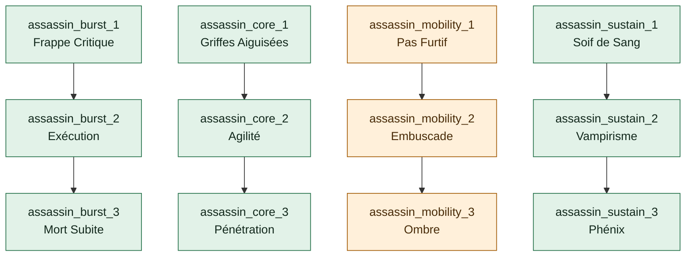
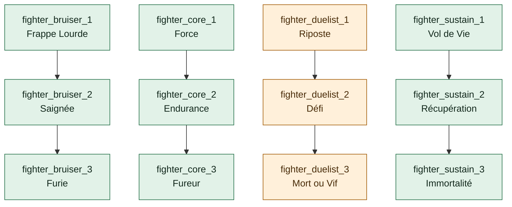
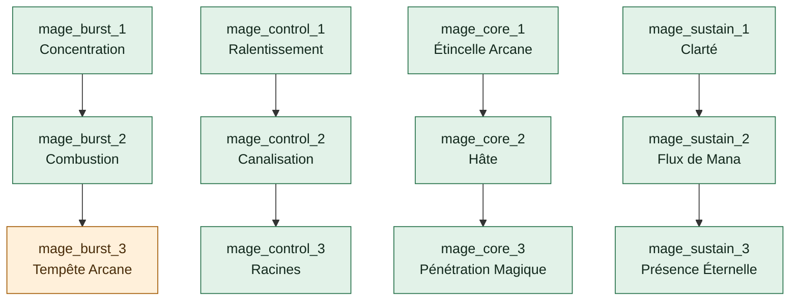
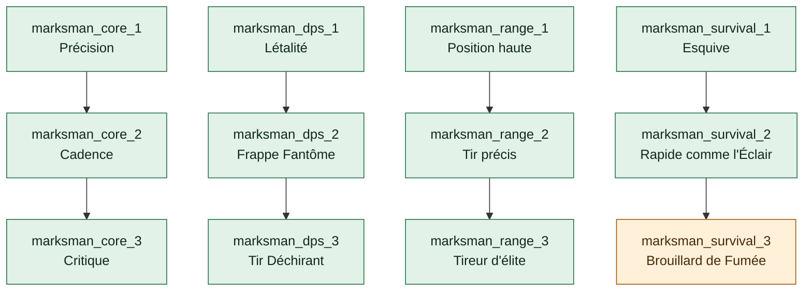
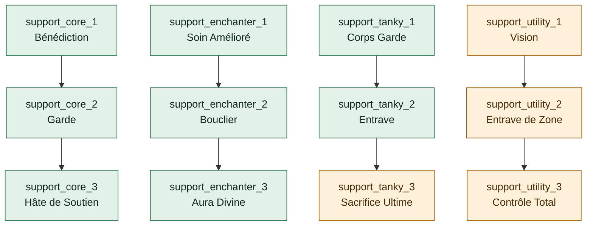
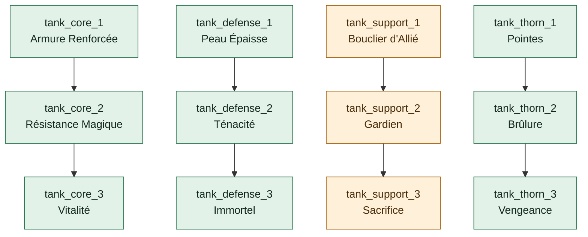

# Audit reproductible des arbres — TREE-01

> Généré par `npm run testing -- enhancements audit`. Ne pas modifier ce rapport à la main.

Le JSON voisin conserve les 72 définitions, libellés FR/EN, chemins, coûts, causes et preuves physiques. Ce rapport est une observation des sources, pas une interrogation distante ni une réparation.

**6 arbres / 72 nœuds ; 57 atteignables, 15 bloqués ; 0 nœud affecté par un défaut topologique.**

Maîtrise maximale : **4**. Budget Candies global : **non plafonné** ; un solde suffisant reste requis pour chaque achat.

12 indisponibilités directes, 3 blocages hérités, 0 blocage de maîtrise. 0 divergence d’attributs du catalogue ; 15 divergences d’éligibilité depuis un état vide entre client et modèle SQL.

Les coûts incluent une fois chaque ancêtre requis au rang 1 ; le rang maximal paie ensuite chaque rang du nœud cible au coût constant. Un coût théorique ne prouve pas un chemin achetable : le champ `reachable` du JSON fait foi.

## Rôle du champion

| Champion | Tags dans l’ordre | Arbre client | Rôle SQL | Concordance |
| --- | --- | --- | --- | --- |
| Aatrox | Fighter | Fighter | fighter | oui |
| Ahri | Mage, Assassin | Mage | mage | oui |
| Akali | Assassin | Assassin | assassin | oui |
| Akshan | Marksman, Assassin | Marksman | marksman | oui |
| Alistar | Tank, Support | Tank | tank | oui |
| Ambessa | Fighter, Assassin | Fighter | fighter | oui |
| Amumu | Tank, Support | Tank | tank | oui |
| Anivia | Mage | Mage | mage | oui |
| Annie | Mage | Mage | mage | oui |
| Aphelios | Marksman | Marksman | marksman | oui |
| Ashe | Marksman | Marksman | marksman | oui |
| AurelionSol | Mage | Mage | mage | oui |
| Aurora | Mage, Assassin | Mage | mage | oui |
| Azir | Mage, Marksman | Mage | mage | oui |
| Bard | Support, Mage | Support | support | oui |
| Belveth | Fighter | Fighter | fighter | oui |
| Blitzcrank | Tank, Support | Tank | tank | oui |
| Brand | Mage, Support | Mage | mage | oui |
| Braum | Tank, Support | Tank | tank | oui |
| Briar | Fighter, Assassin | Fighter | fighter | oui |
| Caitlyn | Marksman | Marksman | marksman | oui |
| Camille | Fighter, Assassin | Fighter | fighter | oui |
| Cassiopeia | Mage | Mage | mage | oui |
| Chogath | Tank, Mage | Tank | tank | oui |
| Corki | Marksman, Mage | Marksman | marksman | oui |
| Darius | Fighter, Tank | Fighter | fighter | oui |
| Diana | Fighter, Assassin | Fighter | fighter | oui |
| DrMundo | Tank, Fighter | Tank | tank | oui |
| Draven | Marksman | Marksman | marksman | oui |
| Ekko | Assassin, Mage | Assassin | assassin | oui |
| Elise | Assassin, Mage | Assassin | assassin | oui |
| Evelynn | Assassin, Mage | Assassin | assassin | oui |
| Ezreal | Marksman, Mage | Marksman | marksman | oui |
| Fiddlesticks | Mage, Support | Mage | mage | oui |
| Fiora | Fighter, Assassin | Fighter | fighter | oui |
| Fizz | Assassin, Fighter | Assassin | assassin | oui |
| Galio | Tank, Mage | Tank | tank | oui |
| Gangplank | Fighter | Fighter | fighter | oui |
| Garen | Fighter, Tank | Fighter | fighter | oui |
| Gnar | Fighter, Tank | Fighter | fighter | oui |
| Gragas | Fighter, Mage | Fighter | fighter | oui |
| Graves | Marksman | Marksman | marksman | oui |
| Gwen | Fighter | Fighter | fighter | oui |
| Hecarim | Fighter, Tank | Fighter | fighter | oui |
| Heimerdinger | Mage, Support | Mage | mage | oui |
| Hwei | Mage, Support | Mage | mage | oui |
| Illaoi | Fighter, Tank | Fighter | fighter | oui |
| Irelia | Fighter, Assassin | Fighter | fighter | oui |
| Ivern | Support, Mage | Support | support | oui |
| Janna | Support, Mage | Support | support | oui |
| JarvanIV | Fighter, Tank | Fighter | fighter | oui |
| Jax | Fighter | Fighter | fighter | oui |
| Jayce | Fighter, Marksman | Fighter | fighter | oui |
| Jhin | Marksman, Mage | Marksman | marksman | oui |
| Jinx | Marksman | Marksman | marksman | oui |
| KSante | Tank, Fighter | Tank | tank | oui |
| Kaisa | Marksman, Mage | Marksman | marksman | oui |
| Kalista | Marksman | Marksman | marksman | oui |
| Karma | Mage, Support | Mage | mage | oui |
| Karthus | Mage | Mage | mage | oui |
| Kassadin | Assassin, Mage | Assassin | assassin | oui |
| Katarina | Assassin, Mage | Assassin | assassin | oui |
| Kayle | Mage, Marksman | Mage | mage | oui |
| Kayn | Fighter, Assassin | Fighter | fighter | oui |
| Kennen | Mage | Mage | mage | oui |
| Khazix | Assassin | Assassin | assassin | oui |
| Kindred | Marksman | Marksman | marksman | oui |
| Kled | Fighter | Fighter | fighter | oui |
| KogMaw | Marksman, Mage | Marksman | marksman | oui |
| Leblanc | Assassin, Mage | Assassin | assassin | oui |
| LeeSin | Fighter, Assassin | Fighter | fighter | oui |
| Leona | Tank, Support | Tank | tank | oui |
| Lillia | Fighter, Mage | Fighter | fighter | oui |
| Lissandra | Mage | Mage | mage | oui |
| Lucian | Marksman, Assassin | Marksman | marksman | oui |
| Lulu | Support, Mage | Support | support | oui |
| Lux | Mage, Support | Mage | mage | oui |
| Malphite | Tank, Mage | Tank | tank | oui |
| Malzahar | Mage | Mage | mage | oui |
| Maokai | Tank, Support | Tank | tank | oui |
| MasterYi | Fighter, Assassin | Fighter | fighter | oui |
| Mel | Mage, Support | Mage | mage | oui |
| Milio | Support, Mage | Support | support | oui |
| MissFortune | Marksman, Mage | Marksman | marksman | oui |
| MonkeyKing | Fighter, Tank | Fighter | fighter | oui |
| Mordekaiser | Fighter, Mage | Fighter | fighter | oui |
| Morgana | Support, Mage | Support | support | oui |
| Naafiri | Assassin, Fighter | Assassin | assassin | oui |
| Nami | Support, Mage | Support | support | oui |
| Nasus | Fighter, Tank | Fighter | fighter | oui |
| Nautilus | Tank, Support | Tank | tank | oui |
| Neeko | Mage, Support | Mage | mage | oui |
| Nidalee | Assassin, Mage | Assassin | assassin | oui |
| Nilah | Fighter, Assassin | Fighter | fighter | oui |
| Nocturne | Fighter, Assassin | Fighter | fighter | oui |
| Nunu | Tank, Mage | Tank | tank | oui |
| Olaf | Fighter, Tank | Fighter | fighter | oui |
| Orianna | Mage, Support | Mage | mage | oui |
| Ornn | Tank | Tank | tank | oui |
| Pantheon | Fighter, Assassin | Fighter | fighter | oui |
| Poppy | Tank, Fighter | Tank | tank | oui |
| Pyke | Support, Assassin | Support | support | oui |
| Qiyana | Assassin | Assassin | assassin | oui |
| Quinn | Marksman, Assassin | Marksman | marksman | oui |
| Rakan | Support | Support | support | oui |
| Rammus | Tank | Tank | tank | oui |
| RekSai | Fighter, Tank | Fighter | fighter | oui |
| Rell | Tank, Support | Tank | tank | oui |
| Renata | Support, Mage | Support | support | oui |
| Renekton | Fighter, Tank | Fighter | fighter | oui |
| Rengar | Assassin, Fighter | Assassin | assassin | oui |
| Riven | Fighter, Assassin | Fighter | fighter | oui |
| Rumble | Fighter, Mage | Fighter | fighter | oui |
| Ryze | Mage | Mage | mage | oui |
| Samira | Marksman, Assassin | Marksman | marksman | oui |
| Sejuani | Tank | Tank | tank | oui |
| Senna | Support, Marksman | Support | support | oui |
| Seraphine | Support, Mage | Support | support | oui |
| Sett | Fighter, Tank | Fighter | fighter | oui |
| Shaco | Assassin | Assassin | assassin | oui |
| Shen | Tank | Tank | tank | oui |
| Shyvana | Fighter, Tank | Fighter | fighter | oui |
| Singed | Tank, Mage | Tank | tank | oui |
| Sion | Tank, Fighter | Tank | tank | oui |
| Sivir | Marksman | Marksman | marksman | oui |
| Skarner | Tank, Fighter | Tank | tank | oui |
| Smolder | Marksman, Mage | Marksman | marksman | oui |
| Sona | Support, Mage | Support | support | oui |
| Soraka | Support, Mage | Support | support | oui |
| Swain | Mage, Support | Mage | mage | oui |
| Sylas | Mage, Assassin | Mage | mage | oui |
| Syndra | Mage | Mage | mage | oui |
| TahmKench | Tank, Support | Tank | tank | oui |
| Taliyah | Mage, Support | Mage | mage | oui |
| Talon | Assassin | Assassin | assassin | oui |
| Taric | Support, Tank | Support | support | oui |
| Teemo | Marksman, Mage | Marksman | marksman | oui |
| Thresh | Support, Tank | Support | support | oui |
| Tristana | Marksman, Assassin | Marksman | marksman | oui |
| Trundle | Fighter, Tank | Fighter | fighter | oui |
| Tryndamere | Fighter, Assassin | Fighter | fighter | oui |
| TwistedFate | Mage, Marksman | Mage | mage | oui |
| Twitch | Marksman, Assassin | Marksman | marksman | oui |
| Udyr | Fighter, Tank | Fighter | fighter | oui |
| Urgot | Fighter, Tank | Fighter | fighter | oui |
| Varus | Marksman, Mage | Marksman | marksman | oui |
| Vayne | Marksman, Assassin | Marksman | marksman | oui |
| Veigar | Mage | Mage | mage | oui |
| Velkoz | Mage, Support | Mage | mage | oui |
| Vex | Mage | Mage | mage | oui |
| Vi | Fighter, Assassin | Fighter | fighter | oui |
| Viego | Fighter, Assassin | Fighter | fighter | oui |
| Viktor | Mage | Mage | mage | oui |
| Vladimir | Mage, Fighter | Mage | mage | oui |
| Volibear | Fighter, Tank | Fighter | fighter | oui |
| Warwick | Fighter, Tank | Fighter | fighter | oui |
| Xayah | Marksman | Marksman | marksman | oui |
| Xerath | Mage, Support | Mage | mage | oui |
| XinZhao | Fighter, Tank | Fighter | fighter | oui |
| Yasuo | Fighter, Assassin | Fighter | fighter | oui |
| Yone | Fighter, Assassin | Fighter | fighter | oui |
| Yorick | Fighter, Tank | Fighter | fighter | oui |
| Yunara | Marksman | Marksman | marksman | oui |
| Yuumi | Support, Mage | Support | support | oui |
| Zaahen | Fighter, Assassin | Fighter | fighter | oui |
| Zac | Tank, Fighter | Tank | tank | oui |
| Zed | Assassin | Assassin | assassin | oui |
| Zeri | Marksman | Marksman | marksman | oui |
| Ziggs | Mage | Mage | mage | oui |
| Zilean | Support, Mage | Support | support | oui |
| Zoe | Mage | Mage | mage | oui |
| Zyra | Mage, Support | Mage | mage | oui |

Le premier tag choisit l’arbre côté client ; les tags secondaires ne le remplacent pas. Le fallback client est Fighter. Le serveur utilise son propre catalogue de rôles ; un champion absent n’est pas autorisé par ce fallback.

## Assassin

Racines : `assassin_burst_1`, `assassin_core_1`, `assassin_mobility_1`, `assassin_sustain_1`. Total théorique du catalogue : 930 Candies.

Vert : chemin légal ; orange : indisponibilité ou héritage ; violet : maîtrise ; rouge : topologie invalide. Les IDs restent dans les étiquettes du graphe.

| ID | FR / EN | Branche | Rang max | Candies/rang ; chemin 1er/max | Maîtrise | Parents | Déblocage client / SQL | Effet |
| --- | --- | --- | ---: | --- | ---: | --- | --- | --- |
| `assassin_burst_1` | Frappe Critique / Critical Strike | assassin_burst | 1 | 50 ; 50 / 50 | 1 | — | oui / oui | implemented |
| `assassin_burst_2` | Exécution / Execution | assassin_burst | 1 | 80 ; 130 / 130 | 2 | assassin_burst_1 | oui / oui | implemented |
| `assassin_burst_3` | Mort Subite / Sudden Death | assassin_burst | 1 | 150 ; 280 / 280 | 3 | assassin_burst_2 | oui / oui | implemented |
| `assassin_core_1` | Griffes Aiguisées / Sharpened Claws | socle | 1 | 20 ; 20 / 20 | 0 | — | oui / oui | implemented |
| `assassin_core_2` | Agilité / Agility | socle | 1 | 30 ; 50 / 50 | 1 | assassin_core_1 | oui / oui | implemented |
| `assassin_core_3` | Pénétration / Penetration | socle | 1 | 40 ; 90 / 90 | 2 | assassin_core_2 | oui / oui | implemented |
| `assassin_mobility_1` | Pas Furtif / Stealthy Step | assassin_mobility | 1 | 50 ; 50 / 50 | 1 | — | non / oui | descriptive |
| `assassin_mobility_2` | Embuscade / Ambush | assassin_mobility | 1 | 80 ; 130 / 130 | 2 | assassin_mobility_1 | non / oui | descriptive |
| `assassin_mobility_3` | Ombre / Shadow | assassin_mobility | 1 | 150 ; 280 / 280 | 3 | assassin_mobility_2 | non / oui | descriptive |
| `assassin_sustain_1` | Soif de Sang / Bloodthirst | assassin_sustain | 1 | 50 ; 50 / 50 | 1 | — | oui / oui | partial |
| `assassin_sustain_2` | Vampirisme / Vampirism | assassin_sustain | 1 | 80 ; 130 / 130 | 2 | assassin_sustain_1 | oui / oui | implemented |
| `assassin_sustain_3` | Phénix / Phoenix | assassin_sustain | 1 | 150 ; 280 / 280 | 3 | assassin_sustain_2 | oui / oui | partial |

### assassin_burst_1 — Frappe Critique

FR : +8 % Chances de coup critique

EN : +8% Critical Strike Chance

Visibilité : branche sélectionnée ; les effets indisponibles ne masquent pas la carte. Attribut serveur : `champion_enhancements.unlocked_nodes.assassin_burst_1`.

Effet : **implemented**. Types : statistiques. flat.crit=8. Points de pourcentage de critique canonique, plafonnés entre 0 et 100.

Valeurs déclarées : plats `{"crit":8}` ; pourcentages `{}`.

Responsables des effets : EnhancementService / statCalculator / CombatRuleRuntime / traductions. Suite : TREE-04.

- Source : `src/services/enhancementService.ts` — `EnhancementService._processNodes`.
- Source : `src/utils/statCalculator.ts` — `enhancementModifiers`.
- Source : `src/game/stats/statContract.ts` — `applyCanonicalModifiers`.
- Source : `src/game/ChampionInstance.ts` — `ChampionInstance.getStatsWithEnhancements`.

### assassin_burst_2 — Exécution

FR : +10 % de dégâts contre les cibles en dessous de 40 % PV

EN : +10% damage against targets below 40% HP

Visibilité : branche sélectionnée ; les effets indisponibles ne masquent pas la carte. Attribut serveur : `champion_enhancements.unlocked_nodes.assassin_burst_2`.

Effet : **implemented**. Types : `execute_damage`. Multiplie les dégâts par 1 + value si les PV courants de la cible sont strictement sous 40 %.

Valeurs déclarées : plats `{}` ; pourcentages `{}`.

Responsables des effets : CombatRuleRuntime / résolveurs combat / catalogue et traductions. Suite : TREE-04.

- Source : `src/game/rules/CombatRuleRuntime.ts` — `CombatRuleRuntime.beforeDamage`.

### assassin_burst_3 — Mort Subite

FR : Ultime : dégâts explosifs augmentés de 20 %

EN : Ultimate: Burst damage increased by 20%

Visibilité : branche sélectionnée ; les effets indisponibles ne masquent pas la carte. Attribut serveur : `champion_enhancements.unlocked_nodes.assassin_burst_3`.

Effet : **implemented**. Types : `burst_amplify`. Multiplie les dégâts de l’action SpellR par 1 + value.

Valeurs déclarées : plats `{}` ; pourcentages `{}`.

Responsables des effets : CombatRuleRuntime / résolveurs combat / catalogue et traductions. Suite : TREE-04.

- Source : `src/game/rules/CombatRuleRuntime.ts` — `CombatRuleRuntime.beforeDamage`.

### assassin_core_1 — Griffes Aiguisées

FR : +5 Dégâts d'attaque

EN : +5 Attack Damage

Visibilité : socle toujours rendu ; les effets indisponibles ne masquent pas la carte. Attribut serveur : `champion_enhancements.unlocked_nodes.assassin_core_1`.

Effet : **implemented**. Types : statistiques. flat.atk=5. Dégâts d’attaque canoniques, pas un multiplicateur global de dégâts.

Valeurs déclarées : plats `{"atk":5}` ; pourcentages `{}`.

Responsables des effets : EnhancementService / statCalculator / CombatRuleRuntime / traductions. Suite : TREE-04.

- Source : `src/services/enhancementService.ts` — `EnhancementService._processNodes`.
- Source : `src/utils/statCalculator.ts` — `enhancementModifiers`.
- Source : `src/game/stats/statContract.ts` — `applyCanonicalModifiers`.
- Source : `src/game/ChampionInstance.ts` — `ChampionInstance.getStatsWithEnhancements`.

### assassin_core_2 — Agilité

FR : +3 % Vitesse de déplacement

EN : +3% Movement Speed

Visibilité : socle toujours rendu ; les effets indisponibles ne masquent pas la carte. Attribut serveur : `champion_enhancements.unlocked_nodes.assassin_core_2`.

Effet : **implemented**. Types : statistiques. percent.spd=0.03. Vitesse de déplacement canonique, composante de l’initiative ; aucun déplacement spatial.

Valeurs déclarées : plats `{}` ; pourcentages `{"spd":0.03}`.

Responsables des effets : EnhancementService / statCalculator / CombatRuleRuntime / traductions. Suite : TREE-04.

- Source : `src/services/enhancementService.ts` — `EnhancementService._processNodes`.
- Source : `src/utils/statCalculator.ts` — `enhancementModifiers`.
- Source : `src/game/stats/statContract.ts` — `applyCanonicalModifiers`.
- Source : `src/game/ChampionInstance.ts` — `ChampionInstance.getStatsWithEnhancements`.

### assassin_core_3 — Pénétration

FR : +4 Pénétration d'armure

EN : +4 Armor Penetration

Visibilité : socle toujours rendu ; les effets indisponibles ne masquent pas la carte. Attribut serveur : `champion_enhancements.unlocked_nodes.assassin_core_3`.

Effet : **implemented**. Types : statistiques. flat.armorPen=4. Bonus secondaire plat : multiplie les dégâts physiques par 1 + max(0, valeur) / 200.

Valeurs déclarées : plats `{"armorPen":4}` ; pourcentages `{}`.

Responsables des effets : EnhancementService / statCalculator / CombatRuleRuntime / traductions. Suite : TREE-04.

- Source : `src/services/enhancementService.ts` — `EnhancementService._processNodes`.
- Source : `src/utils/statCalculator.ts` — `enhancementModifiers`.
- Source : `src/game/stats/statContract.ts` — `applyCanonicalModifiers`.
- Source : `src/game/ChampionInstance.ts` — `ChampionInstance.getStatsWithEnhancements`.
- Source : `src/game/rules/CombatRuleRuntime.ts` — `CombatRuleRuntime.beforeDamage`.

### assassin_mobility_1 — Pas Furtif

FR : +5 % Vitesse de déplacement hors combat

EN : +5% out-of-combat Movement Speed

Visibilité : branche sélectionnée ; les effets indisponibles ne masquent pas la carte. Attribut serveur : `champion_enhancements.unlocked_nodes.assassin_mobility_1`.

Effet : **descriptive**. Types : `out_of_combat_speed`. Aucun effet appliqué ; type explicitement indisponible dans ce mode.

Valeurs déclarées : plats `{}` ; pourcentages `{}`.

- Blocage `unavailable` via `assassin_mobility_1` : Vitesse de déplacement augmentée hors combat. Responsable : Disponibilité des effets / descendants ; suite : TREE-02 / TREE-03.

- Écart d’effet : Le déplacement hors combat n’a pas de consommateur moteur.

Responsables des effets : Catalogue / disponibilité du moteur / traductions. Suite : TREE-03, TREE-04.

- Source : `src/game/rules/catalogSupport.ts` — `UNAVAILABLE_ENHANCEMENT_EFFECTS`.
- Source : `src/game/rules/CombatRuleRuntime.ts` — `CombatRuleRuntime.getEnhancements`.

### assassin_mobility_2 — Embuscade

FR : +15 % de dégâts depuis les broussailles ou hors de vue

EN : +15% damage from brush or while out of sight

Visibilité : branche sélectionnée ; les effets indisponibles ne masquent pas la carte. Attribut serveur : `champion_enhancements.unlocked_nodes.assassin_mobility_2`.

Effet : **descriptive**. Types : `ambush_damage`. Aucun effet appliqué ; type explicitement indisponible dans ce mode.

Valeurs déclarées : plats `{}` ; pourcentages `{}`.

- Blocage `unavailable` via `assassin_mobility_2` → `assassin_mobility_1` : Vitesse de déplacement augmentée hors combat. Responsable : Disponibilité des effets / descendants ; suite : TREE-02 / TREE-03.
- Blocage `unavailable` via `assassin_mobility_2` : Dégâts augmentés depuis la dissimulation. Responsable : Disponibilité des effets / descendants ; suite : TREE-02 / TREE-03.

- Écart d’effet : Les broussailles et la dissimulation ne sont pas modélisées.

Responsables des effets : Catalogue / disponibilité du moteur / traductions. Suite : TREE-03, TREE-04.

- Source : `src/game/rules/catalogSupport.ts` — `UNAVAILABLE_ENHANCEMENT_EFFECTS`.
- Source : `src/game/rules/CombatRuleRuntime.ts` — `CombatRuleRuntime.getEnhancements`.

### assassin_mobility_3 — Ombre

FR : Ultime : devient invisible pendant 1,5 s après une élimination

EN : Ultimate: Become invisible for 1.5s after a kill

Visibilité : branche sélectionnée ; les effets indisponibles ne masquent pas la carte. Attribut serveur : `champion_enhancements.unlocked_nodes.assassin_mobility_3`.

Effet : **descriptive**. Types : `stealth_on_kill`. Aucun effet appliqué ; type explicitement indisponible dans ce mode.

Valeurs déclarées : plats `{}` ; pourcentages `{}`.

- Blocage `unavailable` via `assassin_mobility_3` → `assassin_mobility_2` → `assassin_mobility_1` : Vitesse de déplacement augmentée hors combat. Responsable : Disponibilité des effets / descendants ; suite : TREE-02 / TREE-03.
- Blocage `unavailable` via `assassin_mobility_3` → `assassin_mobility_2` : Dégâts augmentés depuis la dissimulation. Responsable : Disponibilité des effets / descendants ; suite : TREE-02 / TREE-03.
- Blocage `unavailable` via `assassin_mobility_3` : Invisibilité après un kill. Responsable : Disponibilité des effets / descendants ; suite : TREE-02 / TREE-03.

- Écart d’effet : L’invisibilité et sa durée en secondes ne sont pas modélisées.

Responsables des effets : Catalogue / disponibilité du moteur / traductions. Suite : TREE-03, TREE-04.

- Source : `src/game/rules/catalogSupport.ts` — `UNAVAILABLE_ENHANCEMENT_EFFECTS`.
- Source : `src/game/rules/CombatRuleRuntime.ts` — `CombatRuleRuntime.getEnhancements`.

### assassin_sustain_1 — Soif de Sang

FR : +5 % Vol de vie

EN : +5% Lifesteal

Visibilité : branche sélectionnée ; les effets indisponibles ne masquent pas la carte. Attribut serveur : `champion_enhancements.unlocked_nodes.assassin_sustain_1`.

Effet : **partial**. Types : statistiques. flat.lifesteal=5. Bonus secondaire plat divisé par 100, appliqué à tous les événements damage_dealt du porteur.

Valeurs déclarées : plats `{"lifesteal":5}` ; pourcentages `{}`.

- Écart d’effet : Vol de vie appliqué aussi aux sorts et DoT, sans restriction aux attaques de base.

Responsables des effets : EnhancementService / statCalculator / CombatRuleRuntime / traductions. Suite : TREE-03, TREE-04.

- Source : `src/services/enhancementService.ts` — `EnhancementService._processNodes`.
- Source : `src/utils/statCalculator.ts` — `enhancementModifiers`.
- Source : `src/game/stats/statContract.ts` — `applyCanonicalModifiers`.
- Source : `src/game/ChampionInstance.ts` — `ChampionInstance.getStatsWithEnhancements`.
- Source : `src/game/rules/CombatRuleRuntime.ts` — `CombatRuleRuntime.afterDamage`.

### assassin_sustain_2 — Vampirisme

FR : +3 % Omnivampirisme

EN : +3% Omnivamp

Visibilité : branche sélectionnée ; les effets indisponibles ne masquent pas la carte. Attribut serveur : `champion_enhancements.unlocked_nodes.assassin_sustain_2`.

Effet : **implemented**. Types : statistiques. flat.omnivamp=3. Même consommateur que lifesteal : les deux pourcentages plats s’additionnent aux soins après dégâts.

Valeurs déclarées : plats `{"omnivamp":3}` ; pourcentages `{}`.

Responsables des effets : EnhancementService / statCalculator / CombatRuleRuntime / traductions. Suite : TREE-04.

- Source : `src/services/enhancementService.ts` — `EnhancementService._processNodes`.
- Source : `src/utils/statCalculator.ts` — `enhancementModifiers`.
- Source : `src/game/stats/statContract.ts` — `applyCanonicalModifiers`.
- Source : `src/game/ChampionInstance.ts` — `ChampionInstance.getStatsWithEnhancements`.
- Source : `src/game/rules/CombatRuleRuntime.ts` — `CombatRuleRuntime.afterDamage`.

### assassin_sustain_3 — Phénix

FR : Ultime : en dessous de 20 % PV, gagne un bouclier de 200 PV (60 s de récupération)

EN : Ultimate: Below 20% HP, gain a 200 HP shield (60s cooldown)

Visibilité : branche sélectionnée ; les effets indisponibles ne masquent pas la carte. Attribut serveur : `champion_enhancements.unlocked_nodes.assassin_sustain_3`.

Effet : **partial**. Types : `survival_shield`. Sous 20 % PV avant le coup, le bus émet un bouclier puis marque la source utilisée jusqu’au reset du combat.

Valeurs déclarées : plats `{}` ; pourcentages `{}`.

- Écart d’effet : Phénix : le texte FR/EN annonce 60 secondes ; le bus autorise une seule émission par combat et ignore cooldown.
- Écart d’effet : BattleManager ne résout pas beforeRules.instantEffects : le bouclier émis n’est pas appliqué au combat normal.
- Écart d’effet : Le seuil est testé avant les dégâts ; le passage de plus de 20 % à moins de 20 % ne déclenche pas le bouclier sur ce coup.

Responsables des effets : CombatRuleRuntime / résolveurs combat / catalogue et traductions. Suite : TREE-03, TREE-04.

- Source : `src/game/rules/CombatRuleRuntime.ts` — `CombatRuleRuntime.beforeDamage`.
- Source : `src/game/battle/BattleManager.ts` — `BattleManager._applyDamageToTarget`.
- Source : `src/game/battle/BattleRuleEffectResolver.ts` — `resolveBattleRuleEffect`.

## Fighter

Racines : `fighter_bruiser_1`, `fighter_core_1`, `fighter_duelist_1`, `fighter_sustain_1`. Total théorique du catalogue : 930 Candies.

Vert : chemin légal ; orange : indisponibilité ou héritage ; violet : maîtrise ; rouge : topologie invalide. Les IDs restent dans les étiquettes du graphe.

| ID | FR / EN | Branche | Rang max | Candies/rang ; chemin 1er/max | Maîtrise | Parents | Déblocage client / SQL | Effet |
| --- | --- | --- | ---: | --- | ---: | --- | --- | --- |
| `fighter_bruiser_1` | Frappe Lourde / Heavy Strike | fighter_bruiser | 1 | 50 ; 50 / 50 | 1 | — | oui / oui | partial |
| `fighter_bruiser_2` | Saignée / Bloodletting | fighter_bruiser | 1 | 80 ; 130 / 130 | 2 | fighter_bruiser_1 | oui / oui | partial |
| `fighter_bruiser_3` | Furie / Berserker | fighter_bruiser | 1 | 150 ; 280 / 280 | 3 | fighter_bruiser_2 | oui / oui | implemented |
| `fighter_core_1` | Force / Strength | socle | 1 | 20 ; 20 / 20 | 0 | — | oui / oui | implemented |
| `fighter_core_2` | Endurance / Endurance | socle | 1 | 30 ; 50 / 50 | 1 | fighter_core_1 | oui / oui | implemented |
| `fighter_core_3` | Fureur / Fury | socle | 1 | 40 ; 90 / 90 | 2 | fighter_core_2 | oui / oui | implemented |
| `fighter_duelist_1` | Riposte / Riposte | fighter_duelist | 1 | 50 ; 50 / 50 | 1 | — | non / oui | descriptive |
| `fighter_duelist_2` | Défi / Challenge | fighter_duelist | 1 | 80 ; 130 / 130 | 2 | fighter_duelist_1 | non / oui | partial |
| `fighter_duelist_3` | Mort ou Vif / Dead or Alive | fighter_duelist | 1 | 150 ; 280 / 280 | 3 | fighter_duelist_2 | non / oui | partial |
| `fighter_sustain_1` | Vol de Vie / Lifesteal | fighter_sustain | 1 | 50 ; 50 / 50 | 1 | — | oui / oui | partial |
| `fighter_sustain_2` | Récupération / Recovery | fighter_sustain | 1 | 80 ; 130 / 130 | 2 | fighter_sustain_1 | oui / oui | implemented |
| `fighter_sustain_3` | Immortalité / Immortality | fighter_sustain | 1 | 150 ; 280 / 280 | 3 | fighter_sustain_2 | oui / oui | implemented |

### fighter_bruiser_1 — Frappe Lourde

FR : +5 % de dégâts

EN : +5% damage

Visibilité : branche sélectionnée ; les effets indisponibles ne masquent pas la carte. Attribut serveur : `champion_enhancements.unlocked_nodes.fighter_bruiser_1`.

Effet : **partial**. Types : statistiques. percent.atk=0.05. Dégâts d’attaque canoniques, pas un multiplicateur global de dégâts.

Valeurs déclarées : plats `{}` ; pourcentages `{"atk":0.05}`.

- Écart d’effet : Frappe Lourde annonce +5 % de dégâts mais livre percent.atk=0,05 : +5 % de dégâts d’attaque, sans multiplication globale.

Responsables des effets : EnhancementService / statCalculator / CombatRuleRuntime / traductions. Suite : TREE-03, TREE-04.

- Source : `src/services/enhancementService.ts` — `EnhancementService._processNodes`.
- Source : `src/utils/statCalculator.ts` — `enhancementModifiers`.
- Source : `src/game/stats/statContract.ts` — `applyCanonicalModifiers`.
- Source : `src/game/ChampionInstance.ts` — `ChampionInstance.getStatsWithEnhancements`.

### fighter_bruiser_2 — Saignée

FR : Les attaques appliquent des saignements (3 % des PV maximum sur 2 s)

EN : Attacks inflict bleeding (3% max HP over 2s)

Visibilité : branche sélectionnée ; les effets indisponibles ne masquent pas la carte. Attribut serveur : `champion_enhancements.unlocked_nodes.fighter_bruiser_2`.

Effet : **partial**. Types : `bleed`. Après chaque attaque de base infligeant des dégâts HP, émet un DoT de PV max cible × value, réparti en round(duration) tours, en dégâts vrais.

Valeurs déclarées : plats `{}` ; pourcentages `{}`.

- Écart d’effet : Aucun tirage de chance : Tir Déchirant s’applique à chaque événement éligible malgré les 15 % annoncés.
- Écart d’effet : Les durées annoncées en secondes sont utilisées comme tours ; chaque tick est arrondi séparément, sans garantie d’un total exact.
- Écart d’effet : Chaque application crée une instance indépendante (maxStacks=1), sans plafond global ni rafraîchissement ; les ticks repassent par before_damage et les boucliers.

Responsables des effets : CombatRuleRuntime / résolveurs combat / catalogue et traductions. Suite : TREE-03, TREE-04.

- Source : `src/game/rules/CombatRuleRuntime.ts` — `CombatRuleRuntime.afterDamage`.
- Source : `src/game/battle/BattleRuleEffectResolver.ts` — `resolveBattleRuleEffect`.
- Source : `src/game/effects/DamageEffect.ts` — `DamageEffect.tick`.
- Source : `src/game/effects/EffectManager.ts` — `EffectManager.apply`.
- Source : `src/game/battle/BattleManager.ts` — `BattleManager._tickTurnEffects`.

### fighter_bruiser_3 — Furie

FR : Ultime : en dessous de 50 % PV, +20 % de dégâts

EN : Ultimate: Below 50% HP, deal +20% damage

Visibilité : branche sélectionnée ; les effets indisponibles ne masquent pas la carte. Attribut serveur : `champion_enhancements.unlocked_nodes.fighter_bruiser_3`.

Effet : **implemented**. Types : `berserker`. Multiplie les dégâts par 1 + value quand les PV du porteur sont strictement sous 50 %.

Valeurs déclarées : plats `{}` ; pourcentages `{}`.

Responsables des effets : CombatRuleRuntime / résolveurs combat / catalogue et traductions. Suite : TREE-04.

- Source : `src/game/rules/CombatRuleRuntime.ts` — `CombatRuleRuntime.beforeDamage`.

### fighter_core_1 — Force

FR : +10 PV, +3 Dégâts d'attaque

EN : +10 HP, +3 Attack Damage

Visibilité : socle toujours rendu ; les effets indisponibles ne masquent pas la carte. Attribut serveur : `champion_enhancements.unlocked_nodes.fighter_core_1`.

Effet : **implemented**. Types : statistiques. flat.hp=10. PV maximum canoniques ; bonus appliqué avant le multiplicateur de santé de run. flat.atk=3. Dégâts d’attaque canoniques, pas un multiplicateur global de dégâts.

Valeurs déclarées : plats `{"hp":10,"atk":3}` ; pourcentages `{}`.

Responsables des effets : EnhancementService / statCalculator / CombatRuleRuntime / traductions. Suite : TREE-04.

- Source : `src/services/enhancementService.ts` — `EnhancementService._processNodes`.
- Source : `src/utils/statCalculator.ts` — `enhancementModifiers`.
- Source : `src/game/stats/statContract.ts` — `applyCanonicalModifiers`.
- Source : `src/game/ChampionInstance.ts` — `ChampionInstance.getStatsWithEnhancements`.

### fighter_core_2 — Endurance

FR : +5 Armure

EN : +5 Armor

Visibilité : socle toujours rendu ; les effets indisponibles ne masquent pas la carte. Attribut serveur : `champion_enhancements.unlocked_nodes.fighter_core_2`.

Effet : **implemented**. Types : statistiques. flat.def=5. Armure canonique, utilisée par la mitigation physique.

Valeurs déclarées : plats `{"def":5}` ; pourcentages `{}`.

Responsables des effets : EnhancementService / statCalculator / CombatRuleRuntime / traductions. Suite : TREE-04.

- Source : `src/services/enhancementService.ts` — `EnhancementService._processNodes`.
- Source : `src/utils/statCalculator.ts` — `enhancementModifiers`.
- Source : `src/game/stats/statContract.ts` — `applyCanonicalModifiers`.
- Source : `src/game/ChampionInstance.ts` — `ChampionInstance.getStatsWithEnhancements`.

### fighter_core_3 — Fureur

FR : +5 % d'initiative d'attaque

EN : +5% Attack Initiative

Visibilité : socle toujours rendu ; les effets indisponibles ne masquent pas la carte. Attribut serveur : `champion_enhancements.unlocked_nodes.fighter_core_3`.

Effet : **implemented**. Types : statistiques. percent.attackSpeed=0.05. Initiative d’attaque canonique, plafonnée entre 0,1 et 10 ; aucune attaque supplémentaire.

Valeurs déclarées : plats `{}` ; pourcentages `{"attackSpeed":0.05}`.

Responsables des effets : EnhancementService / statCalculator / CombatRuleRuntime / traductions. Suite : TREE-04.

- Source : `src/services/enhancementService.ts` — `EnhancementService._processNodes`.
- Source : `src/utils/statCalculator.ts` — `enhancementModifiers`.
- Source : `src/game/stats/statContract.ts` — `applyCanonicalModifiers`.
- Source : `src/game/ChampionInstance.ts` — `ChampionInstance.getStatsWithEnhancements`.

### fighter_duelist_1 — Riposte

FR : Après une esquive, la prochaine attaque inflige +20 % de dégâts

EN : After dodging, the next attack deals +20% damage

Visibilité : branche sélectionnée ; les effets indisponibles ne masquent pas la carte. Attribut serveur : `champion_enhancements.unlocked_nodes.fighter_duelist_1`.

Effet : **descriptive**. Types : `riposte`. Aucun effet appliqué ; type explicitement indisponible dans ce mode.

Valeurs déclarées : plats `{}` ; pourcentages `{}`.

- Blocage `unavailable` via `fighter_duelist_1` : Bonus de dégâts après esquive. Responsable : Disponibilité des effets / descendants ; suite : TREE-02 / TREE-03.

- Écart d’effet : Aucune mémoire esquive → prochaine attaque n’est implémentée.

Responsables des effets : Catalogue / disponibilité du moteur / traductions. Suite : TREE-03, TREE-04.

- Source : `src/game/rules/catalogSupport.ts` — `UNAVAILABLE_ENHANCEMENT_EFFECTS`.
- Source : `src/game/rules/CombatRuleRuntime.ts` — `CombatRuleRuntime.getEnhancements`.

### fighter_duelist_2 — Défi

FR : +10 % de dégâts contre les champions ennemis

EN : +10% damage against enemy champions

Visibilité : branche sélectionnée ; les effets indisponibles ne masquent pas la carte. Attribut serveur : `champion_enhancements.unlocked_nodes.fighter_duelist_2`.

Effet : **partial**. Types : `champion_damage`. Multiplie tous les dégâts par 1 + value sans classification de la cible.

Valeurs déclarées : plats `{}` ; pourcentages `{}`.

- Blocage `unavailable` via `fighter_duelist_2` → `fighter_duelist_1` : Bonus de dégâts après esquive. Responsable : Disponibilité des effets / descendants ; suite : TREE-02 / TREE-03.

- Écart d’effet : Le texte annonce les champions ; aucun prédicat de type de cible n’est présent.

Responsables des effets : CombatRuleRuntime / résolveurs combat / catalogue et traductions. Suite : TREE-03, TREE-04.

- Source : `src/game/rules/CombatRuleRuntime.ts` — `CombatRuleRuntime.beforeDamage`.

### fighter_duelist_3 — Mort ou Vif

FR : Ultime : en duel contre un champion, +25 % de dégâts et +15 % de réduction des dégâts

EN : Ultimate: In a duel against a champion, gain +25% damage and +15% damage reduction

Visibilité : branche sélectionnée ; les effets indisponibles ne masquent pas la carte. Attribut serveur : `champion_enhancements.unlocked_nodes.fighter_duelist_3`.

Effet : **partial**. Types : `duelist`. Quand chaque camp possède exactement un acteur vivant, multiplie les dégâts sortants par 1 + value et ajoute 15 % de réduction entrante.

Valeurs déclarées : plats `{}` ; pourcentages `{}`.

- Blocage `unavailable` via `fighter_duelist_3` → `fighter_duelist_2` → `fighter_duelist_1` : Bonus de dégâts après esquive. Responsable : Disponibilité des effets / descendants ; suite : TREE-02 / TREE-03.

- Écart d’effet : Aucun contrôle du type champion de l’adversaire malgré le texte ; le bonus défensif de 15 % est codé dans le handler.

Responsables des effets : CombatRuleRuntime / résolveurs combat / catalogue et traductions. Suite : TREE-03, TREE-04.

- Source : `src/game/rules/CombatRuleRuntime.ts` — `CombatRuleRuntime.beforeDamage`.

### fighter_sustain_1 — Vol de Vie

FR : +4 % Vol de vie

EN : +4% Lifesteal

Visibilité : branche sélectionnée ; les effets indisponibles ne masquent pas la carte. Attribut serveur : `champion_enhancements.unlocked_nodes.fighter_sustain_1`.

Effet : **partial**. Types : statistiques. flat.lifesteal=4. Bonus secondaire plat divisé par 100, appliqué à tous les événements damage_dealt du porteur.

Valeurs déclarées : plats `{"lifesteal":4}` ; pourcentages `{}`.

- Écart d’effet : Vol de vie appliqué aussi aux sorts et DoT, sans restriction aux attaques de base.

Responsables des effets : EnhancementService / statCalculator / CombatRuleRuntime / traductions. Suite : TREE-03, TREE-04.

- Source : `src/services/enhancementService.ts` — `EnhancementService._processNodes`.
- Source : `src/utils/statCalculator.ts` — `enhancementModifiers`.
- Source : `src/game/stats/statContract.ts` — `applyCanonicalModifiers`.
- Source : `src/game/ChampionInstance.ts` — `ChampionInstance.getStatsWithEnhancements`.
- Source : `src/game/rules/CombatRuleRuntime.ts` — `CombatRuleRuntime.afterDamage`.

### fighter_sustain_2 — Récupération

FR : +5 Régénération PV

EN : +5 HP Regeneration

Visibilité : branche sélectionnée ; les effets indisponibles ne masquent pas la carte. Attribut serveur : `champion_enhancements.unlocked_nodes.fighter_sustain_2`.

Effet : **implemented**. Types : statistiques. flat.hpRegen=5. Stat canonique ; le bonus plat est aussi émis en soin au début du tour du porteur.

Valeurs déclarées : plats `{"hpRegen":5}` ; pourcentages `{}`.

Responsables des effets : EnhancementService / statCalculator / CombatRuleRuntime / traductions. Suite : TREE-04.

- Source : `src/services/enhancementService.ts` — `EnhancementService._processNodes`.
- Source : `src/utils/statCalculator.ts` — `enhancementModifiers`.
- Source : `src/game/stats/statContract.ts` — `applyCanonicalModifiers`.
- Source : `src/game/ChampionInstance.ts` — `ChampionInstance.getStatsWithEnhancements`.
- Source : `src/game/rules/CombatRuleRuntime.ts` — `CombatRuleRuntime.onTurnStart`.

### fighter_sustain_3 — Immortalité

FR : Ultime : les éliminations restaurent 20 % des PV maximum

EN : Ultimate: Kills restore 20% max HP

Visibilité : branche sélectionnée ; les effets indisponibles ne masquent pas la carte. Attribut serveur : `champion_enhancements.unlocked_nodes.fighter_sustain_3`.

Effet : **implemented**. Types : `heal_on_kill`. Une élimination créditée au porteur émet un soin de ses PV max × value ; amplification du soin et plafond HP ensuite.

Valeurs déclarées : plats `{}` ; pourcentages `{}`.

Responsables des effets : CombatRuleRuntime / résolveurs combat / catalogue et traductions. Suite : TREE-04.

- Source : `src/game/rules/CombatRuleRuntime.ts` — `CombatRuleRuntime.onKill`.
- Source : `src/game/battle/BattleRuleEffectResolver.ts` — `resolveBattleRuleEffect`.
- Source : `src/game/battle/BattleManager.ts` — `BattleManager._applyHeal`.

## Mage

Racines : `mage_burst_1`, `mage_control_1`, `mage_core_1`, `mage_sustain_1`. Total théorique du catalogue : 930 Candies.

Vert : chemin légal ; orange : indisponibilité ou héritage ; violet : maîtrise ; rouge : topologie invalide. Les IDs restent dans les étiquettes du graphe.

| ID | FR / EN | Branche | Rang max | Candies/rang ; chemin 1er/max | Maîtrise | Parents | Déblocage client / SQL | Effet |
| --- | --- | --- | ---: | --- | ---: | --- | --- | --- |
| `mage_burst_1` | Concentration / Focus | mage_burst | 1 | 50 ; 50 / 50 | 1 | — | oui / oui | implemented |
| `mage_burst_2` | Combustion / Combustion | mage_burst | 1 | 80 ; 130 / 130 | 2 | mage_burst_1 | oui / oui | partial |
| `mage_burst_3` | Tempête Arcane / Arcane Storm | mage_burst | 1 | 150 ; 280 / 280 | 3 | mage_burst_2 | non / oui | descriptive |
| `mage_control_1` | Ralentissement / Slow | mage_control | 1 | 50 ; 50 / 50 | 1 | — | oui / oui | partial |
| `mage_control_2` | Canalisation / Channeling | mage_control | 1 | 80 ; 130 / 130 | 2 | mage_control_1 | oui / oui | partial |
| `mage_control_3` | Racines / Roots | mage_control | 1 | 150 ; 280 / 280 | 3 | mage_control_2 | oui / oui | partial |
| `mage_core_1` | Étincelle Arcane / Arcane Spark | socle | 1 | 20 ; 20 / 20 | 0 | — | oui / oui | implemented |
| `mage_core_2` | Hâte / Haste | socle | 1 | 30 ; 50 / 50 | 1 | mage_core_1 | oui / oui | implemented |
| `mage_core_3` | Pénétration Magique / Magic Penetration | socle | 1 | 40 ; 90 / 90 | 2 | mage_core_2 | oui / oui | implemented |
| `mage_sustain_1` | Clarté / Clarity | mage_sustain | 1 | 50 ; 50 / 50 | 1 | — | oui / oui | implemented |
| `mage_sustain_2` | Flux de Mana / Manaflow | mage_sustain | 1 | 80 ; 130 / 130 | 2 | mage_sustain_1 | oui / oui | partial |
| `mage_sustain_3` | Présence Éternelle / Eternal Presence | mage_sustain | 1 | 150 ; 280 / 280 | 3 | mage_sustain_2 | oui / oui | implemented |

### mage_burst_1 — Concentration

FR : +8 Puissance

EN : +8 Ability Power

Visibilité : branche sélectionnée ; les effets indisponibles ne masquent pas la carte. Attribut serveur : `champion_enhancements.unlocked_nodes.mage_burst_1`.

Effet : **implemented**. Types : statistiques. flat.ap=8. Puissance canonique, utilisée uniquement par les ratios AP des effets.

Valeurs déclarées : plats `{"ap":8}` ; pourcentages `{}`.

Responsables des effets : EnhancementService / statCalculator / CombatRuleRuntime / traductions. Suite : TREE-04.

- Source : `src/services/enhancementService.ts` — `EnhancementService._processNodes`.
- Source : `src/utils/statCalculator.ts` — `enhancementModifiers`.
- Source : `src/game/stats/statContract.ts` — `applyCanonicalModifiers`.
- Source : `src/game/ChampionInstance.ts` — `ChampionInstance.getStatsWithEnhancements`.

### mage_burst_2 — Combustion

FR : +15 % de dégâts magiques

EN : +15% magic damage

Visibilité : branche sélectionnée ; les effets indisponibles ne masquent pas la carte. Attribut serveur : `champion_enhancements.unlocked_nodes.mage_burst_2`.

Effet : **partial**. Types : statistiques. percent.ap=0.15. Puissance canonique, utilisée uniquement par les ratios AP des effets.

Valeurs déclarées : plats `{}` ; pourcentages `{"ap":0.15}`.

- Écart d’effet : Combustion annonce +15 % de dégâts magiques mais livre percent.ap=0,15 : +15 % de puissance ; dégâts de base et dégâts sans ratio AP inchangés.

Responsables des effets : EnhancementService / statCalculator / CombatRuleRuntime / traductions. Suite : TREE-03, TREE-04.

- Source : `src/services/enhancementService.ts` — `EnhancementService._processNodes`.
- Source : `src/utils/statCalculator.ts` — `enhancementModifiers`.
- Source : `src/game/stats/statContract.ts` — `applyCanonicalModifiers`.
- Source : `src/game/ChampionInstance.ts` — `ChampionInstance.getStatsWithEnhancements`.

### mage_burst_3 — Tempête Arcane

FR : Ultime : les compétences de zone ont 20 % de chances de se répéter

EN : Ultimate: AoE abilities have a 20% chance to repeat

Visibilité : branche sélectionnée ; les effets indisponibles ne masquent pas la carte. Attribut serveur : `champion_enhancements.unlocked_nodes.mage_burst_3`.

Effet : **descriptive**. Types : `spell_echo`. Aucun effet appliqué ; type explicitement indisponible dans ce mode.

Valeurs déclarées : plats `{}` ; pourcentages `{}`.

- Blocage `unavailable` via `mage_burst_3` : Chance de répéter les sorts AoE. Responsable : Disponibilité des effets / descendants ; suite : TREE-02 / TREE-03.

- Écart d’effet : Aucune répétition de sort de zone n’est implémentée.

Responsables des effets : Catalogue / disponibilité du moteur / traductions. Suite : TREE-03, TREE-04.

- Source : `src/game/rules/catalogSupport.ts` — `UNAVAILABLE_ENHANCEMENT_EFFECTS`.
- Source : `src/game/rules/CombatRuleRuntime.ts` — `CombatRuleRuntime.getEnhancements`.

### mage_control_1 — Ralentissement

FR : Les sorts appliquent 15 % de ralentissement pendant 1 s

EN : Spells apply a 15% slow for 1s

Visibilité : branche sélectionnée ; les effets indisponibles ne masquent pas la carte. Attribut serveur : `champion_enhancements.unlocked_nodes.mage_control_1`.

Effet : **partial**. Types : `slow`. Après un dégât de sort, applique value de ralentissement pendant max(1, round(duration)) tours ; les ralentissements cumulés sont plafonnés à 60 %.

Valeurs déclarées : plats `{}` ; pourcentages `{}`.

- Écart d’effet : La seconde annoncée devient un tour ; les contrôles émis par ce résolveur ne passent pas par les multiplicateurs ténacité/extension des sorts.

Responsables des effets : CombatRuleRuntime / résolveurs combat / catalogue et traductions. Suite : TREE-03, TREE-04.

- Source : `src/game/rules/CombatRuleRuntime.ts` — `CombatRuleRuntime.afterDamage`.
- Source : `src/game/battle/BattleRuleEffectResolver.ts` — `resolveBattleRuleEffect`.
- Source : `src/game/effects/EffectManager.ts` — `EffectManager.getSpeedMultiplier`.

### mage_control_2 — Canalisation

FR : +10 de hâte de compétence

EN : +10 Ability Haste

Visibilité : branche sélectionnée ; les effets indisponibles ne masquent pas la carte. Attribut serveur : `champion_enhancements.unlocked_nodes.mage_control_2`.

Effet : **partial**. Types : statistiques. percent.abilityHaste=0.1. Hâte effective = flat + percent × 100 ; recharge × 100 / (100 + max(0, hâte)), minimum ×0,1.

Valeurs déclarées : plats `{}` ; pourcentages `{"abilityHaste":0.1}`.

- Écart d’effet : Canalisation stocke percent.abilityHaste=0,1 ; le runtime convertit en 10 points, et non +10 % de hâte. L’aperçu canonique filtre cette stat secondaire.

Responsables des effets : EnhancementService / statCalculator / CombatRuleRuntime / traductions. Suite : TREE-03, TREE-04.

- Source : `src/services/enhancementService.ts` — `EnhancementService._processNodes`.
- Source : `src/utils/statCalculator.ts` — `enhancementModifiers`.
- Source : `src/game/stats/statContract.ts` — `applyCanonicalModifiers`.
- Source : `src/game/ChampionInstance.ts` — `ChampionInstance.getStatsWithEnhancements`.
- Source : `src/game/rules/CombatRuleRuntime.ts` — `CombatRuleRuntime.getCooldownMultiplier`.

### mage_control_3 — Racines

FR : Ultime : 20 % de chances qu'un sort enracine la cible pendant 1 s

EN : Ultimate: Spells have a 20% chance to root the target for 1s

Visibilité : branche sélectionnée ; les effets indisponibles ne masquent pas la carte. Attribut serveur : `champion_enhancements.unlocked_nodes.mage_control_3`.

Effet : **partial**. Types : `root_chance`. Après chaque événement de dégâts de sort, tire random() < value et applique Snare pendant max(1, round(duration)) tours.

Valeurs déclarées : plats `{}` ; pourcentages `{}`.

- Écart d’effet : La seconde annoncée devient un tour ; le tirage est par événement de dégâts et le résolveur ne passe pas par ténacité/extension.

Responsables des effets : CombatRuleRuntime / résolveurs combat / catalogue et traductions. Suite : TREE-03, TREE-04.

- Source : `src/game/rules/CombatRuleRuntime.ts` — `CombatRuleRuntime.afterDamage`.
- Source : `src/game/battle/BattleRuleEffectResolver.ts` — `resolveBattleRuleEffect`.

### mage_core_1 — Étincelle Arcane

FR : +5 Puissance

EN : +5 Ability Power

Visibilité : socle toujours rendu ; les effets indisponibles ne masquent pas la carte. Attribut serveur : `champion_enhancements.unlocked_nodes.mage_core_1`.

Effet : **implemented**. Types : statistiques. flat.ap=5. Puissance canonique, utilisée uniquement par les ratios AP des effets.

Valeurs déclarées : plats `{"ap":5}` ; pourcentages `{}`.

Responsables des effets : EnhancementService / statCalculator / CombatRuleRuntime / traductions. Suite : TREE-04.

- Source : `src/services/enhancementService.ts` — `EnhancementService._processNodes`.
- Source : `src/utils/statCalculator.ts` — `enhancementModifiers`.
- Source : `src/game/stats/statContract.ts` — `applyCanonicalModifiers`.
- Source : `src/game/ChampionInstance.ts` — `ChampionInstance.getStatsWithEnhancements`.

### mage_core_2 — Hâte

FR : +5 Hâte d'habileté

EN : +5 Ability Haste

Visibilité : socle toujours rendu ; les effets indisponibles ne masquent pas la carte. Attribut serveur : `champion_enhancements.unlocked_nodes.mage_core_2`.

Effet : **implemented**. Types : statistiques. flat.abilityHaste=5. Hâte effective = flat + percent × 100 ; recharge × 100 / (100 + max(0, hâte)), minimum ×0,1.

Valeurs déclarées : plats `{"abilityHaste":5}` ; pourcentages `{}`.

Responsables des effets : EnhancementService / statCalculator / CombatRuleRuntime / traductions. Suite : TREE-04.

- Source : `src/services/enhancementService.ts` — `EnhancementService._processNodes`.
- Source : `src/utils/statCalculator.ts` — `enhancementModifiers`.
- Source : `src/game/stats/statContract.ts` — `applyCanonicalModifiers`.
- Source : `src/game/ChampionInstance.ts` — `ChampionInstance.getStatsWithEnhancements`.
- Source : `src/game/rules/CombatRuleRuntime.ts` — `CombatRuleRuntime.getCooldownMultiplier`.

### mage_core_3 — Pénétration Magique

FR : +4 Pénétration magique

EN : +4 Magic Penetration

Visibilité : socle toujours rendu ; les effets indisponibles ne masquent pas la carte. Attribut serveur : `champion_enhancements.unlocked_nodes.mage_core_3`.

Effet : **implemented**. Types : statistiques. flat.magicPen=4. Bonus secondaire plat : multiplie les dégâts magiques par 1 + max(0, valeur) / 200.

Valeurs déclarées : plats `{"magicPen":4}` ; pourcentages `{}`.

Responsables des effets : EnhancementService / statCalculator / CombatRuleRuntime / traductions. Suite : TREE-04.

- Source : `src/services/enhancementService.ts` — `EnhancementService._processNodes`.
- Source : `src/utils/statCalculator.ts` — `enhancementModifiers`.
- Source : `src/game/stats/statContract.ts` — `applyCanonicalModifiers`.
- Source : `src/game/ChampionInstance.ts` — `ChampionInstance.getStatsWithEnhancements`.
- Source : `src/game/rules/CombatRuleRuntime.ts` — `CombatRuleRuntime.beforeDamage`.

### mage_sustain_1 — Clarté

FR : +20 PM, +3 Régénération PM

EN : +20 MP, +3 MP Regeneration

Visibilité : branche sélectionnée ; les effets indisponibles ne masquent pas la carte. Attribut serveur : `champion_enhancements.unlocked_nodes.mage_sustain_1`.

Effet : **implemented**. Types : statistiques. flat.mp=20. PM maximum canoniques. flat.mpRegen=3. Stat canonique ; le bonus plat est aussi émis en PM au début du tour du porteur.

Valeurs déclarées : plats `{"mp":20,"mpRegen":3}` ; pourcentages `{}`.

Responsables des effets : EnhancementService / statCalculator / CombatRuleRuntime / traductions. Suite : TREE-04.

- Source : `src/services/enhancementService.ts` — `EnhancementService._processNodes`.
- Source : `src/utils/statCalculator.ts` — `enhancementModifiers`.
- Source : `src/game/stats/statContract.ts` — `applyCanonicalModifiers`.
- Source : `src/game/ChampionInstance.ts` — `ChampionInstance.getStatsWithEnhancements`.
- Source : `src/game/rules/CombatRuleRuntime.ts` — `CombatRuleRuntime.onTurnStart`.

### mage_sustain_2 — Flux de Mana

FR : Les éliminations de sbires restaurent 5 PM

EN : Minion kills restore 5 MP

Visibilité : branche sélectionnée ; les effets indisponibles ne masquent pas la carte. Attribut serveur : `champion_enhancements.unlocked_nodes.mage_sustain_2`.

Effet : **partial**. Types : `mana_restore`. Sur une élimination créditée au porteur, restaure value PM avec plafond maxMp.

Valeurs déclarées : plats `{}` ; pourcentages `{}`.

- Écart d’effet : Le texte annonce des sbires ; aucun test de type de victime n’existe dans le bus.

Responsables des effets : CombatRuleRuntime / résolveurs combat / catalogue et traductions. Suite : TREE-03, TREE-04.

- Source : `src/game/rules/CombatRuleRuntime.ts` — `CombatRuleRuntime.onKill`.
- Source : `src/game/battle/BattleRuleEffectResolver.ts` — `resolveBattleRuleEffect`.

### mage_sustain_3 — Présence Éternelle

FR : Ultime : réduit les délais de récupération ultimes de 20 %

EN : Ultimate: Reduces ultimate cooldowns by 20%

Visibilité : branche sélectionnée ; les effets indisponibles ne masquent pas la carte. Attribut serveur : `champion_enhancements.unlocked_nodes.mage_sustain_3`.

Effet : **implemented**. Types : `cdr_ultimate`. Pour R, multiplie la recharge par 1 - somme(value), après 100 / (100 + hâte) ; multiplicateur minimum 0,1.

Valeurs déclarées : plats `{}` ; pourcentages `{}`.

Responsables des effets : CombatRuleRuntime / résolveurs combat / catalogue et traductions. Suite : TREE-04.

- Source : `src/game/rules/CombatRuleRuntime.ts` — `CombatRuleRuntime.getCooldownMultiplier`.
- Source : `src/game/battle/BattleActionExecutor.ts` — `executeValidatedBattleAction`.

## Marksman

Racines : `marksman_core_1`, `marksman_dps_1`, `marksman_range_1`, `marksman_survival_1`. Total théorique du catalogue : 930 Candies.

Vert : chemin légal ; orange : indisponibilité ou héritage ; violet : maîtrise ; rouge : topologie invalide. Les IDs restent dans les étiquettes du graphe.

| ID | FR / EN | Branche | Rang max | Candies/rang ; chemin 1er/max | Maîtrise | Parents | Déblocage client / SQL | Effet |
| --- | --- | --- | ---: | --- | ---: | --- | --- | --- |
| `marksman_core_1` | Précision / Precision | socle | 1 | 20 ; 20 / 20 | 0 | — | oui / oui | implemented |
| `marksman_core_2` | Cadence / Tempo | socle | 1 | 30 ; 50 / 50 | 1 | marksman_core_1 | oui / oui | implemented |
| `marksman_core_3` | Critique / Critical | socle | 1 | 40 ; 90 / 90 | 2 | marksman_core_2 | oui / oui | implemented |
| `marksman_dps_1` | Létalité / Lethality | marksman_dps | 1 | 50 ; 50 / 50 | 1 | — | oui / oui | implemented |
| `marksman_dps_2` | Frappe Fantôme / Phantom Strike | marksman_dps | 1 | 80 ; 130 / 130 | 2 | marksman_dps_1 | oui / oui | implemented |
| `marksman_dps_3` | Tir Déchirant / Rending Shot | marksman_dps | 1 | 150 ; 280 / 280 | 3 | marksman_dps_2 | oui / oui | partial |
| `marksman_range_1` | Position haute / High Ground | marksman_range | 1 | 50 ; 50 / 50 | 1 | — | oui / oui | implemented |
| `marksman_range_2` | Tir précis / Precise Shot | marksman_range | 1 | 80 ; 130 / 130 | 2 | marksman_range_1 | oui / oui | partial |
| `marksman_range_3` | Tireur d'élite / Sniper | marksman_range | 1 | 150 ; 280 / 280 | 3 | marksman_range_2 | oui / oui | implemented |
| `marksman_survival_1` | Esquive / Dodge | marksman_survival | 1 | 50 ; 50 / 50 | 1 | — | oui / oui | implemented |
| `marksman_survival_2` | Rapide comme l'Éclair / Lightning Fast | marksman_survival | 1 | 80 ; 130 / 130 | 2 | marksman_survival_1 | oui / oui | implemented |
| `marksman_survival_3` | Brouillard de Fumée / Smoke Screen | marksman_survival | 1 | 150 ; 280 / 280 | 3 | marksman_survival_2 | non / oui | descriptive |

### marksman_core_1 — Précision

FR : +5 Dégâts d'attaque

EN : +5 Attack Damage

Visibilité : socle toujours rendu ; les effets indisponibles ne masquent pas la carte. Attribut serveur : `champion_enhancements.unlocked_nodes.marksman_core_1`.

Effet : **implemented**. Types : statistiques. flat.atk=5. Dégâts d’attaque canoniques, pas un multiplicateur global de dégâts.

Valeurs déclarées : plats `{"atk":5}` ; pourcentages `{}`.

Responsables des effets : EnhancementService / statCalculator / CombatRuleRuntime / traductions. Suite : TREE-04.

- Source : `src/services/enhancementService.ts` — `EnhancementService._processNodes`.
- Source : `src/utils/statCalculator.ts` — `enhancementModifiers`.
- Source : `src/game/stats/statContract.ts` — `applyCanonicalModifiers`.
- Source : `src/game/ChampionInstance.ts` — `ChampionInstance.getStatsWithEnhancements`.

### marksman_core_2 — Cadence

FR : +8 % d'initiative d'attaque

EN : +8% Attack Initiative

Visibilité : socle toujours rendu ; les effets indisponibles ne masquent pas la carte. Attribut serveur : `champion_enhancements.unlocked_nodes.marksman_core_2`.

Effet : **implemented**. Types : statistiques. percent.attackSpeed=0.08. Initiative d’attaque canonique, plafonnée entre 0,1 et 10 ; aucune attaque supplémentaire.

Valeurs déclarées : plats `{}` ; pourcentages `{"attackSpeed":0.08}`.

Responsables des effets : EnhancementService / statCalculator / CombatRuleRuntime / traductions. Suite : TREE-04.

- Source : `src/services/enhancementService.ts` — `EnhancementService._processNodes`.
- Source : `src/utils/statCalculator.ts` — `enhancementModifiers`.
- Source : `src/game/stats/statContract.ts` — `applyCanonicalModifiers`.
- Source : `src/game/ChampionInstance.ts` — `ChampionInstance.getStatsWithEnhancements`.

### marksman_core_3 — Critique

FR : +5 % Chances de coup critique

EN : +5% Critical Strike Chance

Visibilité : socle toujours rendu ; les effets indisponibles ne masquent pas la carte. Attribut serveur : `champion_enhancements.unlocked_nodes.marksman_core_3`.

Effet : **implemented**. Types : statistiques. flat.crit=5. Points de pourcentage de critique canonique, plafonnés entre 0 et 100.

Valeurs déclarées : plats `{"crit":5}` ; pourcentages `{}`.

Responsables des effets : EnhancementService / statCalculator / CombatRuleRuntime / traductions. Suite : TREE-04.

- Source : `src/services/enhancementService.ts` — `EnhancementService._processNodes`.
- Source : `src/utils/statCalculator.ts` — `enhancementModifiers`.
- Source : `src/game/stats/statContract.ts` — `applyCanonicalModifiers`.
- Source : `src/game/ChampionInstance.ts` — `ChampionInstance.getStatsWithEnhancements`.

### marksman_dps_1 — Létalité

FR : +5 Pénétration d'armure

EN : +5 Armor Penetration

Visibilité : branche sélectionnée ; les effets indisponibles ne masquent pas la carte. Attribut serveur : `champion_enhancements.unlocked_nodes.marksman_dps_1`.

Effet : **implemented**. Types : statistiques. flat.armorPen=5. Bonus secondaire plat : multiplie les dégâts physiques par 1 + max(0, valeur) / 200.

Valeurs déclarées : plats `{"armorPen":5}` ; pourcentages `{}`.

Responsables des effets : EnhancementService / statCalculator / CombatRuleRuntime / traductions. Suite : TREE-04.

- Source : `src/services/enhancementService.ts` — `EnhancementService._processNodes`.
- Source : `src/utils/statCalculator.ts` — `enhancementModifiers`.
- Source : `src/game/stats/statContract.ts` — `applyCanonicalModifiers`.
- Source : `src/game/ChampionInstance.ts` — `ChampionInstance.getStatsWithEnhancements`.
- Source : `src/game/rules/CombatRuleRuntime.ts` — `CombatRuleRuntime.beforeDamage`.

### marksman_dps_2 — Frappe Fantôme

FR : +10 % d'initiative d'attaque pendant 3 tours après une élimination

EN : +10% Attack Initiative for 3 turns after a takedown

Visibilité : branche sélectionnée ; les effets indisponibles ne masquent pas la carte. Attribut serveur : `champion_enhancements.unlocked_nodes.marksman_dps_2`.

Effet : **implemented**. Types : `attack_speed_on_kill`. Une élimination du porteur pose un bonus relatif attackSpeed pendant round(duration) tours ; une nouvelle élimination remplace et rafraîchit ce bonus.

Valeurs déclarées : plats `{}` ; pourcentages `{}`.

Responsables des effets : CombatRuleRuntime / résolveurs combat / catalogue et traductions. Suite : TREE-04.

- Source : `src/game/rules/CombatRuleRuntime.ts` — `CombatRuleRuntime.onKill`.
- Source : `src/game/rules/CombatRuleRuntime.ts` — `CombatRuleRuntime.getStatBonuses`.
- Source : `src/game/rules/CombatRuleRuntime.ts` — `CombatRuleRuntime.onTurnEnd`.

### marksman_dps_3 — Tir Déchirant

FR : Ultime : les attaques ont 15 % de chances d'infliger des saignements (5 % des PV maximum sur 3 s)

EN : Ultimate: Attacks have a 15% chance to inflict bleeding (5% max HP over 3s)

Visibilité : branche sélectionnée ; les effets indisponibles ne masquent pas la carte. Attribut serveur : `champion_enhancements.unlocked_nodes.marksman_dps_3`.

Effet : **partial**. Types : `bleed`. Après chaque attaque de base infligeant des dégâts HP, émet un DoT de PV max cible × value, réparti en round(duration) tours, en dégâts vrais.

Valeurs déclarées : plats `{}` ; pourcentages `{}`.

- Écart d’effet : Aucun tirage de chance : Tir Déchirant s’applique à chaque événement éligible malgré les 15 % annoncés.
- Écart d’effet : Les durées annoncées en secondes sont utilisées comme tours ; chaque tick est arrondi séparément, sans garantie d’un total exact.
- Écart d’effet : Chaque application crée une instance indépendante (maxStacks=1), sans plafond global ni rafraîchissement ; les ticks repassent par before_damage et les boucliers.

Responsables des effets : CombatRuleRuntime / résolveurs combat / catalogue et traductions. Suite : TREE-03, TREE-04.

- Source : `src/game/rules/CombatRuleRuntime.ts` — `CombatRuleRuntime.afterDamage`.
- Source : `src/game/battle/BattleRuleEffectResolver.ts` — `resolveBattleRuleEffect`.
- Source : `src/game/effects/DamageEffect.ts` — `DamageEffect.tick`.
- Source : `src/game/effects/EffectManager.ts` — `EffectManager.apply`.
- Source : `src/game/battle/BattleManager.ts` — `BattleManager._tickTurnEffects`.

### marksman_range_1 — Position haute

FR : +5 vitesse de déplacement

EN : +5 Movement Speed

Visibilité : branche sélectionnée ; les effets indisponibles ne masquent pas la carte. Attribut serveur : `champion_enhancements.unlocked_nodes.marksman_range_1`.

Effet : **implemented**. Types : statistiques. flat.spd=5. Vitesse de déplacement canonique, composante de l’initiative ; aucun déplacement spatial.

Valeurs déclarées : plats `{"spd":5}` ; pourcentages `{}`.

Responsables des effets : EnhancementService / statCalculator / CombatRuleRuntime / traductions. Suite : TREE-04.

- Source : `src/services/enhancementService.ts` — `EnhancementService._processNodes`.
- Source : `src/utils/statCalculator.ts` — `enhancementModifiers`.
- Source : `src/game/stats/statContract.ts` — `applyCanonicalModifiers`.
- Source : `src/game/ChampionInstance.ts` — `ChampionInstance.getStatsWithEnhancements`.

### marksman_range_2 — Tir précis

FR : +8 % de dégâts contre les champions

EN : +8% damage against champions

Visibilité : branche sélectionnée ; les effets indisponibles ne masquent pas la carte. Attribut serveur : `champion_enhancements.unlocked_nodes.marksman_range_2`.

Effet : **partial**. Types : `champion_damage`. Multiplie tous les dégâts par 1 + value sans classification de la cible.

Valeurs déclarées : plats `{}` ; pourcentages `{}`.

- Écart d’effet : Le texte annonce les champions ; aucun prédicat de type de cible n’est présent.

Responsables des effets : CombatRuleRuntime / résolveurs combat / catalogue et traductions. Suite : TREE-03, TREE-04.

- Source : `src/game/rules/CombatRuleRuntime.ts` — `CombatRuleRuntime.beforeDamage`.

### marksman_range_3 — Tireur d'élite

FR : Ultime : +15 % de dégâts contre les cibles sous 40 % PV

EN : Ultimate: +15% damage against targets below 40% HP

Visibilité : branche sélectionnée ; les effets indisponibles ne masquent pas la carte. Attribut serveur : `champion_enhancements.unlocked_nodes.marksman_range_3`.

Effet : **implemented**. Types : `execute_damage`. Multiplie les dégâts par 1 + value si les PV courants de la cible sont strictement sous 40 %.

Valeurs déclarées : plats `{}` ; pourcentages `{}`.

Responsables des effets : CombatRuleRuntime / résolveurs combat / catalogue et traductions. Suite : TREE-04.

- Source : `src/game/rules/CombatRuleRuntime.ts` — `CombatRuleRuntime.beforeDamage`.

### marksman_survival_1 — Esquive

FR : +3 % de chances d'esquiver une attaque

EN : +3% chance to dodge an attack

Visibilité : branche sélectionnée ; les effets indisponibles ne masquent pas la carte. Attribut serveur : `champion_enhancements.unlocked_nodes.marksman_survival_1`.

Effet : **implemented**. Types : `dodge`. Sur attaque de base, random() < value met la réduction entrante à 100 %.

Valeurs déclarées : plats `{}` ; pourcentages `{}`.

Responsables des effets : CombatRuleRuntime / résolveurs combat / catalogue et traductions. Suite : TREE-04.

- Source : `src/game/rules/CombatRuleRuntime.ts` — `CombatRuleRuntime.beforeDamage`.

### marksman_survival_2 — Rapide comme l'Éclair

FR : +8 % de vitesse de déplacement

EN : +8% Movement Speed

Visibilité : branche sélectionnée ; les effets indisponibles ne masquent pas la carte. Attribut serveur : `champion_enhancements.unlocked_nodes.marksman_survival_2`.

Effet : **implemented**. Types : statistiques. percent.spd=0.08. Vitesse de déplacement canonique, composante de l’initiative ; aucun déplacement spatial.

Valeurs déclarées : plats `{}` ; pourcentages `{"spd":0.08}`.

Responsables des effets : EnhancementService / statCalculator / CombatRuleRuntime / traductions. Suite : TREE-04.

- Source : `src/services/enhancementService.ts` — `EnhancementService._processNodes`.
- Source : `src/utils/statCalculator.ts` — `enhancementModifiers`.
- Source : `src/game/stats/statContract.ts` — `applyCanonicalModifiers`.
- Source : `src/game/ChampionInstance.ts` — `ChampionInstance.getStatsWithEnhancements`.

### marksman_survival_3 — Brouillard de Fumée

FR : Ultime : quand les PV tombent en dessous de 30 %, devient invisible pendant 1,5 s et gagne +30 % de vitesse (90 s de récupération)

EN : Ultimate: When HP falls below 30%, become invisible for 1.5s and gain +30% speed (90s cooldown)

Visibilité : branche sélectionnée ; les effets indisponibles ne masquent pas la carte. Attribut serveur : `champion_enhancements.unlocked_nodes.marksman_survival_3`.

Effet : **descriptive**. Types : `smoke_screen`. Aucun effet appliqué ; type explicitement indisponible dans ce mode.

Valeurs déclarées : plats `{}` ; pourcentages `{}`.

- Blocage `unavailable` via `marksman_survival_3` : Invisibilité et vitesse quand PV bas. Responsable : Disponibilité des effets / descendants ; suite : TREE-02 / TREE-03.

- Écart d’effet : Aucune invisibilité, accélération conditionnelle ou recharge n’est implémentée.

Responsables des effets : Catalogue / disponibilité du moteur / traductions. Suite : TREE-03, TREE-04.

- Source : `src/game/rules/catalogSupport.ts` — `UNAVAILABLE_ENHANCEMENT_EFFECTS`.
- Source : `src/game/rules/CombatRuleRuntime.ts` — `CombatRuleRuntime.getEnhancements`.

## Support

Racines : `support_core_1`, `support_enchanter_1`, `support_tanky_1`, `support_utility_1`. Total théorique du catalogue : 980 Candies.

Vert : chemin légal ; orange : indisponibilité ou héritage ; violet : maîtrise ; rouge : topologie invalide. Les IDs restent dans les étiquettes du graphe.

| ID | FR / EN | Branche | Rang max | Candies/rang ; chemin 1er/max | Maîtrise | Parents | Déblocage client / SQL | Effet |
| --- | --- | --- | ---: | --- | ---: | --- | --- | --- |
| `support_core_1` | Bénédiction / Blessing | socle | 1 | 20 ; 20 / 20 | 0 | — | oui / oui | implemented |
| `support_core_2` | Garde / Guard | socle | 1 | 30 ; 50 / 50 | 1 | support_core_1 | oui / oui | implemented |
| `support_core_3` | Hâte de Soutien / Support Haste | socle | 1 | 40 ; 90 / 90 | 2 | support_core_2 | oui / oui | implemented |
| `support_enchanter_1` | Soin Amélioré / Improved Healing | support_enchanter | 1 | 50 ; 50 / 50 | 1 | — | oui / oui | implemented |
| `support_enchanter_2` | Bouclier / Shield | support_enchanter | 1 | 80 ; 130 / 130 | 2 | support_enchanter_1 | oui / oui | implemented |
| `support_enchanter_3` | Aura Divine / Divine Aura | support_enchanter | 1 | 150 ; 280 / 280 | 3 | support_enchanter_2 | oui / oui | partial |
| `support_tanky_1` | Corps Garde / Bodyguard | support_tanky | 1 | 50 ; 50 / 50 | 1 | — | oui / oui | implemented |
| `support_tanky_2` | Entrave / Bind | support_tanky | 1 | 80 ; 130 / 130 | 2 | support_tanky_1 | oui / oui | partial |
| `support_tanky_3` | Sacrifice Ultime / Ultimate Sacrifice | support_tanky | 1 | 200 ; 330 / 330 | 3 | support_tanky_2 | non / oui | descriptive |
| `support_utility_1` | Vision / Vision | support_utility | 1 | 50 ; 50 / 50 | 1 | — | non / oui | descriptive |
| `support_utility_2` | Entrave de Zone / Area Bind | support_utility | 1 | 80 ; 130 / 130 | 2 | support_utility_1 | non / oui | descriptive |
| `support_utility_3` | Contrôle Total / Total Control | support_utility | 1 | 150 ; 280 / 280 | 3 | support_utility_2 | non / oui | descriptive |

### support_core_1 — Bénédiction

FR : +15 PV, +3 Puissance

EN : +15 HP, +3 Ability Power

Visibilité : socle toujours rendu ; les effets indisponibles ne masquent pas la carte. Attribut serveur : `champion_enhancements.unlocked_nodes.support_core_1`.

Effet : **implemented**. Types : statistiques. flat.hp=15. PV maximum canoniques ; bonus appliqué avant le multiplicateur de santé de run. flat.ap=3. Puissance canonique, utilisée uniquement par les ratios AP des effets.

Valeurs déclarées : plats `{"hp":15,"ap":3}` ; pourcentages `{}`.

Responsables des effets : EnhancementService / statCalculator / CombatRuleRuntime / traductions. Suite : TREE-04.

- Source : `src/services/enhancementService.ts` — `EnhancementService._processNodes`.
- Source : `src/utils/statCalculator.ts` — `enhancementModifiers`.
- Source : `src/game/stats/statContract.ts` — `applyCanonicalModifiers`.
- Source : `src/game/ChampionInstance.ts` — `ChampionInstance.getStatsWithEnhancements`.

### support_core_2 — Garde

FR : +3 Armure, +3 Résistance magique

EN : +3 Armor, +3 Magic Resistance

Visibilité : socle toujours rendu ; les effets indisponibles ne masquent pas la carte. Attribut serveur : `champion_enhancements.unlocked_nodes.support_core_2`.

Effet : **implemented**. Types : statistiques. flat.def=3. Armure canonique, utilisée par la mitigation physique. flat.mr=3. Résistance magique canonique, utilisée par la mitigation magique.

Valeurs déclarées : plats `{"def":3,"mr":3}` ; pourcentages `{}`.

Responsables des effets : EnhancementService / statCalculator / CombatRuleRuntime / traductions. Suite : TREE-04.

- Source : `src/services/enhancementService.ts` — `EnhancementService._processNodes`.
- Source : `src/utils/statCalculator.ts` — `enhancementModifiers`.
- Source : `src/game/stats/statContract.ts` — `applyCanonicalModifiers`.
- Source : `src/game/ChampionInstance.ts` — `ChampionInstance.getStatsWithEnhancements`.

### support_core_3 — Hâte de Soutien

FR : +8 Hâte d'habileté

EN : +8 Ability Haste

Visibilité : socle toujours rendu ; les effets indisponibles ne masquent pas la carte. Attribut serveur : `champion_enhancements.unlocked_nodes.support_core_3`.

Effet : **implemented**. Types : statistiques. flat.abilityHaste=8. Hâte effective = flat + percent × 100 ; recharge × 100 / (100 + max(0, hâte)), minimum ×0,1.

Valeurs déclarées : plats `{"abilityHaste":8}` ; pourcentages `{}`.

Responsables des effets : EnhancementService / statCalculator / CombatRuleRuntime / traductions. Suite : TREE-04.

- Source : `src/services/enhancementService.ts` — `EnhancementService._processNodes`.
- Source : `src/utils/statCalculator.ts` — `enhancementModifiers`.
- Source : `src/game/stats/statContract.ts` — `applyCanonicalModifiers`.
- Source : `src/game/ChampionInstance.ts` — `ChampionInstance.getStatsWithEnhancements`.
- Source : `src/game/rules/CombatRuleRuntime.ts` — `CombatRuleRuntime.getCooldownMultiplier`.

### support_enchanter_1 — Soin Amélioré

FR : +10 % de puissance des soins

EN : +10% healing power

Visibilité : branche sélectionnée ; les effets indisponibles ne masquent pas la carte. Attribut serveur : `champion_enhancements.unlocked_nodes.support_enchanter_1`.

Effet : **implemented**. Types : `heal_amp`. Ajoute value au multiplicateur des soins dont le porteur est la source ; cumul additif avec Spirit Visage du destinataire.

Valeurs déclarées : plats `{}` ; pourcentages `{}`.

Responsables des effets : CombatRuleRuntime / résolveurs combat / catalogue et traductions. Suite : TREE-04.

- Source : `src/game/rules/CombatRuleRuntime.ts` — `CombatRuleRuntime.getHealMultiplier`.
- Source : `src/game/battle/BattleManager.ts` — `BattleManager._applyHeal`.

### support_enchanter_2 — Bouclier

FR : Les boucliers appliqués sont 15 % plus puissants

EN : Applied shields are 15% stronger

Visibilité : branche sélectionnée ; les effets indisponibles ne masquent pas la carte. Attribut serveur : `champion_enhancements.unlocked_nodes.support_enchanter_2`.

Effet : **implemented**. Types : `shield_amp`. Ajoute value au multiplicateur des boucliers de sort dont le porteur est la source.

Valeurs déclarées : plats `{}` ; pourcentages `{}`.

Responsables des effets : CombatRuleRuntime / résolveurs combat / catalogue et traductions. Suite : TREE-04.

- Source : `src/game/rules/CombatRuleRuntime.ts` — `CombatRuleRuntime.getShieldMultiplier`.
- Source : `src/game/battle/BattleSpellEffectResolver.ts` — `BattleSpellEffectResolver.resolve`.

### support_enchanter_3 — Aura Divine

FR : Ultime : les alliés proches gagnent +10 % à tous leurs dégâts

EN : Ultimate: Nearby allies gain +10% to all damage

Visibilité : branche sélectionnée ; les effets indisponibles ne masquent pas la carte. Attribut serveur : `champion_enhancements.unlocked_nodes.support_enchanter_3`.

Effet : **partial**. Types : `damage_aura`. Additionne les values de toute l’équipe puis multiplie les dégâts sortants par 1 + somme.

Valeurs déclarées : plats `{}` ; pourcentages `{}`.

- Écart d’effet : La proximité n’est pas représentée ; le porteur est inclus et la défaite du contributeur ne retire pas son aura du loadout.

Responsables des effets : CombatRuleRuntime / résolveurs combat / catalogue et traductions. Suite : TREE-03, TREE-04.

- Source : `src/game/rules/CombatRuleRuntime.ts` — `CombatRuleRuntime.beforeDamage`.
- Source : `src/game/rules/CombatRuleRuntime.ts` — `CombatRuleRuntime.getAllTeamEnhancements`.

### support_tanky_1 — Corps Garde

FR : +20 PV, +5 Armure

EN : +20 HP, +5 Armor

Visibilité : branche sélectionnée ; les effets indisponibles ne masquent pas la carte. Attribut serveur : `champion_enhancements.unlocked_nodes.support_tanky_1`.

Effet : **implemented**. Types : statistiques. flat.hp=20. PV maximum canoniques ; bonus appliqué avant le multiplicateur de santé de run. flat.def=5. Armure canonique, utilisée par la mitigation physique.

Valeurs déclarées : plats `{"hp":20,"def":5}` ; pourcentages `{}`.

Responsables des effets : EnhancementService / statCalculator / CombatRuleRuntime / traductions. Suite : TREE-04.

- Source : `src/services/enhancementService.ts` — `EnhancementService._processNodes`.
- Source : `src/utils/statCalculator.ts` — `enhancementModifiers`.
- Source : `src/game/stats/statContract.ts` — `applyCanonicalModifiers`.
- Source : `src/game/ChampionInstance.ts` — `ChampionInstance.getStatsWithEnhancements`.

### support_tanky_2 — Entrave

FR : Les effets de contrôle durent 10 % plus longtemps

EN : Crowd control effects last 10% longer

Visibilité : branche sélectionnée ; les effets indisponibles ne masquent pas la carte. Attribut serveur : `champion_enhancements.unlocked_nodes.support_tanky_2`.

Effet : **partial**. Types : `cc_extension`. Multiplie la durée des contrôles de sort par 1 + somme(value), avant ténacité, arrondis et plafonds par type.

Valeurs déclarées : plats `{}` ; pourcentages `{}`.

- Écart d’effet : Les contrôles provenant de BattleRuleEffectResolver contournent ce multiplicateur ; les arrondis peuvent annuler le gain sur une courte durée.

Responsables des effets : CombatRuleRuntime / résolveurs combat / catalogue et traductions. Suite : TREE-03, TREE-04.

- Source : `src/game/rules/CombatRuleRuntime.ts` — `CombatRuleRuntime.getAppliedControlDurationMultiplier`.
- Source : `src/game/battle/BattleSpellEffectResolver.ts` — `BattleSpellEffectResolver.resolve`.

### support_tanky_3 — Sacrifice Ultime

FR : Ultime : peut absorber les dégâts mortels dirigés vers un allié (120 s de récupération)

EN : Ultimate: Can absorb lethal damage directed at an ally (120s cooldown)

Visibilité : branche sélectionnée ; les effets indisponibles ne masquent pas la carte. Attribut serveur : `champion_enhancements.unlocked_nodes.support_tanky_3`.

Effet : **descriptive**. Types : `damage_sacrifice`. Aucun effet appliqué ; type explicitement indisponible dans ce mode.

Valeurs déclarées : plats `{}` ; pourcentages `{}`.

- Blocage `unavailable` via `support_tanky_3` : Absorption de dégâts mortels. Responsable : Disponibilité des effets / descendants ; suite : TREE-02 / TREE-03.

- Écart d’effet : Aucune interception des dégâts mortels d’un allié n’est implémentée.

Responsables des effets : Catalogue / disponibilité du moteur / traductions. Suite : TREE-03, TREE-04.

- Source : `src/game/rules/catalogSupport.ts` — `UNAVAILABLE_ENHANCEMENT_EFFECTS`.
- Source : `src/game/rules/CombatRuleRuntime.ts` — `CombatRuleRuntime.getEnhancements`.

### support_utility_1 — Vision

FR : Détection automatique des ennemis dans les broussailles proches

EN : Automatically detects enemies in nearby brush

Visibilité : branche sélectionnée ; les effets indisponibles ne masquent pas la carte. Attribut serveur : `champion_enhancements.unlocked_nodes.support_utility_1`.

Effet : **descriptive**. Types : `bush_vision`. Aucun effet appliqué ; type explicitement indisponible dans ce mode.

Valeurs déclarées : plats `{}` ; pourcentages `{}`.

- Blocage `unavailable` via `support_utility_1` : Vision dans les broussailles. Responsable : Disponibilité des effets / descendants ; suite : TREE-02 / TREE-03.

- Écart d’effet : Aucun champ de vision ou broussailles n’est modélisé.

Responsables des effets : Catalogue / disponibilité du moteur / traductions. Suite : TREE-03, TREE-04.

- Source : `src/game/rules/catalogSupport.ts` — `UNAVAILABLE_ENHANCEMENT_EFFECTS`.
- Source : `src/game/rules/CombatRuleRuntime.ts` — `CombatRuleRuntime.getEnhancements`.

### support_utility_2 — Entrave de Zone

FR : Les sorts de zone ralentissent de 20 % supplémentaires

EN : Area spells apply an additional 20% slow

Visibilité : branche sélectionnée ; les effets indisponibles ne masquent pas la carte. Attribut serveur : `champion_enhancements.unlocked_nodes.support_utility_2`.

Effet : **descriptive**. Types : `aoe_slow`. Aucun effet appliqué ; type explicitement indisponible dans ce mode.

Valeurs déclarées : plats `{}` ; pourcentages `{}`.

- Blocage `unavailable` via `support_utility_2` → `support_utility_1` : Vision dans les broussailles. Responsable : Disponibilité des effets / descendants ; suite : TREE-02 / TREE-03.
- Blocage `unavailable` via `support_utility_2` : Ralentissement de zone augmenté. Responsable : Disponibilité des effets / descendants ; suite : TREE-02 / TREE-03.

- Écart d’effet : Aucun bonus spécifique au ralentissement de zone n’est consommé.

Responsables des effets : Catalogue / disponibilité du moteur / traductions. Suite : TREE-03, TREE-04.

- Source : `src/game/rules/catalogSupport.ts` — `UNAVAILABLE_ENHANCEMENT_EFFECTS`.
- Source : `src/game/rules/CombatRuleRuntime.ts` — `CombatRuleRuntime.getEnhancements`.

### support_utility_3 — Contrôle Total

FR : Ultime : les effets de contrôle affectent une zone plus large (+30 %)

EN : Ultimate: Crowd control abilities affect a 30% larger area

Visibilité : branche sélectionnée ; les effets indisponibles ne masquent pas la carte. Attribut serveur : `champion_enhancements.unlocked_nodes.support_utility_3`.

Effet : **descriptive**. Types : `cc_aoe`. Aucun effet appliqué ; type explicitement indisponible dans ce mode.

Valeurs déclarées : plats `{}` ; pourcentages `{}`.

- Blocage `unavailable` via `support_utility_3` → `support_utility_2` → `support_utility_1` : Vision dans les broussailles. Responsable : Disponibilité des effets / descendants ; suite : TREE-02 / TREE-03.
- Blocage `unavailable` via `support_utility_3` → `support_utility_2` : Ralentissement de zone augmenté. Responsable : Disponibilité des effets / descendants ; suite : TREE-02 / TREE-03.
- Blocage `unavailable` via `support_utility_3` : Zone de CC augmentée. Responsable : Disponibilité des effets / descendants ; suite : TREE-02 / TREE-03.

- Écart d’effet : Aucune extension spatiale de zone de contrôle n’est consommée.

Responsables des effets : Catalogue / disponibilité du moteur / traductions. Suite : TREE-03, TREE-04.

- Source : `src/game/rules/catalogSupport.ts` — `UNAVAILABLE_ENHANCEMENT_EFFECTS`.
- Source : `src/game/rules/CombatRuleRuntime.ts` — `CombatRuleRuntime.getEnhancements`.

## Tank

Racines : `tank_core_1`, `tank_defense_1`, `tank_support_1`, `tank_thorn_1`. Total théorique du catalogue : 1080 Candies.

Vert : chemin légal ; orange : indisponibilité ou héritage ; violet : maîtrise ; rouge : topologie invalide. Les IDs restent dans les étiquettes du graphe.

| ID | FR / EN | Branche | Rang max | Candies/rang ; chemin 1er/max | Maîtrise | Parents | Déblocage client / SQL | Effet |
| --- | --- | --- | ---: | --- | ---: | --- | --- | --- |
| `tank_core_1` | Armure Renforcée / Reinforced Armor | socle | 1 | 20 ; 20 / 20 | 0 | — | oui / oui | implemented |
| `tank_core_2` | Résistance Magique / Magic Resistance | socle | 1 | 30 ; 50 / 50 | 1 | tank_core_1 | oui / oui | implemented |
| `tank_core_3` | Vitalité / Vitality | socle | 1 | 40 ; 90 / 90 | 2 | tank_core_2 | oui / oui | implemented |
| `tank_defense_1` | Peau Épaisse / Thick Skin | tank_defense | 1 | 50 ; 50 / 50 | 1 | — | oui / oui | implemented |
| `tank_defense_2` | Ténacité / Tenacity | tank_defense | 1 | 80 ; 130 / 130 | 2 | tank_defense_1 | oui / oui | partial |
| `tank_defense_3` | Immortel / Immortal | tank_defense | 1 | 200 ; 330 / 330 | 3 | tank_defense_2 | oui / oui | partial |
| `tank_support_1` | Bouclier d'Allié / Ally Shield | tank_support | 1 | 50 ; 50 / 50 | 1 | — | non / oui | descriptive |
| `tank_support_2` | Gardien / Guardian | tank_support | 1 | 80 ; 130 / 130 | 2 | tank_support_1 | non / oui | partial |
| `tank_support_3` | Sacrifice / Sacrifice | tank_support | 1 | 200 ; 330 / 330 | 3 | tank_support_2 | non / oui | descriptive |
| `tank_thorn_1` | Pointes / Spikes | tank_thorn | 1 | 50 ; 50 / 50 | 1 | — | oui / oui | partial |
| `tank_thorn_2` | Brûlure / Burn | tank_thorn | 1 | 80 ; 130 / 130 | 2 | tank_thorn_1 | oui / oui | partial |
| `tank_thorn_3` | Vengeance / Vengeance | tank_thorn | 1 | 200 ; 330 / 330 | 3 | tank_thorn_2 | oui / oui | partial |

### tank_core_1 — Armure Renforcée

FR : +15 PV, +2 Armure

EN : +15 HP, +2 Armor

Visibilité : socle toujours rendu ; les effets indisponibles ne masquent pas la carte. Attribut serveur : `champion_enhancements.unlocked_nodes.tank_core_1`.

Effet : **implemented**. Types : statistiques. flat.hp=15. PV maximum canoniques ; bonus appliqué avant le multiplicateur de santé de run. flat.def=2. Armure canonique, utilisée par la mitigation physique.

Valeurs déclarées : plats `{"hp":15,"def":2}` ; pourcentages `{}`.

Responsables des effets : EnhancementService / statCalculator / CombatRuleRuntime / traductions. Suite : TREE-04.

- Source : `src/services/enhancementService.ts` — `EnhancementService._processNodes`.
- Source : `src/utils/statCalculator.ts` — `enhancementModifiers`.
- Source : `src/game/stats/statContract.ts` — `applyCanonicalModifiers`.
- Source : `src/game/ChampionInstance.ts` — `ChampionInstance.getStatsWithEnhancements`.

### tank_core_2 — Résistance Magique

FR : +3 Résistance magique

EN : +3 Magic Resistance

Visibilité : socle toujours rendu ; les effets indisponibles ne masquent pas la carte. Attribut serveur : `champion_enhancements.unlocked_nodes.tank_core_2`.

Effet : **implemented**. Types : statistiques. flat.mr=3. Résistance magique canonique, utilisée par la mitigation magique.

Valeurs déclarées : plats `{"mr":3}` ; pourcentages `{}`.

Responsables des effets : EnhancementService / statCalculator / CombatRuleRuntime / traductions. Suite : TREE-04.

- Source : `src/services/enhancementService.ts` — `EnhancementService._processNodes`.
- Source : `src/utils/statCalculator.ts` — `enhancementModifiers`.
- Source : `src/game/stats/statContract.ts` — `applyCanonicalModifiers`.
- Source : `src/game/ChampionInstance.ts` — `ChampionInstance.getStatsWithEnhancements`.

### tank_core_3 — Vitalité

FR : +25 PV, +2 Régénération PV

EN : +25 HP, +2 HP Regeneration

Visibilité : socle toujours rendu ; les effets indisponibles ne masquent pas la carte. Attribut serveur : `champion_enhancements.unlocked_nodes.tank_core_3`.

Effet : **implemented**. Types : statistiques. flat.hp=25. PV maximum canoniques ; bonus appliqué avant le multiplicateur de santé de run. flat.hpRegen=2. Stat canonique ; le bonus plat est aussi émis en soin au début du tour du porteur.

Valeurs déclarées : plats `{"hp":25,"hpRegen":2}` ; pourcentages `{}`.

Responsables des effets : EnhancementService / statCalculator / CombatRuleRuntime / traductions. Suite : TREE-04.

- Source : `src/services/enhancementService.ts` — `EnhancementService._processNodes`.
- Source : `src/utils/statCalculator.ts` — `enhancementModifiers`.
- Source : `src/game/stats/statContract.ts` — `applyCanonicalModifiers`.
- Source : `src/game/ChampionInstance.ts` — `ChampionInstance.getStatsWithEnhancements`.
- Source : `src/game/rules/CombatRuleRuntime.ts` — `CombatRuleRuntime.onTurnStart`.

### tank_defense_1 — Peau Épaisse

FR : +5 Armure, +5 Résistance magique

EN : +5 Armor, +5 Magic Resistance

Visibilité : branche sélectionnée ; les effets indisponibles ne masquent pas la carte. Attribut serveur : `champion_enhancements.unlocked_nodes.tank_defense_1`.

Effet : **implemented**. Types : statistiques. flat.def=5. Armure canonique, utilisée par la mitigation physique. flat.mr=5. Résistance magique canonique, utilisée par la mitigation magique.

Valeurs déclarées : plats `{"def":5,"mr":5}` ; pourcentages `{}`.

Responsables des effets : EnhancementService / statCalculator / CombatRuleRuntime / traductions. Suite : TREE-04.

- Source : `src/services/enhancementService.ts` — `EnhancementService._processNodes`.
- Source : `src/utils/statCalculator.ts` — `enhancementModifiers`.
- Source : `src/game/stats/statContract.ts` — `applyCanonicalModifiers`.
- Source : `src/game/ChampionInstance.ts` — `ChampionInstance.getStatsWithEnhancements`.

### tank_defense_2 — Ténacité

FR : +10 % Ténacité (réduction des contrôles)

EN : +10% Tenacity (crowd control reduction)

Visibilité : branche sélectionnée ; les effets indisponibles ne masquent pas la carte. Attribut serveur : `champion_enhancements.unlocked_nodes.tank_defense_2`.

Effet : **partial**. Types : statistiques. flat.tenacity=10. Bonus secondaire plat : max(0,2 ; 1 - max(0, valeur) / 100), appliqué aux contrôles de sort.

Valeurs déclarées : plats `{"tenacity":10}` ; pourcentages `{}`.

- Écart d’effet : Ne passe pas par les contrôles de BattleRuleEffectResolver ; les arrondis peuvent supprimer le gain.

Responsables des effets : EnhancementService / statCalculator / CombatRuleRuntime / traductions. Suite : TREE-03, TREE-04.

- Source : `src/services/enhancementService.ts` — `EnhancementService._processNodes`.
- Source : `src/utils/statCalculator.ts` — `enhancementModifiers`.
- Source : `src/game/stats/statContract.ts` — `applyCanonicalModifiers`.
- Source : `src/game/ChampionInstance.ts` — `ChampionInstance.getStatsWithEnhancements`.
- Source : `src/game/rules/CombatRuleRuntime.ts` — `CombatRuleRuntime.getControlDurationMultiplier`.

### tank_defense_3 — Immortel

FR : Ultime : quand les PV tombent à 0, reste à 1 PV avec une immunité de 2 s (120 s de récupération)

EN : Ultimate: When HP reaches 0, remain at 1 HP with immunity for 2s (120s cooldown)

Visibilité : branche sélectionnée ; les effets indisponibles ne masquent pas la carte. Attribut serveur : `champion_enhancements.unlocked_nodes.tank_defense_3`.

Effet : **partial**. Types : `revive`. Une fois par champion et par combat, before_defeat conserve 1 PV après les priorités augment puis objet.

Valeurs déclarées : plats `{}` ; pourcentages `{}`.

- Écart d’effet : Aucune immunité de 2 secondes ni recharge de 120 secondes n’est appliquée ; duration et cooldown sont ignorés.

Responsables des effets : CombatRuleRuntime / résolveurs combat / catalogue et traductions. Suite : TREE-03, TREE-04.

- Source : `src/game/rules/CombatRuleRuntime.ts` — `CombatRuleRuntime.beforeDefeat`.
- Source : `src/game/battle/BattleManager.ts` — `BattleManager._applyDamageToTarget`.

### tank_support_1 — Bouclier d'Allié

FR : Les soins reçus sont partagés à 20 % avec l'allié le plus proche

EN : 20% of healing received is shared with the nearest ally

Visibilité : branche sélectionnée ; les effets indisponibles ne masquent pas la carte. Attribut serveur : `champion_enhancements.unlocked_nodes.tank_support_1`.

Effet : **descriptive**. Types : `heal_share`. Aucun effet appliqué ; type explicitement indisponible dans ce mode.

Valeurs déclarées : plats `{}` ; pourcentages `{}`.

- Blocage `unavailable` via `tank_support_1` : Partage des soins avec alliés proches. Responsable : Disponibilité des effets / descendants ; suite : TREE-02 / TREE-03.

- Écart d’effet : Aucun transfert de soin vers un allié proche n’est implémenté.

Responsables des effets : Catalogue / disponibilité du moteur / traductions. Suite : TREE-03, TREE-04.

- Source : `src/game/rules/catalogSupport.ts` — `UNAVAILABLE_ENHANCEMENT_EFFECTS`.
- Source : `src/game/rules/CombatRuleRuntime.ts` — `CombatRuleRuntime.getEnhancements`.

### tank_support_2 — Gardien

FR : +10 % de réduction des dégâts subis par les alliés proches

EN : +10% damage reduction for nearby allies

Visibilité : branche sélectionnée ; les effets indisponibles ne masquent pas la carte. Attribut serveur : `champion_enhancements.unlocked_nodes.tank_support_2`.

Effet : **partial**. Types : `ally_damage_reduction`. Additionne les valeurs de tous les loadouts de l’équipe aux réductions entrantes, plafonnées à 100 %.

Valeurs déclarées : plats `{}` ; pourcentages `{}`.

- Blocage `unavailable` via `tank_support_2` → `tank_support_1` : Partage des soins avec alliés proches. Responsable : Disponibilité des effets / descendants ; suite : TREE-02 / TREE-03.

- Écart d’effet : La proximité n’est pas représentée ; le porteur est inclus et un allié vaincu reste contributeur tant que son loadout existe.

Responsables des effets : CombatRuleRuntime / résolveurs combat / catalogue et traductions. Suite : TREE-03, TREE-04.

- Source : `src/game/rules/CombatRuleRuntime.ts` — `CombatRuleRuntime.beforeDamage`.
- Source : `src/game/rules/CombatRuleRuntime.ts` — `CombatRuleRuntime.getAllTeamEnhancements`.

### tank_support_3 — Sacrifice

FR : Ultime : peut intercepter les dégâts dirigés vers un allié (90 s de récupération)

EN : Ultimate: Can intercept damage directed at an ally (90s cooldown)

Visibilité : branche sélectionnée ; les effets indisponibles ne masquent pas la carte. Attribut serveur : `champion_enhancements.unlocked_nodes.tank_support_3`.

Effet : **descriptive**. Types : `damage_intercept`. Aucun effet appliqué ; type explicitement indisponible dans ce mode.

Valeurs déclarées : plats `{}` ; pourcentages `{}`.

- Blocage `unavailable` via `tank_support_3` → `tank_support_2` → `tank_support_1` : Partage des soins avec alliés proches. Responsable : Disponibilité des effets / descendants ; suite : TREE-02 / TREE-03.
- Blocage `unavailable` via `tank_support_3` : Interception des dégâts ciblés sur alliés. Responsable : Disponibilité des effets / descendants ; suite : TREE-02 / TREE-03.

- Écart d’effet : Aucune interception ciblée ni recharge de 90 secondes n’est implémentée.

Responsables des effets : Catalogue / disponibilité du moteur / traductions. Suite : TREE-03, TREE-04.

- Source : `src/game/rules/catalogSupport.ts` — `UNAVAILABLE_ENHANCEMENT_EFFECTS`.
- Source : `src/game/rules/CombatRuleRuntime.ts` — `CombatRuleRuntime.getEnhancements`.

### tank_thorn_1 — Pointes

FR : Renvoie 5 % des dégâts physiques reçus aux attaquants

EN : Reflect 5% of physical damage received back to attackers

Visibilité : branche sélectionnée ; les effets indisponibles ne masquent pas la carte. Attribut serveur : `champion_enhancements.unlocked_nodes.tank_thorn_1`.

Effet : **partial**. Types : `thornmail`. Renvoie amount × value en dégâts vrais sans déclenchement récursif des règles après les dégâts reçus.

Valeurs déclarées : plats `{}` ; pourcentages `{}`.

- Écart d’effet : Le texte limite aux dégâts physiques ; le bus ne filtre pas damageType et le renvoi est vrai.

Responsables des effets : CombatRuleRuntime / résolveurs combat / catalogue et traductions. Suite : TREE-03, TREE-04.

- Source : `src/game/rules/CombatRuleRuntime.ts` — `CombatRuleRuntime.afterDamage`.
- Source : `src/game/battle/BattleRuleEffectResolver.ts` — `resolveBattleRuleEffect`.

### tank_thorn_2 — Brûlure

FR : Les attaques contre vous infligent à leur auteur 2 % de ses PV maximum en dégâts magiques

EN : Attacks against you deal 2% of the attacker's max HP as magic damage

Visibilité : branche sélectionnée ; les effets indisponibles ne masquent pas la carte. Attribut serveur : `champion_enhancements.unlocked_nodes.tank_thorn_2`.

Effet : **partial**. Types : `burn_reflect`. Après une attaque de base reçue, renvoie les PV max de l’attaquant × value en dégâts vrais.

Valeurs déclarées : plats `{}` ; pourcentages `{}`.

- Écart d’effet : Le texte FR/EN annonce des dégâts magiques ; le résolveur applique des dégâts vrais.

Responsables des effets : CombatRuleRuntime / résolveurs combat / catalogue et traductions. Suite : TREE-03, TREE-04.

- Source : `src/game/rules/CombatRuleRuntime.ts` — `CombatRuleRuntime.afterDamage`.
- Source : `src/game/battle/BattleRuleEffectResolver.ts` — `resolveBattleRuleEffect`.

### tank_thorn_3 — Vengeance

FR : Ultime : après avoir subi 500 dégâts, renvoie 50 dégâts bruts à tous les ennemis proches

EN : Ultimate: After taking 500 damage, deal 50 true damage to all nearby enemies

Visibilité : branche sélectionnée ; les effets indisponibles ne masquent pas la carte. Attribut serveur : `champion_enhancements.unlocked_nodes.tank_thorn_3`.

Effet : **partial**. Types : `vengeance_burst`. Cumule les dégâts HP reçus ; à partir de 500, émet value dégâts vrais vers tous les ennemis vivants, une fois par combat.

Valeurs déclarées : plats `{}` ; pourcentages `{}`.

- Écart d’effet : La proximité annoncée n’est pas représentée ; la protection par bouclier ne contribue pas au compteur damage_dealt.

Responsables des effets : CombatRuleRuntime / résolveurs combat / catalogue et traductions. Suite : TREE-03, TREE-04.

- Source : `src/game/rules/CombatRuleRuntime.ts` — `CombatRuleRuntime.afterDamage`.
- Source : `src/game/battle/BattleRuleEffectResolver.ts` — `resolveBattleRuleEffect`.

## Contrats transverses

### rank-aggregation

calculateStatBonuses additionne stat × rang ; les effets sont copiés une fois par nœud sans multiplier value par rang. Les émissions numériques créées par CombatRuleRuntime.effect sont bornées et arrondies par max(0, round(amount)) avant leur résolution.

Limite : Ce calcul ne valide ni prérequis, ni indisponibilité, ni plafond du rang ; il ne prouve pas qu’un achat est légal.

- `src/services/enhancementService.ts` — `EnhancementService._processNodes`
- `src/game/rules/CombatRuleRuntime.ts` — `CombatRuleRuntime.effect`

### preview-and-combat

Les alias sont normalisés ; aperçu et ChampionInstance partagent applyEnhancementBonuses et la formule (base + plats) × (1 + somme %) avant caps.

Limite : L’aperçu canonique exclut les stats secondaires et n’exécute aucun effet conditionnel ; la présence d’un texte FR/EN ne prouve aucun handler.

- `src/services/enhancementService.ts` — `EnhancementService._processNodes`
- `src/utils/statCalculator.ts` — `enhancementModifiers`
- `src/game/stats/statContract.ts` — `applyCanonicalModifiers`
- `src/game/ChampionInstance.ts` — `ChampionInstance.getStatsWithEnhancements`
- `src/i18n/enhancementContent.ts` — `getEnhancementNodeContent`

### combatant-identity

Les événements du bus conservent id=champion.id et side ; les effets instantanés émis ne transportent que sourceId/targetId. Le résolveur retrouve le premier champion correspondant, en parcourant les joueurs avant les ennemis.

Limite : Combat miroir : avec Garen dans chaque camp, une attaque du joueur peut appliquer son saignement au Garen joueur au lieu du Garen ennemi. Renvois et contrôles émis partagent cette résolution ambiguë. TREE-04 : porter une identité de combattant non ambiguë et tester les deux camps, sans retoucher les replays historiques.

- `src/game/battle/BattleManager.ts` — `BattleManager._toRuleActor`
- `src/game/battle/BattleManager.ts` — `BattleManager._findCombatantByChampionId`
- `src/game/rules/types.ts` — `CombatRuleInstantEffect`
- `src/game/battle/BattleRuleEffectResolver.ts` — `resolveBattleRuleEffect`

### serialized-snapshot

Le serveur capture champion_enhancements.unlocked_nodes dans run_attempts.enhancement_snapshot ; le client lit enhancementSnapshot et la sauvegarde locale valide sa forme.

Limite : Le client n’est pas l’autorité de l’achat ; l’Edge reconstruit depuis le claim serveur, pas depuis une description ou une liste d’effets UI.

- `src/services/runAttemptService.ts` — `parseEnhancementSnapshot`
- `src/game/run/runPersistenceValidation.ts` — `authorityAttempt`
- `supabase/functions/verify-run/index.ts` — `enhancementSnapshot: claim.enhancement_snapshot`

### authority-validation

validateRunAttempt contrôle champion disponible, ID du nœud, entier sûr de 0 à maxRanks et chaque parent acquis au moins au rang 1 ; le moteur utilise le même buildCombatRuleLoadout.

Limite : La validation d’une forme et de parents ne démontre pas la parité de chaque effet manuel/autoplay/Edge. TREE-04 doit fournir ces fixtures.

- `src/game/authority/RunCommandValidator.ts` — `validateRunAttempt`
- `src/game/authority/AuthorityRunEngine.ts` — `AuthorityReplayState`
- `src/game/rules/loadout.ts` — `buildCombatRuleLoadout`

### daily-neutrality

cloneRunAttempt remplace masterySnapshot et enhancementSnapshot par {} en mode daily.

Limite : Aucun investissement Candies ne doit changer le Daily officiel ; audit courant uniquement, sans requalification des bundles historiques.

- `src/game/authority/AuthorityRunEngine.ts` — `cloneRunAttempt`

### historical-replay

La registry sélectionne une version de moteur et un hash de contenu ; les bundles historiques sont conservés.

Limite : Toute future correction de mécanique attend TREE-03/04 et une version future ; cet audit ne modifie ni gameplay, ni hash, ni replay archivé.

- `src/game/authority/index.ts` — `getAuthorityVerifier`

### veigar-separation

ChampionInstance applique les bonus intra-run après les bonus de niveau, maîtrise et améliorations.

Limite : Les rangs d’amélioration ne constituent pas des stacks Veigar ; aucun compteur runProgress n’est créé par calculateStatBonuses.

- `src/game/ChampionInstance.ts` — `ChampionInstance.getStatsWithEnhancements`
- `src/game/runProgression.ts` — `applyRunProgressStatBonuses`

## Preuve serveur

Le JSON contient les attributs et SHA-256 des migrations, la chaîne de copies du catalogue, le contrat RPC, ses rôles et ses limites. Les tests de base locale comparent séparément cette projection aux lignes actives et exécutent les achats sous rollback ; la génération de ce document reste hors ligne.

## Provenance reproductible

SHA-256 des 132 entrées et de la liste des 73 migrations : `5c00232211bd688a70dd5ad32a42936277105e57e1b51a48ac94d8806bb14779`. Les chemins et empreintes individuels figurent dans le JSON voisin. Aucun horodatage ni SHA de commit auto-référencé.
