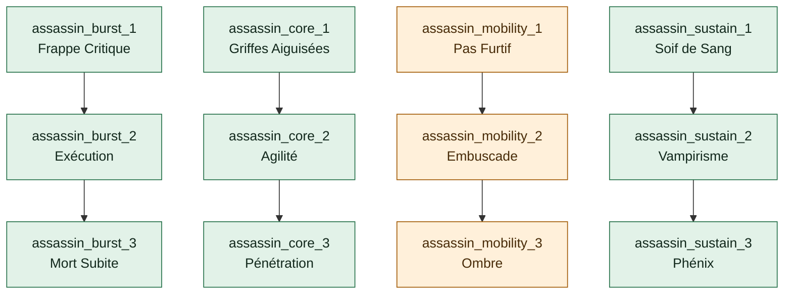
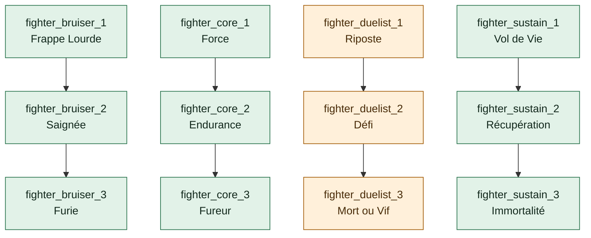
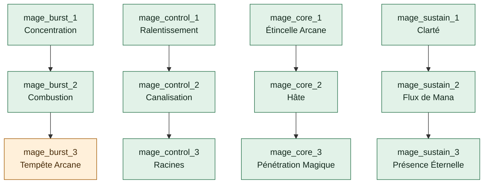
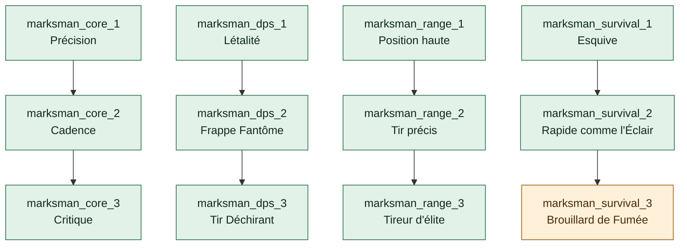
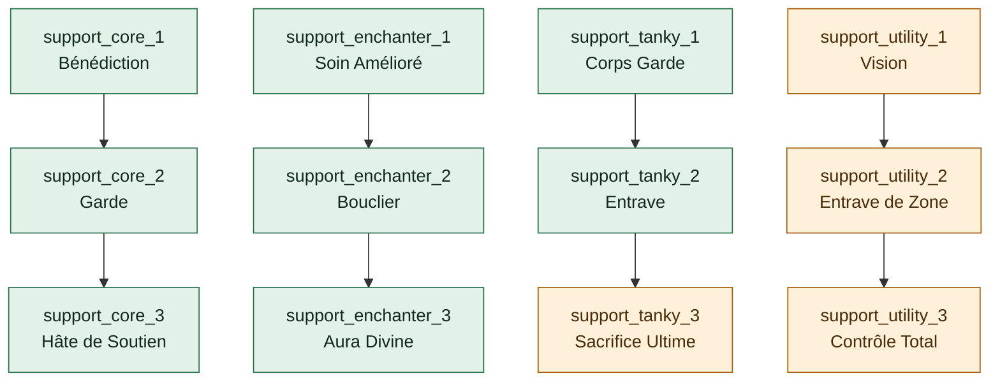
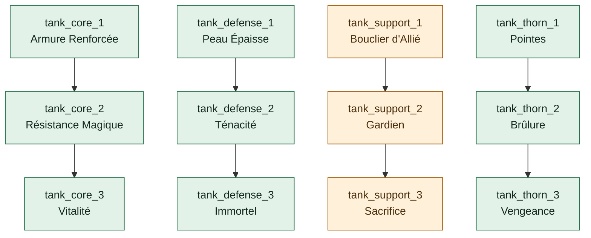

# Audit reproductible des arbres — TREE-01 / TREE-10

> Généré par `npm run testing -- enhancements audit`. Ne pas modifier ce rapport à la main.

Le JSON voisin conserve les 72 nœuds de rôle et les 16 extensions spécialisées du catalogue 4, leurs libellés FR/EN, chemins, coûts, conditions et sources. Observation hors ligne : aucune interrogation distante ou écriture de progression.

**6 arbres de rôle + 4 extensions / 88 nœuds ; 57 atteignables, 31 bloqués ; 0 nœud affecté par un défaut topologique.**

Maîtrise maximale : **4**. Budget Candies global : **non plafonné** ; un solde suffisant reste requis pour chaque achat.

12 indisponibilités directes, 3 blocages hérités, 16 extensions fermées par gate, 0 blocage de maîtrise. 0 divergence d’attributs du catalogue ; 0 divergences d’éligibilité depuis un état vide entre client et modèle SQL.

Les coûts incluent une fois chaque ancêtre requis au rang 1 ; le rang maximal paie ensuite chaque rang du nœud cible au coût constant. Un coût théorique ne prouve pas un chemin achetable : le champ `reachable` du JSON fait foi.

## Rôle du champion

| Champion | Tags dans l’ordre | Arbre client | Rôle SQL | Concordance |
| --- | --- | --- | --- | --- |
| Aatrox | Fighter | Fighter | fighter | oui |
| Ahri | Mage, Assassin | Mage | mage | oui |
| Akali | Assassin | Assassin | assassin | oui |
| Akshan | Marksman, Assassin | Marksman | marksman | oui |
| Alistar | Tank, Support | Tank | tank | oui |
| Ambessa | Fighter, Assassin | Fighter | fighter | oui |
| Amumu | Tank, Support | Tank | tank | oui |
| Anivia | Mage | Mage | mage | oui |
| Annie | Mage | Mage | mage | oui |
| Aphelios | Marksman | Marksman | marksman | oui |
| Ashe | Marksman | Marksman | marksman | oui |
| AurelionSol | Mage | Mage | mage | oui |
| Aurora | Mage, Assassin | Mage | mage | oui |
| Azir | Mage, Marksman | Mage | mage | oui |
| Bard | Support, Mage | Support | support | oui |
| Belveth | Fighter | Fighter | fighter | oui |
| Blitzcrank | Tank, Support | Tank | tank | oui |
| Brand | Mage, Support | Mage | mage | oui |
| Braum | Tank, Support | Tank | tank | oui |
| Briar | Fighter, Assassin | Fighter | fighter | oui |
| Caitlyn | Marksman | Marksman | marksman | oui |
| Camille | Fighter, Assassin | Fighter | fighter | oui |
| Cassiopeia | Mage | Mage | mage | oui |
| Chogath | Tank, Mage | Tank | tank | oui |
| Corki | Marksman, Mage | Marksman | marksman | oui |
| Darius | Fighter, Tank | Fighter | fighter | oui |
| Diana | Fighter, Assassin | Fighter | fighter | oui |
| DrMundo | Tank, Fighter | Tank | tank | oui |
| Draven | Marksman | Marksman | marksman | oui |
| Ekko | Assassin, Mage | Assassin | assassin | oui |
| Elise | Assassin, Mage | Assassin | assassin | oui |
| Evelynn | Assassin, Mage | Assassin | assassin | oui |
| Ezreal | Marksman, Mage | Marksman | marksman | oui |
| Fiddlesticks | Mage, Support | Mage | mage | oui |
| Fiora | Fighter, Assassin | Fighter | fighter | oui |
| Fizz | Assassin, Fighter | Assassin | assassin | oui |
| Galio | Tank, Mage | Tank | tank | oui |
| Gangplank | Fighter | Fighter | fighter | oui |
| Garen | Fighter, Tank | Fighter | fighter | oui |
| Gnar | Fighter, Tank | Fighter | fighter | oui |
| Gragas | Fighter, Mage | Fighter | fighter | oui |
| Graves | Marksman | Marksman | marksman | oui |
| Gwen | Fighter | Fighter | fighter | oui |
| Hecarim | Fighter, Tank | Fighter | fighter | oui |
| Heimerdinger | Mage, Support | Mage | mage | oui |
| Hwei | Mage, Support | Mage | mage | oui |
| Illaoi | Fighter, Tank | Fighter | fighter | oui |
| Irelia | Fighter, Assassin | Fighter | fighter | oui |
| Ivern | Support, Mage | Support | support | oui |
| Janna | Support, Mage | Support | support | oui |
| JarvanIV | Fighter, Tank | Fighter | fighter | oui |
| Jax | Fighter | Fighter | fighter | oui |
| Jayce | Fighter, Marksman | Fighter | fighter | oui |
| Jhin | Marksman, Mage | Marksman | marksman | oui |
| Jinx | Marksman | Marksman | marksman | oui |
| KSante | Tank, Fighter | Tank | tank | oui |
| Kaisa | Marksman, Mage | Marksman | marksman | oui |
| Kalista | Marksman | Marksman | marksman | oui |
| Karma | Mage, Support | Mage | mage | oui |
| Karthus | Mage | Mage | mage | oui |
| Kassadin | Assassin, Mage | Assassin | assassin | oui |
| Katarina | Assassin, Mage | Assassin | assassin | oui |
| Kayle | Mage, Marksman | Mage | mage | oui |
| Kayn | Fighter, Assassin | Fighter | fighter | oui |
| Kennen | Mage | Mage | mage | oui |
| Khazix | Assassin | Assassin | assassin | oui |
| Kindred | Marksman | Marksman | marksman | oui |
| Kled | Fighter | Fighter | fighter | oui |
| KogMaw | Marksman, Mage | Marksman | marksman | oui |
| Leblanc | Assassin, Mage | Assassin | assassin | oui |
| LeeSin | Fighter, Assassin | Fighter | fighter | oui |
| Leona | Tank, Support | Tank | tank | oui |
| Lillia | Fighter, Mage | Fighter | fighter | oui |
| Lissandra | Mage | Mage | mage | oui |
| Lucian | Marksman, Assassin | Marksman | marksman | oui |
| Lulu | Support, Mage | Support | support | oui |
| Lux | Mage, Support | Mage | mage | oui |
| Malphite | Tank, Mage | Tank | tank | oui |
| Malzahar | Mage | Mage | mage | oui |
| Maokai | Tank, Support | Tank | tank | oui |
| MasterYi | Fighter, Assassin | Fighter | fighter | oui |
| Mel | Mage, Support | Mage | mage | oui |
| Milio | Support, Mage | Support | support | oui |
| MissFortune | Marksman, Mage | Marksman | marksman | oui |
| MonkeyKing | Fighter, Tank | Fighter | fighter | oui |
| Mordekaiser | Fighter, Mage | Fighter | fighter | oui |
| Morgana | Support, Mage | Support | support | oui |
| Naafiri | Assassin, Fighter | Assassin | assassin | oui |
| Nami | Support, Mage | Support | support | oui |
| Nasus | Fighter, Tank | Fighter | fighter | oui |
| Nautilus | Tank, Support | Tank | tank | oui |
| Neeko | Mage, Support | Mage | mage | oui |
| Nidalee | Assassin, Mage | Assassin | assassin | oui |
| Nilah | Fighter, Assassin | Fighter | fighter | oui |
| Nocturne | Fighter, Assassin | Fighter | fighter | oui |
| Nunu | Tank, Mage | Tank | tank | oui |
| Olaf | Fighter, Tank | Fighter | fighter | oui |
| Orianna | Mage, Support | Mage | mage | oui |
| Ornn | Tank | Tank | tank | oui |
| Pantheon | Fighter, Assassin | Fighter | fighter | oui |
| Poppy | Tank, Fighter | Tank | tank | oui |
| Pyke | Support, Assassin | Support | support | oui |
| Qiyana | Assassin | Assassin | assassin | oui |
| Quinn | Marksman, Assassin | Marksman | marksman | oui |
| Rakan | Support | Support | support | oui |
| Rammus | Tank | Tank | tank | oui |
| RekSai | Fighter, Tank | Fighter | fighter | oui |
| Rell | Tank, Support | Tank | tank | oui |
| Renata | Support, Mage | Support | support | oui |
| Renekton | Fighter, Tank | Fighter | fighter | oui |
| Rengar | Assassin, Fighter | Assassin | assassin | oui |
| Riven | Fighter, Assassin | Fighter | fighter | oui |
| Rumble | Fighter, Mage | Fighter | fighter | oui |
| Ryze | Mage | Mage | mage | oui |
| Samira | Marksman, Assassin | Marksman | marksman | oui |
| Sejuani | Tank | Tank | tank | oui |
| Senna | Support, Marksman | Support | support | oui |
| Seraphine | Support, Mage | Support | support | oui |
| Sett | Fighter, Tank | Fighter | fighter | oui |
| Shaco | Assassin | Assassin | assassin | oui |
| Shen | Tank | Tank | tank | oui |
| Shyvana | Fighter, Tank | Fighter | fighter | oui |
| Singed | Tank, Mage | Tank | tank | oui |
| Sion | Tank, Fighter | Tank | tank | oui |
| Sivir | Marksman | Marksman | marksman | oui |
| Skarner | Tank, Fighter | Tank | tank | oui |
| Smolder | Marksman, Mage | Marksman | marksman | oui |
| Sona | Support, Mage | Support | support | oui |
| Soraka | Support, Mage | Support | support | oui |
| Swain | Mage, Support | Mage | mage | oui |
| Sylas | Mage, Assassin | Mage | mage | oui |
| Syndra | Mage | Mage | mage | oui |
| TahmKench | Tank, Support | Tank | tank | oui |
| Taliyah | Mage, Support | Mage | mage | oui |
| Talon | Assassin | Assassin | assassin | oui |
| Taric | Support, Tank | Support | support | oui |
| Teemo | Marksman, Mage | Marksman | marksman | oui |
| Thresh | Support, Tank | Support | support | oui |
| Tristana | Marksman, Assassin | Marksman | marksman | oui |
| Trundle | Fighter, Tank | Fighter | fighter | oui |
| Tryndamere | Fighter, Assassin | Fighter | fighter | oui |
| TwistedFate | Mage, Marksman | Mage | mage | oui |
| Twitch | Marksman, Assassin | Marksman | marksman | oui |
| Udyr | Fighter, Tank | Fighter | fighter | oui |
| Urgot | Fighter, Tank | Fighter | fighter | oui |
| Varus | Marksman, Mage | Marksman | marksman | oui |
| Vayne | Marksman, Assassin | Marksman | marksman | oui |
| Veigar | Mage | Mage | mage | oui |
| Velkoz | Mage, Support | Mage | mage | oui |
| Vex | Mage | Mage | mage | oui |
| Vi | Fighter, Assassin | Fighter | fighter | oui |
| Viego | Fighter, Assassin | Fighter | fighter | oui |
| Viktor | Mage | Mage | mage | oui |
| Vladimir | Mage, Fighter | Mage | mage | oui |
| Volibear | Fighter, Tank | Fighter | fighter | oui |
| Warwick | Fighter, Tank | Fighter | fighter | oui |
| Xayah | Marksman | Marksman | marksman | oui |
| Xerath | Mage, Support | Mage | mage | oui |
| XinZhao | Fighter, Tank | Fighter | fighter | oui |
| Yasuo | Fighter, Assassin | Fighter | fighter | oui |
| Yone | Fighter, Assassin | Fighter | fighter | oui |
| Yorick | Fighter, Tank | Fighter | fighter | oui |
| Yunara | Marksman | Marksman | marksman | oui |
| Yuumi | Support, Mage | Support | support | oui |
| Zaahen | Fighter, Assassin | Fighter | fighter | oui |
| Zac | Tank, Fighter | Tank | tank | oui |
| Zed | Assassin | Assassin | assassin | oui |
| Zeri | Marksman | Marksman | marksman | oui |
| Ziggs | Mage | Mage | mage | oui |
| Zilean | Support, Mage | Support | support | oui |
| Zoe | Mage | Mage | mage | oui |
| Zyra | Mage, Support | Mage | mage | oui |

Le premier tag choisit l’arbre côté client ; les tags secondaires ne le remplacent pas. Le fallback client est Fighter. Le serveur utilise son propre catalogue de rôles ; un champion absent n’est pas autorisé par ce fallback.

## Assassin

Racines : `assassin_burst_1`, `assassin_core_1`, `assassin_mobility_1`, `assassin_sustain_1`. Total théorique du catalogue : 930 Candies.

Vert : chemin légal ; orange : indisponibilité ou héritage ; violet : maîtrise ; rouge : topologie invalide. Les IDs restent dans les étiquettes du graphe.

| ID | FR / EN | Branche | Rang max | Candies/rang ; chemin 1er/max | Maîtrise | Parents | Déblocage client / SQL | Effet |
| --- | --- | --- | ---: | --- | ---: | --- | --- | --- |
| `assassin_burst_1` | Frappe Critique / Critical Strike | assassin_burst | 1 | 50 ; 50 / 50 | 1 | — | oui / oui | implemented |
| `assassin_burst_2` | Exécution / Execution | assassin_burst | 1 | 80 ; 130 / 130 | 2 | assassin_burst_1 | oui / oui | implemented |
| `assassin_burst_3` | Mort Subite / Sudden Death | assassin_burst | 1 | 150 ; 280 / 280 | 3 | assassin_burst_2 | oui / oui | implemented |
| `assassin_core_1` | Griffes Aiguisées / Sharpened Claws | socle | 1 | 20 ; 20 / 20 | 0 | — | oui / oui | implemented |
| `assassin_core_2` | Agilité / Agility | socle | 1 | 30 ; 50 / 50 | 1 | assassin_core_1 | oui / oui | implemented |
| `assassin_core_3` | Pénétration / Penetration | socle | 1 | 40 ; 90 / 90 | 2 | assassin_core_2 | oui / oui | implemented |
| `assassin_mobility_1` | Pas Furtif / Stealthy Step | assassin_mobility | 1 | 50 ; 50 / 50 | 1 | — | non / non | descriptive |
| `assassin_mobility_2` | Embuscade / Ambush | assassin_mobility | 1 | 80 ; 130 / 130 | 2 | assassin_mobility_1 | non / non | descriptive |
| `assassin_mobility_3` | Ombre / Shadow | assassin_mobility | 1 | 150 ; 280 / 280 | 3 | assassin_mobility_2 | non / non | descriptive |
| `assassin_sustain_1` | Soif de Sang / Bloodthirst | assassin_sustain | 1 | 50 ; 50 / 50 | 1 | — | oui / oui | implemented |
| `assassin_sustain_2` | Vampirisme / Vampirism | assassin_sustain | 1 | 80 ; 130 / 130 | 2 | assassin_sustain_1 | oui / oui | implemented |
| `assassin_sustain_3` | Phénix / Phoenix | assassin_sustain | 1 | 150 ; 280 / 280 | 3 | assassin_sustain_2 | oui / oui | implemented |

### assassin_burst_1 — Frappe Critique

FR : +8 % Chances de coup critique

EN : +8% Critical Strike Chance

Visibilité : branche sélectionnée ; les effets indisponibles ne masquent pas la carte. Attribut serveur : `champion_enhancements.unlocked_nodes.assassin_burst_1`.

Effet : **implemented**. Types : statistiques. flat.crit=8. Points de pourcentage de critique canonique, plafonnés entre 0 et 100.

Valeurs déclarées : plats `{"crit":8}` ; pourcentages `{}`.

Responsables des effets : EnhancementService / statCalculator / CombatRuleRuntime / traductions. Suite : TREE-04.

- Source : `src/game/enhancements/bonuses.ts` — `aggregateEnhancementBonuses`.
- Source : `src/services/enhancementService.ts` — `EnhancementService.calculateStatBonuses`.
- Source : `src/game/enhancements/eligibility.ts` — `getActiveEnhancementRanks`.
- Source : `src/utils/statCalculator.ts` — `enhancementModifiers`.
- Source : `src/game/stats/statContract.ts` — `applyCanonicalModifiers`.
- Source : `src/game/ChampionInstance.ts` — `ChampionInstance.getStatsWithEnhancements`.

### assassin_burst_2 — Exécution

FR : +10 % de dégâts contre les cibles en dessous de 40 % PV

EN : +10% damage against targets below 40% HP

Visibilité : branche sélectionnée ; les effets indisponibles ne masquent pas la carte. Attribut serveur : `champion_enhancements.unlocked_nodes.assassin_burst_2`.

Effet : **implemented**. Types : `execute_damage`. Dégâts × (1 + value) sous 40 % des PV max de la cible, seuil strict.

Valeurs déclarées : plats `{}` ; pourcentages `{}`.

Responsables des effets : CombatRuleRuntime / résolveurs combat / catalogue et traductions. Suite : TREE-04.

- Source : `src/game/rules/CombatRuleRuntime.ts` — `CombatRuleRuntime.beforeDamage`.

### assassin_burst_3 — Mort Subite

FR : Les dégâts de la compétence R sont augmentés de 20 %.

EN : Damage from the R ability is increased by 20%.

Visibilité : branche sélectionnée ; les effets indisponibles ne masquent pas la carte. Attribut serveur : `champion_enhancements.unlocked_nodes.assassin_burst_3`.

Effet : **implemented**. Types : `burst_amplify`. Dégâts de la compétence R × (1 + value), autres actions inchangées.

Valeurs déclarées : plats `{}` ; pourcentages `{}`.

Responsables des effets : CombatRuleRuntime / résolveurs combat / catalogue et traductions. Suite : TREE-04.

- Source : `src/game/rules/CombatRuleRuntime.ts` — `CombatRuleRuntime.beforeDamage`.

### assassin_core_1 — Griffes Aiguisées

FR : +5 Dégâts d'attaque

EN : +5 Attack Damage

Visibilité : socle toujours rendu ; les effets indisponibles ne masquent pas la carte. Attribut serveur : `champion_enhancements.unlocked_nodes.assassin_core_1`.

Effet : **implemented**. Types : statistiques. flat.atk=5. Dégâts d’attaque canoniques, pas un multiplicateur global de dégâts.

Valeurs déclarées : plats `{"atk":5}` ; pourcentages `{}`.

Responsables des effets : EnhancementService / statCalculator / CombatRuleRuntime / traductions. Suite : TREE-04.

- Source : `src/game/enhancements/bonuses.ts` — `aggregateEnhancementBonuses`.
- Source : `src/services/enhancementService.ts` — `EnhancementService.calculateStatBonuses`.
- Source : `src/game/enhancements/eligibility.ts` — `getActiveEnhancementRanks`.
- Source : `src/utils/statCalculator.ts` — `enhancementModifiers`.
- Source : `src/game/stats/statContract.ts` — `applyCanonicalModifiers`.
- Source : `src/game/ChampionInstance.ts` — `ChampionInstance.getStatsWithEnhancements`.

### assassin_core_2 — Agilité

FR : +3 % Vitesse de déplacement

EN : +3% Movement Speed

Visibilité : socle toujours rendu ; les effets indisponibles ne masquent pas la carte. Attribut serveur : `champion_enhancements.unlocked_nodes.assassin_core_2`.

Effet : **implemented**. Types : statistiques. percent.spd=0.03. Vitesse de déplacement canonique, composante de l’initiative ; aucun déplacement spatial.

Valeurs déclarées : plats `{}` ; pourcentages `{"spd":0.03}`.

Responsables des effets : EnhancementService / statCalculator / CombatRuleRuntime / traductions. Suite : TREE-04.

- Source : `src/game/enhancements/bonuses.ts` — `aggregateEnhancementBonuses`.
- Source : `src/services/enhancementService.ts` — `EnhancementService.calculateStatBonuses`.
- Source : `src/game/enhancements/eligibility.ts` — `getActiveEnhancementRanks`.
- Source : `src/utils/statCalculator.ts` — `enhancementModifiers`.
- Source : `src/game/stats/statContract.ts` — `applyCanonicalModifiers`.
- Source : `src/game/ChampionInstance.ts` — `ChampionInstance.getStatsWithEnhancements`.

### assassin_core_3 — Pénétration

FR : +4 Pénétration d'armure

EN : +4 Armor Penetration

Visibilité : socle toujours rendu ; les effets indisponibles ne masquent pas la carte. Attribut serveur : `champion_enhancements.unlocked_nodes.assassin_core_3`.

Effet : **implemented**. Types : statistiques. flat.armorPen=4. Bonus secondaire plat : multiplie les dégâts physiques par 1 + max(0, valeur) / 200.

Valeurs déclarées : plats `{"armorPen":4}` ; pourcentages `{}`.

Responsables des effets : EnhancementService / statCalculator / CombatRuleRuntime / traductions. Suite : TREE-04.

- Source : `src/game/enhancements/bonuses.ts` — `aggregateEnhancementBonuses`.
- Source : `src/services/enhancementService.ts` — `EnhancementService.calculateStatBonuses`.
- Source : `src/game/enhancements/eligibility.ts` — `getActiveEnhancementRanks`.
- Source : `src/utils/statCalculator.ts` — `enhancementModifiers`.
- Source : `src/game/stats/statContract.ts` — `applyCanonicalModifiers`.
- Source : `src/game/ChampionInstance.ts` — `ChampionInstance.getStatsWithEnhancements`.
- Source : `src/game/rules/CombatRuleRuntime.ts` — `CombatRuleRuntime.beforeDamage`.

### assassin_mobility_1 — Pas Furtif

FR : +5 % Vitesse de déplacement hors combat

EN : +5% out-of-combat Movement Speed

Visibilité : branche sélectionnée ; les effets indisponibles ne masquent pas la carte. Attribut serveur : `champion_enhancements.unlocked_nodes.assassin_mobility_1`.

Effet : **descriptive**. Types : `out_of_combat_speed`. Aucun effet appliqué ; type explicitement indisponible dans ce mode.

Valeurs déclarées : plats `{}` ; pourcentages `{}`.

- Blocage `unavailable` via `assassin_mobility_1` : Vitesse de déplacement augmentée hors combat. Responsable : Disponibilité des effets / descendants ; suite : TREE-02 / TREE-03.

- Écart d’effet : Le déplacement hors combat n’a pas de consommateur moteur.

Responsables des effets : Catalogue / disponibilité du moteur / traductions. Suite : TREE-03, TREE-04.

- Source : `src/game/rules/catalogSupport.ts` — `UNAVAILABLE_ENHANCEMENT_EFFECTS`.
- Source : `src/game/rules/CombatRuleRuntime.ts` — `CombatRuleRuntime.getEnhancements`.

### assassin_mobility_2 — Embuscade

FR : +15 % de dégâts depuis les broussailles ou hors de vue

EN : +15% damage from brush or while out of sight

Visibilité : branche sélectionnée ; les effets indisponibles ne masquent pas la carte. Attribut serveur : `champion_enhancements.unlocked_nodes.assassin_mobility_2`.

Effet : **descriptive**. Types : `ambush_damage`. Aucun effet appliqué ; type explicitement indisponible dans ce mode.

Valeurs déclarées : plats `{}` ; pourcentages `{}`.

- Blocage `unavailable` via `assassin_mobility_2` → `assassin_mobility_1` : Vitesse de déplacement augmentée hors combat. Responsable : Disponibilité des effets / descendants ; suite : TREE-02 / TREE-03.
- Blocage `unavailable` via `assassin_mobility_2` : Dégâts augmentés depuis la dissimulation. Responsable : Disponibilité des effets / descendants ; suite : TREE-02 / TREE-03.

- Écart d’effet : Les broussailles et la dissimulation ne sont pas modélisées.

Responsables des effets : Catalogue / disponibilité du moteur / traductions. Suite : TREE-03, TREE-04.

- Source : `src/game/rules/catalogSupport.ts` — `UNAVAILABLE_ENHANCEMENT_EFFECTS`.
- Source : `src/game/rules/CombatRuleRuntime.ts` — `CombatRuleRuntime.getEnhancements`.

### assassin_mobility_3 — Ombre

FR : Ultime : devient invisible pendant 1,5 s après une élimination

EN : Ultimate: Become invisible for 1.5s after a kill

Visibilité : branche sélectionnée ; les effets indisponibles ne masquent pas la carte. Attribut serveur : `champion_enhancements.unlocked_nodes.assassin_mobility_3`.

Effet : **descriptive**. Types : `stealth_on_kill`. Aucun effet appliqué ; type explicitement indisponible dans ce mode.

Valeurs déclarées : plats `{}` ; pourcentages `{}`.

- Blocage `unavailable` via `assassin_mobility_3` → `assassin_mobility_2` → `assassin_mobility_1` : Vitesse de déplacement augmentée hors combat. Responsable : Disponibilité des effets / descendants ; suite : TREE-02 / TREE-03.
- Blocage `unavailable` via `assassin_mobility_3` → `assassin_mobility_2` : Dégâts augmentés depuis la dissimulation. Responsable : Disponibilité des effets / descendants ; suite : TREE-02 / TREE-03.
- Blocage `unavailable` via `assassin_mobility_3` : Invisibilité après un kill. Responsable : Disponibilité des effets / descendants ; suite : TREE-02 / TREE-03.

- Écart d’effet : L’invisibilité et sa durée en secondes ne sont pas modélisées.

Responsables des effets : Catalogue / disponibilité du moteur / traductions. Suite : TREE-03, TREE-04.

- Source : `src/game/rules/catalogSupport.ts` — `UNAVAILABLE_ENHANCEMENT_EFFECTS`.
- Source : `src/game/rules/CombatRuleRuntime.ts` — `CombatRuleRuntime.getEnhancements`.

### assassin_sustain_1 — Soif de Sang

FR : +5 % Vol de vie

EN : +5% Lifesteal

Visibilité : branche sélectionnée ; les effets indisponibles ne masquent pas la carte. Attribut serveur : `champion_enhancements.unlocked_nodes.assassin_sustain_1`.

Effet : **implemented**. Types : statistiques. flat.lifesteal=5. Bonus secondaire plat divisé par 100, appliqué aux dégâts HP des attaques de base du porteur.

Valeurs déclarées : plats `{"lifesteal":5}` ; pourcentages `{}`.

Responsables des effets : EnhancementService / statCalculator / CombatRuleRuntime / traductions. Suite : TREE-04.

- Source : `src/game/enhancements/bonuses.ts` — `aggregateEnhancementBonuses`.
- Source : `src/services/enhancementService.ts` — `EnhancementService.calculateStatBonuses`.
- Source : `src/game/enhancements/eligibility.ts` — `getActiveEnhancementRanks`.
- Source : `src/utils/statCalculator.ts` — `enhancementModifiers`.
- Source : `src/game/stats/statContract.ts` — `applyCanonicalModifiers`.
- Source : `src/game/ChampionInstance.ts` — `ChampionInstance.getStatsWithEnhancements`.
- Source : `src/game/rules/CombatRuleRuntime.ts` — `CombatRuleRuntime.afterDamage`.

### assassin_sustain_2 — Vampirisme

FR : +3 % Omnivampirisme

EN : +3% Omnivamp

Visibilité : branche sélectionnée ; les effets indisponibles ne masquent pas la carte. Attribut serveur : `champion_enhancements.unlocked_nodes.assassin_sustain_2`.

Effet : **implemented**. Types : statistiques. flat.omnivamp=3. Bonus secondaire plat divisé par 100 sur tous les dégâts HP du porteur ; s’ajoute au vol de vie seulement pour les attaques de base.

Valeurs déclarées : plats `{"omnivamp":3}` ; pourcentages `{}`.

Responsables des effets : EnhancementService / statCalculator / CombatRuleRuntime / traductions. Suite : TREE-04.

- Source : `src/game/enhancements/bonuses.ts` — `aggregateEnhancementBonuses`.
- Source : `src/services/enhancementService.ts` — `EnhancementService.calculateStatBonuses`.
- Source : `src/game/enhancements/eligibility.ts` — `getActiveEnhancementRanks`.
- Source : `src/utils/statCalculator.ts` — `enhancementModifiers`.
- Source : `src/game/stats/statContract.ts` — `applyCanonicalModifiers`.
- Source : `src/game/ChampionInstance.ts` — `ChampionInstance.getStatsWithEnhancements`.
- Source : `src/game/rules/CombatRuleRuntime.ts` — `CombatRuleRuntime.afterDamage`.

### assassin_sustain_3 — Phénix

FR : Avant un coup reçu sous 20 % PV, gagne un bouclier de 200 PV pendant 2 tours, une fois par combat.

EN : Before a hit received below 20% HP, gain a 200 HP shield for 2 turns, once per battle.

Visibilité : branche sélectionnée ; les effets indisponibles ne masquent pas la carte. Attribut serveur : `champion_enhancements.unlocked_nodes.assassin_sustain_3`.

Effet : **implemented**. Types : `survival_shield`. Sous 20 % PV avant un coup, émet et applique le bouclier avant ce coup, pour duration tours ; une utilisation par combat.

Valeurs déclarées : plats `{}` ; pourcentages `{}`.

Responsables des effets : CombatRuleRuntime / résolveurs combat / catalogue et traductions. Suite : TREE-04.

- Source : `src/game/rules/CombatRuleRuntime.ts` — `CombatRuleRuntime.beforeDamage`.
- Source : `src/game/battle/BattleManager.ts` — `BattleManager._applyDamageToTarget`.
- Source : `src/game/battle/BattleRuleEffectResolver.ts` — `resolveBattleRuleEffect`.

## Fighter

Racines : `fighter_bruiser_1`, `fighter_core_1`, `fighter_duelist_1`, `fighter_sustain_1`. Total théorique du catalogue : 930 Candies.

Vert : chemin légal ; orange : indisponibilité ou héritage ; violet : maîtrise ; rouge : topologie invalide. Les IDs restent dans les étiquettes du graphe.

| ID | FR / EN | Branche | Rang max | Candies/rang ; chemin 1er/max | Maîtrise | Parents | Déblocage client / SQL | Effet |
| --- | --- | --- | ---: | --- | ---: | --- | --- | --- |
| `fighter_bruiser_1` | Frappe Lourde / Heavy Strike | fighter_bruiser | 1 | 50 ; 50 / 50 | 1 | — | oui / oui | implemented |
| `fighter_bruiser_2` | Saignée / Bloodletting | fighter_bruiser | 1 | 80 ; 130 / 130 | 2 | fighter_bruiser_1 | oui / oui | implemented |
| `fighter_bruiser_3` | Furie / Berserker | fighter_bruiser | 1 | 150 ; 280 / 280 | 3 | fighter_bruiser_2 | oui / oui | implemented |
| `fighter_core_1` | Force / Strength | socle | 1 | 20 ; 20 / 20 | 0 | — | oui / oui | implemented |
| `fighter_core_2` | Endurance / Endurance | socle | 1 | 30 ; 50 / 50 | 1 | fighter_core_1 | oui / oui | implemented |
| `fighter_core_3` | Fureur / Fury | socle | 1 | 40 ; 90 / 90 | 2 | fighter_core_2 | oui / oui | implemented |
| `fighter_duelist_1` | Riposte / Riposte | fighter_duelist | 1 | 50 ; 50 / 50 | 1 | — | non / non | descriptive |
| `fighter_duelist_2` | Défi / Challenge | fighter_duelist | 1 | 80 ; 130 / 130 | 2 | fighter_duelist_1 | non / non | implemented |
| `fighter_duelist_3` | Mort ou Vif / Dead or Alive | fighter_duelist | 1 | 150 ; 280 / 280 | 3 | fighter_duelist_2 | non / non | implemented |
| `fighter_sustain_1` | Vol de Vie / Lifesteal | fighter_sustain | 1 | 50 ; 50 / 50 | 1 | — | oui / oui | implemented |
| `fighter_sustain_2` | Récupération / Recovery | fighter_sustain | 1 | 80 ; 130 / 130 | 2 | fighter_sustain_1 | oui / oui | implemented |
| `fighter_sustain_3` | Immortalité / Immortality | fighter_sustain | 1 | 150 ; 280 / 280 | 3 | fighter_sustain_2 | oui / oui | implemented |

### fighter_bruiser_1 — Frappe Lourde

FR : +5 % de dégâts d’attaque ; aucun multiplicateur global de dégâts.

EN : +5% Attack Damage; no global damage multiplier.

Visibilité : branche sélectionnée ; les effets indisponibles ne masquent pas la carte. Attribut serveur : `champion_enhancements.unlocked_nodes.fighter_bruiser_1`.

Effet : **implemented**. Types : statistiques. percent.atk=0.05. Dégâts d’attaque canoniques, pas un multiplicateur global de dégâts.

Valeurs déclarées : plats `{}` ; pourcentages `{"atk":0.05}`.

Responsables des effets : EnhancementService / statCalculator / CombatRuleRuntime / traductions. Suite : TREE-04.

- Source : `src/game/enhancements/bonuses.ts` — `aggregateEnhancementBonuses`.
- Source : `src/services/enhancementService.ts` — `EnhancementService.calculateStatBonuses`.
- Source : `src/game/enhancements/eligibility.ts` — `getActiveEnhancementRanks`.
- Source : `src/utils/statCalculator.ts` — `enhancementModifiers`.
- Source : `src/game/stats/statContract.ts` — `applyCanonicalModifiers`.
- Source : `src/game/ChampionInstance.ts` — `ChampionInstance.getStatsWithEnhancements`.

### fighter_bruiser_2 — Saignée

FR : Les attaques de base infligent 3 % des PV max de la cible en dégâts vrais sur 2 tours ; applications indépendantes.

EN : Basic attacks deal 3% of the target’s max HP as true damage over 2 turns; applications are independent.

Visibilité : branche sélectionnée ; les effets indisponibles ne masquent pas la carte. Attribut serveur : `champion_enhancements.unlocked_nodes.fighter_bruiser_2`.

Effet : **implemented**. Types : `bleed`. Sur une attaque de base infligeant des dégâts HP, tirage chance (absent = 100 %), puis total round(PV max cible × value) en dégâts vrais répartis exactement sur duration tours ; applications indépendantes et boucliers absorbants.

Valeurs déclarées : plats `{}` ; pourcentages `{}`.

Responsables des effets : CombatRuleRuntime / résolveurs combat / catalogue et traductions. Suite : TREE-04.

- Source : `src/game/rules/CombatRuleRuntime.ts` — `CombatRuleRuntime.afterDamage`.
- Source : `src/game/rules/CombatRuleRuntime.ts` — `CombatRuleRuntime.shouldTriggerEnhancementChance`.
- Source : `src/game/battle/BattleRuleEffectResolver.ts` — `resolveBattleRuleEffect`.
- Source : `src/game/effects/DamageEffect.ts` — `DamageEffect.tick`.
- Source : `src/game/battle/BattleManager.ts` — `BattleManager._tickTurnEffects`.

### fighter_bruiser_3 — Furie

FR : Ultime : en dessous de 50 % PV, +20 % de dégâts

EN : Ultimate: Below 50% HP, deal +20% damage

Visibilité : branche sélectionnée ; les effets indisponibles ne masquent pas la carte. Attribut serveur : `champion_enhancements.unlocked_nodes.fighter_bruiser_3`.

Effet : **implemented**. Types : `berserker`. Dégâts × (1 + value) lorsque les PV du porteur sont strictement sous 50 %.

Valeurs déclarées : plats `{}` ; pourcentages `{}`.

Responsables des effets : CombatRuleRuntime / résolveurs combat / catalogue et traductions. Suite : TREE-04.

- Source : `src/game/rules/CombatRuleRuntime.ts` — `CombatRuleRuntime.beforeDamage`.

### fighter_core_1 — Force

FR : +10 PV, +3 Dégâts d'attaque

EN : +10 HP, +3 Attack Damage

Visibilité : socle toujours rendu ; les effets indisponibles ne masquent pas la carte. Attribut serveur : `champion_enhancements.unlocked_nodes.fighter_core_1`.

Effet : **implemented**. Types : statistiques. flat.hp=10. PV maximum canoniques ; bonus appliqué avant le multiplicateur de santé de run. flat.atk=3. Dégâts d’attaque canoniques, pas un multiplicateur global de dégâts.

Valeurs déclarées : plats `{"hp":10,"atk":3}` ; pourcentages `{}`.

Responsables des effets : EnhancementService / statCalculator / CombatRuleRuntime / traductions. Suite : TREE-04.

- Source : `src/game/enhancements/bonuses.ts` — `aggregateEnhancementBonuses`.
- Source : `src/services/enhancementService.ts` — `EnhancementService.calculateStatBonuses`.
- Source : `src/game/enhancements/eligibility.ts` — `getActiveEnhancementRanks`.
- Source : `src/utils/statCalculator.ts` — `enhancementModifiers`.
- Source : `src/game/stats/statContract.ts` — `applyCanonicalModifiers`.
- Source : `src/game/ChampionInstance.ts` — `ChampionInstance.getStatsWithEnhancements`.

### fighter_core_2 — Endurance

FR : +5 Armure

EN : +5 Armor

Visibilité : socle toujours rendu ; les effets indisponibles ne masquent pas la carte. Attribut serveur : `champion_enhancements.unlocked_nodes.fighter_core_2`.

Effet : **implemented**. Types : statistiques. flat.def=5. Armure canonique, utilisée par la mitigation physique.

Valeurs déclarées : plats `{"def":5}` ; pourcentages `{}`.

Responsables des effets : EnhancementService / statCalculator / CombatRuleRuntime / traductions. Suite : TREE-04.

- Source : `src/game/enhancements/bonuses.ts` — `aggregateEnhancementBonuses`.
- Source : `src/services/enhancementService.ts` — `EnhancementService.calculateStatBonuses`.
- Source : `src/game/enhancements/eligibility.ts` — `getActiveEnhancementRanks`.
- Source : `src/utils/statCalculator.ts` — `enhancementModifiers`.
- Source : `src/game/stats/statContract.ts` — `applyCanonicalModifiers`.
- Source : `src/game/ChampionInstance.ts` — `ChampionInstance.getStatsWithEnhancements`.

### fighter_core_3 — Fureur

FR : +5 % d'initiative d'attaque

EN : +5% Attack Initiative

Visibilité : socle toujours rendu ; les effets indisponibles ne masquent pas la carte. Attribut serveur : `champion_enhancements.unlocked_nodes.fighter_core_3`.

Effet : **implemented**. Types : statistiques. percent.attackSpeed=0.05. Initiative d’attaque canonique, plafonnée entre 0,1 et 10 ; aucune attaque supplémentaire.

Valeurs déclarées : plats `{}` ; pourcentages `{"attackSpeed":0.05}`.

Responsables des effets : EnhancementService / statCalculator / CombatRuleRuntime / traductions. Suite : TREE-04.

- Source : `src/game/enhancements/bonuses.ts` — `aggregateEnhancementBonuses`.
- Source : `src/services/enhancementService.ts` — `EnhancementService.calculateStatBonuses`.
- Source : `src/game/enhancements/eligibility.ts` — `getActiveEnhancementRanks`.
- Source : `src/utils/statCalculator.ts` — `enhancementModifiers`.
- Source : `src/game/stats/statContract.ts` — `applyCanonicalModifiers`.
- Source : `src/game/ChampionInstance.ts` — `ChampionInstance.getStatsWithEnhancements`.

### fighter_duelist_1 — Riposte

FR : Après une esquive, la prochaine attaque inflige +20 % de dégâts

EN : After dodging, the next attack deals +20% damage

Visibilité : branche sélectionnée ; les effets indisponibles ne masquent pas la carte. Attribut serveur : `champion_enhancements.unlocked_nodes.fighter_duelist_1`.

Effet : **descriptive**. Types : `riposte`. Aucun effet appliqué ; type explicitement indisponible dans ce mode.

Valeurs déclarées : plats `{}` ; pourcentages `{}`.

- Blocage `unavailable` via `fighter_duelist_1` : Bonus de dégâts après esquive. Responsable : Disponibilité des effets / descendants ; suite : TREE-02 / TREE-03.

- Écart d’effet : Aucune mémoire esquive → prochaine attaque n’est implémentée.

Responsables des effets : Catalogue / disponibilité du moteur / traductions. Suite : TREE-03, TREE-04.

- Source : `src/game/rules/catalogSupport.ts` — `UNAVAILABLE_ENHANCEMENT_EFFECTS`.
- Source : `src/game/rules/CombatRuleRuntime.ts` — `CombatRuleRuntime.getEnhancements`.

### fighter_duelist_2 — Défi

FR : +10 % de dégâts infligés par attaques, sorts et DoT.

EN : +10% damage dealt by attacks, spells and damage over time.

Visibilité : branche sélectionnée ; les effets indisponibles ne masquent pas la carte. Attribut serveur : `champion_enhancements.unlocked_nodes.fighter_duelist_2`.

Effet : **implemented**. Types : `champion_damage`. Dégâts des attaques, sorts et DoT × (1 + value), sur toute cible ; renvois sans récursion exclus.

Valeurs déclarées : plats `{}` ; pourcentages `{}`.

- Blocage `unavailable` via `fighter_duelist_2` → `fighter_duelist_1` : Bonus de dégâts après esquive. Responsable : Disponibilité des effets / descendants ; suite : TREE-02 / TREE-03.

Responsables des effets : CombatRuleRuntime / résolveurs combat / catalogue et traductions. Suite : TREE-04.

- Source : `src/game/rules/CombatRuleRuntime.ts` — `CombatRuleRuntime.beforeDamage`.

### fighter_duelist_3 — Mort ou Vif

FR : Avec exactement un combattant vivant par camp, +25 % de dégâts infligés et 15 % de réduction des dégâts reçus.

EN : With exactly one living combatant per side, +25% damage dealt and 15% less incoming damage.

Visibilité : branche sélectionnée ; les effets indisponibles ne masquent pas la carte. Attribut serveur : `champion_enhancements.unlocked_nodes.fighter_duelist_3`.

Effet : **implemented**. Types : `duelist`. Avec exactement un acteur vivant par camp, dégâts sortants × (1 + value) et 15 % de réduction entrante.

Valeurs déclarées : plats `{}` ; pourcentages `{}`.

- Blocage `unavailable` via `fighter_duelist_3` → `fighter_duelist_2` → `fighter_duelist_1` : Bonus de dégâts après esquive. Responsable : Disponibilité des effets / descendants ; suite : TREE-02 / TREE-03.

Responsables des effets : CombatRuleRuntime / résolveurs combat / catalogue et traductions. Suite : TREE-04.

- Source : `src/game/rules/CombatRuleRuntime.ts` — `CombatRuleRuntime.beforeDamage`.

### fighter_sustain_1 — Vol de Vie

FR : +4 % Vol de vie

EN : +4% Lifesteal

Visibilité : branche sélectionnée ; les effets indisponibles ne masquent pas la carte. Attribut serveur : `champion_enhancements.unlocked_nodes.fighter_sustain_1`.

Effet : **implemented**. Types : statistiques. flat.lifesteal=4. Bonus secondaire plat divisé par 100, appliqué aux dégâts HP des attaques de base du porteur.

Valeurs déclarées : plats `{"lifesteal":4}` ; pourcentages `{}`.

Responsables des effets : EnhancementService / statCalculator / CombatRuleRuntime / traductions. Suite : TREE-04.

- Source : `src/game/enhancements/bonuses.ts` — `aggregateEnhancementBonuses`.
- Source : `src/services/enhancementService.ts` — `EnhancementService.calculateStatBonuses`.
- Source : `src/game/enhancements/eligibility.ts` — `getActiveEnhancementRanks`.
- Source : `src/utils/statCalculator.ts` — `enhancementModifiers`.
- Source : `src/game/stats/statContract.ts` — `applyCanonicalModifiers`.
- Source : `src/game/ChampionInstance.ts` — `ChampionInstance.getStatsWithEnhancements`.
- Source : `src/game/rules/CombatRuleRuntime.ts` — `CombatRuleRuntime.afterDamage`.

### fighter_sustain_2 — Récupération

FR : +5 Régénération PV

EN : +5 HP Regeneration

Visibilité : branche sélectionnée ; les effets indisponibles ne masquent pas la carte. Attribut serveur : `champion_enhancements.unlocked_nodes.fighter_sustain_2`.

Effet : **implemented**. Types : statistiques. flat.hpRegen=5. Stat canonique ; le bonus plat est aussi émis en soin au début du tour du porteur.

Valeurs déclarées : plats `{"hpRegen":5}` ; pourcentages `{}`.

Responsables des effets : EnhancementService / statCalculator / CombatRuleRuntime / traductions. Suite : TREE-04.

- Source : `src/game/enhancements/bonuses.ts` — `aggregateEnhancementBonuses`.
- Source : `src/services/enhancementService.ts` — `EnhancementService.calculateStatBonuses`.
- Source : `src/game/enhancements/eligibility.ts` — `getActiveEnhancementRanks`.
- Source : `src/utils/statCalculator.ts` — `enhancementModifiers`.
- Source : `src/game/stats/statContract.ts` — `applyCanonicalModifiers`.
- Source : `src/game/ChampionInstance.ts` — `ChampionInstance.getStatsWithEnhancements`.
- Source : `src/game/rules/CombatRuleRuntime.ts` — `CombatRuleRuntime.onTurnStart`.

### fighter_sustain_3 — Immortalité

FR : Ultime : les éliminations restaurent 20 % des PV maximum

EN : Ultimate: Kills restore 20% max HP

Visibilité : branche sélectionnée ; les effets indisponibles ne masquent pas la carte. Attribut serveur : `champion_enhancements.unlocked_nodes.fighter_sustain_3`.

Effet : **implemented**. Types : `heal_on_kill`. Une élimination créditée au porteur soigne ses PV max × value, puis amplification et plafond des PV.

Valeurs déclarées : plats `{}` ; pourcentages `{}`.

Responsables des effets : CombatRuleRuntime / résolveurs combat / catalogue et traductions. Suite : TREE-04.

- Source : `src/game/rules/CombatRuleRuntime.ts` — `CombatRuleRuntime.onKill`.
- Source : `src/game/battle/BattleRuleEffectResolver.ts` — `resolveBattleRuleEffect`.
- Source : `src/game/battle/BattleManager.ts` — `BattleManager._applyHeal`.

## Mage

Racines : `mage_burst_1`, `mage_control_1`, `mage_core_1`, `mage_sustain_1`. Total théorique du catalogue : 930 Candies.

Vert : chemin légal ; orange : indisponibilité ou héritage ; violet : maîtrise ; rouge : topologie invalide. Les IDs restent dans les étiquettes du graphe.

| ID | FR / EN | Branche | Rang max | Candies/rang ; chemin 1er/max | Maîtrise | Parents | Déblocage client / SQL | Effet |
| --- | --- | --- | ---: | --- | ---: | --- | --- | --- |
| `mage_burst_1` | Concentration / Focus | mage_burst | 1 | 50 ; 50 / 50 | 1 | — | oui / oui | implemented |
| `mage_burst_2` | Combustion / Combustion | mage_burst | 1 | 80 ; 130 / 130 | 2 | mage_burst_1 | oui / oui | implemented |
| `mage_burst_3` | Tempête Arcane / Arcane Storm | mage_burst | 1 | 150 ; 280 / 280 | 3 | mage_burst_2 | non / non | descriptive |
| `mage_control_1` | Ralentissement / Slow | mage_control | 1 | 50 ; 50 / 50 | 1 | — | oui / oui | implemented |
| `mage_control_2` | Canalisation / Channeling | mage_control | 1 | 80 ; 130 / 130 | 2 | mage_control_1 | oui / oui | implemented |
| `mage_control_3` | Racines / Roots | mage_control | 1 | 150 ; 280 / 280 | 3 | mage_control_2 | oui / oui | implemented |
| `mage_core_1` | Étincelle Arcane / Arcane Spark | socle | 1 | 20 ; 20 / 20 | 0 | — | oui / oui | implemented |
| `mage_core_2` | Hâte / Haste | socle | 1 | 30 ; 50 / 50 | 1 | mage_core_1 | oui / oui | implemented |
| `mage_core_3` | Pénétration Magique / Magic Penetration | socle | 1 | 40 ; 90 / 90 | 2 | mage_core_2 | oui / oui | implemented |
| `mage_sustain_1` | Clarté / Clarity | mage_sustain | 1 | 50 ; 50 / 50 | 1 | — | oui / oui | implemented |
| `mage_sustain_2` | Flux de Mana / Manaflow | mage_sustain | 1 | 80 ; 130 / 130 | 2 | mage_sustain_1 | oui / oui | implemented |
| `mage_sustain_3` | Présence Éternelle / Eternal Presence | mage_sustain | 1 | 150 ; 280 / 280 | 3 | mage_sustain_2 | oui / oui | implemented |

### mage_burst_1 — Concentration

FR : +8 Puissance

EN : +8 Ability Power

Visibilité : branche sélectionnée ; les effets indisponibles ne masquent pas la carte. Attribut serveur : `champion_enhancements.unlocked_nodes.mage_burst_1`.

Effet : **implemented**. Types : statistiques. flat.ap=8. Puissance canonique, utilisée uniquement par les ratios AP des effets.

Valeurs déclarées : plats `{"ap":8}` ; pourcentages `{}`.

Responsables des effets : EnhancementService / statCalculator / CombatRuleRuntime / traductions. Suite : TREE-04.

- Source : `src/game/enhancements/bonuses.ts` — `aggregateEnhancementBonuses`.
- Source : `src/services/enhancementService.ts` — `EnhancementService.calculateStatBonuses`.
- Source : `src/game/enhancements/eligibility.ts` — `getActiveEnhancementRanks`.
- Source : `src/utils/statCalculator.ts` — `enhancementModifiers`.
- Source : `src/game/stats/statContract.ts` — `applyCanonicalModifiers`.
- Source : `src/game/ChampionInstance.ts` — `ChampionInstance.getStatsWithEnhancements`.

### mage_burst_2 — Combustion

FR : +15 % de puissance ; ne multiplie pas directement les dégâts magiques.

EN : +15% Ability Power; does not directly multiply magic damage.

Visibilité : branche sélectionnée ; les effets indisponibles ne masquent pas la carte. Attribut serveur : `champion_enhancements.unlocked_nodes.mage_burst_2`.

Effet : **implemented**. Types : statistiques. percent.ap=0.15. Puissance canonique, utilisée uniquement par les ratios AP des effets.

Valeurs déclarées : plats `{}` ; pourcentages `{"ap":0.15}`.

Responsables des effets : EnhancementService / statCalculator / CombatRuleRuntime / traductions. Suite : TREE-04.

- Source : `src/game/enhancements/bonuses.ts` — `aggregateEnhancementBonuses`.
- Source : `src/services/enhancementService.ts` — `EnhancementService.calculateStatBonuses`.
- Source : `src/game/enhancements/eligibility.ts` — `getActiveEnhancementRanks`.
- Source : `src/utils/statCalculator.ts` — `enhancementModifiers`.
- Source : `src/game/stats/statContract.ts` — `applyCanonicalModifiers`.
- Source : `src/game/ChampionInstance.ts` — `ChampionInstance.getStatsWithEnhancements`.

### mage_burst_3 — Tempête Arcane

FR : Ultime : les compétences de zone ont 20 % de chances de se répéter

EN : Ultimate: AoE abilities have a 20% chance to repeat

Visibilité : branche sélectionnée ; les effets indisponibles ne masquent pas la carte. Attribut serveur : `champion_enhancements.unlocked_nodes.mage_burst_3`.

Effet : **descriptive**. Types : `spell_echo`. Aucun effet appliqué ; type explicitement indisponible dans ce mode.

Valeurs déclarées : plats `{}` ; pourcentages `{}`.

- Blocage `unavailable` via `mage_burst_3` : Chance de répéter les sorts AoE. Responsable : Disponibilité des effets / descendants ; suite : TREE-02 / TREE-03.

- Écart d’effet : Aucune répétition de sort de zone n’est implémentée.

Responsables des effets : Catalogue / disponibilité du moteur / traductions. Suite : TREE-03, TREE-04.

- Source : `src/game/rules/catalogSupport.ts` — `UNAVAILABLE_ENHANCEMENT_EFFECTS`.
- Source : `src/game/rules/CombatRuleRuntime.ts` — `CombatRuleRuntime.getEnhancements`.

### mage_control_1 — Ralentissement

FR : Les dégâts de sort appliquent 15 % de ralentissement pendant 1 tour, avant modificateurs de durée.

EN : Spell damage applies a 15% slow for 1 turn, before duration modifiers.

Visibilité : branche sélectionnée ; les effets indisponibles ne masquent pas la carte. Attribut serveur : `champion_enhancements.unlocked_nodes.mage_control_1`.

Effet : **implemented**. Types : `slow`. Après un dégât de sort, applique value de ralentissement pour duration tours, modifiés par extension et ténacité, puis arrondi supérieur et caps ; cumul des ralentissements plafonné à 60 %.

Valeurs déclarées : plats `{}` ; pourcentages `{}`.

Responsables des effets : CombatRuleRuntime / résolveurs combat / catalogue et traductions. Suite : TREE-04.

- Source : `src/game/rules/CombatRuleRuntime.ts` — `CombatRuleRuntime.afterDamage`.
- Source : `src/game/battle/BattleRuleEffectResolver.ts` — `resolveBattleRuleEffect`.

### mage_control_2 — Canalisation

FR : +10 points de hâte de compétence ; recharge × 100 / (100 + hâte).

EN : +10 Ability Haste points; cooldown × 100 / (100 + haste).

Visibilité : branche sélectionnée ; les effets indisponibles ne masquent pas la carte. Attribut serveur : `champion_enhancements.unlocked_nodes.mage_control_2`.

Effet : **implemented**. Types : statistiques. flat.abilityHaste=10. Hâte effective = flat + percent × 100 ; recharge × 100 / (100 + max(0, hâte)), minimum ×0,1.

Valeurs déclarées : plats `{"abilityHaste":10}` ; pourcentages `{}`.

Responsables des effets : EnhancementService / statCalculator / CombatRuleRuntime / traductions. Suite : TREE-04.

- Source : `src/game/enhancements/bonuses.ts` — `aggregateEnhancementBonuses`.
- Source : `src/services/enhancementService.ts` — `EnhancementService.calculateStatBonuses`.
- Source : `src/game/enhancements/eligibility.ts` — `getActiveEnhancementRanks`.
- Source : `src/utils/statCalculator.ts` — `enhancementModifiers`.
- Source : `src/game/stats/statContract.ts` — `applyCanonicalModifiers`.
- Source : `src/game/ChampionInstance.ts` — `ChampionInstance.getStatsWithEnhancements`.
- Source : `src/game/rules/CombatRuleRuntime.ts` — `CombatRuleRuntime.getCooldownMultiplier`.

### mage_control_3 — Racines

FR : Chaque événement de dégâts de sort a 20 % de chances d’enraciner la cible pendant 1 tour, avant modificateurs de durée.

EN : Each spell damage event has a 20% chance to root its target for 1 turn, before duration modifiers.

Visibilité : branche sélectionnée ; les effets indisponibles ne masquent pas la carte. Attribut serveur : `champion_enhancements.unlocked_nodes.mage_control_3`.

Effet : **implemented**. Types : `root_chance`. Après chaque événement de dégâts de sort, random() < value applique Snare pour duration tours, avec modificateurs et plafonds de durée.

Valeurs déclarées : plats `{}` ; pourcentages `{}`.

Responsables des effets : CombatRuleRuntime / résolveurs combat / catalogue et traductions. Suite : TREE-04.

- Source : `src/game/rules/CombatRuleRuntime.ts` — `CombatRuleRuntime.afterDamage`.
- Source : `src/game/battle/BattleRuleEffectResolver.ts` — `resolveBattleRuleEffect`.

### mage_core_1 — Étincelle Arcane

FR : +5 Puissance

EN : +5 Ability Power

Visibilité : socle toujours rendu ; les effets indisponibles ne masquent pas la carte. Attribut serveur : `champion_enhancements.unlocked_nodes.mage_core_1`.

Effet : **implemented**. Types : statistiques. flat.ap=5. Puissance canonique, utilisée uniquement par les ratios AP des effets.

Valeurs déclarées : plats `{"ap":5}` ; pourcentages `{}`.

Responsables des effets : EnhancementService / statCalculator / CombatRuleRuntime / traductions. Suite : TREE-04.

- Source : `src/game/enhancements/bonuses.ts` — `aggregateEnhancementBonuses`.
- Source : `src/services/enhancementService.ts` — `EnhancementService.calculateStatBonuses`.
- Source : `src/game/enhancements/eligibility.ts` — `getActiveEnhancementRanks`.
- Source : `src/utils/statCalculator.ts` — `enhancementModifiers`.
- Source : `src/game/stats/statContract.ts` — `applyCanonicalModifiers`.
- Source : `src/game/ChampionInstance.ts` — `ChampionInstance.getStatsWithEnhancements`.

### mage_core_2 — Hâte

FR : +5 Hâte d'habileté

EN : +5 Ability Haste

Visibilité : socle toujours rendu ; les effets indisponibles ne masquent pas la carte. Attribut serveur : `champion_enhancements.unlocked_nodes.mage_core_2`.

Effet : **implemented**. Types : statistiques. flat.abilityHaste=5. Hâte effective = flat + percent × 100 ; recharge × 100 / (100 + max(0, hâte)), minimum ×0,1.

Valeurs déclarées : plats `{"abilityHaste":5}` ; pourcentages `{}`.

Responsables des effets : EnhancementService / statCalculator / CombatRuleRuntime / traductions. Suite : TREE-04.

- Source : `src/game/enhancements/bonuses.ts` — `aggregateEnhancementBonuses`.
- Source : `src/services/enhancementService.ts` — `EnhancementService.calculateStatBonuses`.
- Source : `src/game/enhancements/eligibility.ts` — `getActiveEnhancementRanks`.
- Source : `src/utils/statCalculator.ts` — `enhancementModifiers`.
- Source : `src/game/stats/statContract.ts` — `applyCanonicalModifiers`.
- Source : `src/game/ChampionInstance.ts` — `ChampionInstance.getStatsWithEnhancements`.
- Source : `src/game/rules/CombatRuleRuntime.ts` — `CombatRuleRuntime.getCooldownMultiplier`.

### mage_core_3 — Pénétration Magique

FR : +4 Pénétration magique

EN : +4 Magic Penetration

Visibilité : socle toujours rendu ; les effets indisponibles ne masquent pas la carte. Attribut serveur : `champion_enhancements.unlocked_nodes.mage_core_3`.

Effet : **implemented**. Types : statistiques. flat.magicPen=4. Bonus secondaire plat : multiplie les dégâts magiques par 1 + max(0, valeur) / 200.

Valeurs déclarées : plats `{"magicPen":4}` ; pourcentages `{}`.

Responsables des effets : EnhancementService / statCalculator / CombatRuleRuntime / traductions. Suite : TREE-04.

- Source : `src/game/enhancements/bonuses.ts` — `aggregateEnhancementBonuses`.
- Source : `src/services/enhancementService.ts` — `EnhancementService.calculateStatBonuses`.
- Source : `src/game/enhancements/eligibility.ts` — `getActiveEnhancementRanks`.
- Source : `src/utils/statCalculator.ts` — `enhancementModifiers`.
- Source : `src/game/stats/statContract.ts` — `applyCanonicalModifiers`.
- Source : `src/game/ChampionInstance.ts` — `ChampionInstance.getStatsWithEnhancements`.
- Source : `src/game/rules/CombatRuleRuntime.ts` — `CombatRuleRuntime.beforeDamage`.

### mage_sustain_1 — Clarté

FR : +20 PM, +3 Régénération PM

EN : +20 MP, +3 MP Regeneration

Visibilité : branche sélectionnée ; les effets indisponibles ne masquent pas la carte. Attribut serveur : `champion_enhancements.unlocked_nodes.mage_sustain_1`.

Effet : **implemented**. Types : statistiques. flat.mp=20. PM maximum canoniques. flat.mpRegen=3. Stat canonique ; le bonus plat est aussi émis en PM au début du tour du porteur.

Valeurs déclarées : plats `{"mp":20,"mpRegen":3}` ; pourcentages `{}`.

Responsables des effets : EnhancementService / statCalculator / CombatRuleRuntime / traductions. Suite : TREE-04.

- Source : `src/game/enhancements/bonuses.ts` — `aggregateEnhancementBonuses`.
- Source : `src/services/enhancementService.ts` — `EnhancementService.calculateStatBonuses`.
- Source : `src/game/enhancements/eligibility.ts` — `getActiveEnhancementRanks`.
- Source : `src/utils/statCalculator.ts` — `enhancementModifiers`.
- Source : `src/game/stats/statContract.ts` — `applyCanonicalModifiers`.
- Source : `src/game/ChampionInstance.ts` — `ChampionInstance.getStatsWithEnhancements`.
- Source : `src/game/rules/CombatRuleRuntime.ts` — `CombatRuleRuntime.onTurnStart`.

### mage_sustain_2 — Flux de Mana

FR : Chaque élimination créditée au porteur restaure 5 PM.

EN : Each kill credited to the owner restores 5 MP.

Visibilité : branche sélectionnée ; les effets indisponibles ne masquent pas la carte. Attribut serveur : `champion_enhancements.unlocked_nodes.mage_sustain_2`.

Effet : **implemented**. Types : `mana_restore`. Chaque élimination créditée au porteur restaure value PM, avec plafond maxMp.

Valeurs déclarées : plats `{}` ; pourcentages `{}`.

Responsables des effets : CombatRuleRuntime / résolveurs combat / catalogue et traductions. Suite : TREE-04.

- Source : `src/game/rules/CombatRuleRuntime.ts` — `CombatRuleRuntime.onKill`.
- Source : `src/game/battle/BattleRuleEffectResolver.ts` — `resolveBattleRuleEffect`.

### mage_sustain_3 — Présence Éternelle

FR : Ultime : réduit les délais de récupération ultimes de 20 %

EN : Ultimate: Reduces ultimate cooldowns by 20%

Visibilité : branche sélectionnée ; les effets indisponibles ne masquent pas la carte. Attribut serveur : `champion_enhancements.unlocked_nodes.mage_sustain_3`.

Effet : **implemented**. Types : `cdr_ultimate`. Pour R, recharge × (1 - somme(value)) après le facteur 100 / (100 + hâte), multiplicateur final minimum 0,1.

Valeurs déclarées : plats `{}` ; pourcentages `{}`.

Responsables des effets : CombatRuleRuntime / résolveurs combat / catalogue et traductions. Suite : TREE-04.

- Source : `src/game/rules/CombatRuleRuntime.ts` — `CombatRuleRuntime.getCooldownMultiplier`.
- Source : `src/game/battle/BattleActionExecutor.ts` — `executeValidatedBattleAction`.

## Marksman

Racines : `marksman_core_1`, `marksman_dps_1`, `marksman_range_1`, `marksman_survival_1`. Total théorique du catalogue : 930 Candies.

Vert : chemin légal ; orange : indisponibilité ou héritage ; violet : maîtrise ; rouge : topologie invalide. Les IDs restent dans les étiquettes du graphe.

| ID | FR / EN | Branche | Rang max | Candies/rang ; chemin 1er/max | Maîtrise | Parents | Déblocage client / SQL | Effet |
| --- | --- | --- | ---: | --- | ---: | --- | --- | --- |
| `marksman_core_1` | Précision / Precision | socle | 1 | 20 ; 20 / 20 | 0 | — | oui / oui | implemented |
| `marksman_core_2` | Cadence / Tempo | socle | 1 | 30 ; 50 / 50 | 1 | marksman_core_1 | oui / oui | implemented |
| `marksman_core_3` | Critique / Critical | socle | 1 | 40 ; 90 / 90 | 2 | marksman_core_2 | oui / oui | implemented |
| `marksman_dps_1` | Létalité / Lethality | marksman_dps | 1 | 50 ; 50 / 50 | 1 | — | oui / oui | implemented |
| `marksman_dps_2` | Frappe Fantôme / Phantom Strike | marksman_dps | 1 | 80 ; 130 / 130 | 2 | marksman_dps_1 | oui / oui | implemented |
| `marksman_dps_3` | Tir Déchirant / Rending Shot | marksman_dps | 1 | 150 ; 280 / 280 | 3 | marksman_dps_2 | oui / oui | implemented |
| `marksman_range_1` | Position haute / High Ground | marksman_range | 1 | 50 ; 50 / 50 | 1 | — | oui / oui | implemented |
| `marksman_range_2` | Tir précis / Precise Shot | marksman_range | 1 | 80 ; 130 / 130 | 2 | marksman_range_1 | oui / oui | implemented |
| `marksman_range_3` | Tireur d'élite / Sniper | marksman_range | 1 | 150 ; 280 / 280 | 3 | marksman_range_2 | oui / oui | implemented |
| `marksman_survival_1` | Esquive / Dodge | marksman_survival | 1 | 50 ; 50 / 50 | 1 | — | oui / oui | implemented |
| `marksman_survival_2` | Rapide comme l'Éclair / Lightning Fast | marksman_survival | 1 | 80 ; 130 / 130 | 2 | marksman_survival_1 | oui / oui | implemented |
| `marksman_survival_3` | Brouillard de Fumée / Smoke Screen | marksman_survival | 1 | 150 ; 280 / 280 | 3 | marksman_survival_2 | non / non | descriptive |

### marksman_core_1 — Précision

FR : +5 Dégâts d'attaque

EN : +5 Attack Damage

Visibilité : socle toujours rendu ; les effets indisponibles ne masquent pas la carte. Attribut serveur : `champion_enhancements.unlocked_nodes.marksman_core_1`.

Effet : **implemented**. Types : statistiques. flat.atk=5. Dégâts d’attaque canoniques, pas un multiplicateur global de dégâts.

Valeurs déclarées : plats `{"atk":5}` ; pourcentages `{}`.

Responsables des effets : EnhancementService / statCalculator / CombatRuleRuntime / traductions. Suite : TREE-04.

- Source : `src/game/enhancements/bonuses.ts` — `aggregateEnhancementBonuses`.
- Source : `src/services/enhancementService.ts` — `EnhancementService.calculateStatBonuses`.
- Source : `src/game/enhancements/eligibility.ts` — `getActiveEnhancementRanks`.
- Source : `src/utils/statCalculator.ts` — `enhancementModifiers`.
- Source : `src/game/stats/statContract.ts` — `applyCanonicalModifiers`.
- Source : `src/game/ChampionInstance.ts` — `ChampionInstance.getStatsWithEnhancements`.

### marksman_core_2 — Cadence

FR : +8 % d'initiative d'attaque

EN : +8% Attack Initiative

Visibilité : socle toujours rendu ; les effets indisponibles ne masquent pas la carte. Attribut serveur : `champion_enhancements.unlocked_nodes.marksman_core_2`.

Effet : **implemented**. Types : statistiques. percent.attackSpeed=0.08. Initiative d’attaque canonique, plafonnée entre 0,1 et 10 ; aucune attaque supplémentaire.

Valeurs déclarées : plats `{}` ; pourcentages `{"attackSpeed":0.08}`.

Responsables des effets : EnhancementService / statCalculator / CombatRuleRuntime / traductions. Suite : TREE-04.

- Source : `src/game/enhancements/bonuses.ts` — `aggregateEnhancementBonuses`.
- Source : `src/services/enhancementService.ts` — `EnhancementService.calculateStatBonuses`.
- Source : `src/game/enhancements/eligibility.ts` — `getActiveEnhancementRanks`.
- Source : `src/utils/statCalculator.ts` — `enhancementModifiers`.
- Source : `src/game/stats/statContract.ts` — `applyCanonicalModifiers`.
- Source : `src/game/ChampionInstance.ts` — `ChampionInstance.getStatsWithEnhancements`.

### marksman_core_3 — Critique

FR : +5 % Chances de coup critique

EN : +5% Critical Strike Chance

Visibilité : socle toujours rendu ; les effets indisponibles ne masquent pas la carte. Attribut serveur : `champion_enhancements.unlocked_nodes.marksman_core_3`.

Effet : **implemented**. Types : statistiques. flat.crit=5. Points de pourcentage de critique canonique, plafonnés entre 0 et 100.

Valeurs déclarées : plats `{"crit":5}` ; pourcentages `{}`.

Responsables des effets : EnhancementService / statCalculator / CombatRuleRuntime / traductions. Suite : TREE-04.

- Source : `src/game/enhancements/bonuses.ts` — `aggregateEnhancementBonuses`.
- Source : `src/services/enhancementService.ts` — `EnhancementService.calculateStatBonuses`.
- Source : `src/game/enhancements/eligibility.ts` — `getActiveEnhancementRanks`.
- Source : `src/utils/statCalculator.ts` — `enhancementModifiers`.
- Source : `src/game/stats/statContract.ts` — `applyCanonicalModifiers`.
- Source : `src/game/ChampionInstance.ts` — `ChampionInstance.getStatsWithEnhancements`.

### marksman_dps_1 — Létalité

FR : +5 Pénétration d'armure

EN : +5 Armor Penetration

Visibilité : branche sélectionnée ; les effets indisponibles ne masquent pas la carte. Attribut serveur : `champion_enhancements.unlocked_nodes.marksman_dps_1`.

Effet : **implemented**. Types : statistiques. flat.armorPen=5. Bonus secondaire plat : multiplie les dégâts physiques par 1 + max(0, valeur) / 200.

Valeurs déclarées : plats `{"armorPen":5}` ; pourcentages `{}`.

Responsables des effets : EnhancementService / statCalculator / CombatRuleRuntime / traductions. Suite : TREE-04.

- Source : `src/game/enhancements/bonuses.ts` — `aggregateEnhancementBonuses`.
- Source : `src/services/enhancementService.ts` — `EnhancementService.calculateStatBonuses`.
- Source : `src/game/enhancements/eligibility.ts` — `getActiveEnhancementRanks`.
- Source : `src/utils/statCalculator.ts` — `enhancementModifiers`.
- Source : `src/game/stats/statContract.ts` — `applyCanonicalModifiers`.
- Source : `src/game/ChampionInstance.ts` — `ChampionInstance.getStatsWithEnhancements`.
- Source : `src/game/rules/CombatRuleRuntime.ts` — `CombatRuleRuntime.beforeDamage`.

### marksman_dps_2 — Frappe Fantôme

FR : +10 % d'initiative d'attaque pendant 3 tours après une élimination

EN : +10% Attack Initiative for 3 turns after a takedown

Visibilité : branche sélectionnée ; les effets indisponibles ne masquent pas la carte. Attribut serveur : `champion_enhancements.unlocked_nodes.marksman_dps_2`.

Effet : **implemented**. Types : `attack_speed_on_kill`. Une élimination pose un bonus relatif attackSpeed pendant duration fins de tour du porteur ; une nouvelle élimination rafraîchit ce bonus sans cumul.

Valeurs déclarées : plats `{}` ; pourcentages `{}`.

Responsables des effets : CombatRuleRuntime / résolveurs combat / catalogue et traductions. Suite : TREE-04.

- Source : `src/game/rules/CombatRuleRuntime.ts` — `CombatRuleRuntime.onKill`.
- Source : `src/game/rules/CombatRuleRuntime.ts` — `CombatRuleRuntime.getStatBonuses`.
- Source : `src/game/rules/CombatRuleRuntime.ts` — `CombatRuleRuntime.onTurnEnd`.

### marksman_dps_3 — Tir Déchirant

FR : Les attaques de base ont 15 % de chances d’infliger 5 % des PV max de la cible en dégâts vrais sur 3 tours ; applications indépendantes.

EN : Basic attacks have a 15% chance to deal 5% of the target’s max HP as true damage over 3 turns; applications are independent.

Visibilité : branche sélectionnée ; les effets indisponibles ne masquent pas la carte. Attribut serveur : `champion_enhancements.unlocked_nodes.marksman_dps_3`.

Effet : **implemented**. Types : `bleed`. Sur une attaque de base infligeant des dégâts HP, tirage chance (absent = 100 %), puis total round(PV max cible × value) en dégâts vrais répartis exactement sur duration tours ; applications indépendantes et boucliers absorbants.

Valeurs déclarées : plats `{}` ; pourcentages `{}`.

Responsables des effets : CombatRuleRuntime / résolveurs combat / catalogue et traductions. Suite : TREE-04.

- Source : `src/game/rules/CombatRuleRuntime.ts` — `CombatRuleRuntime.afterDamage`.
- Source : `src/game/rules/CombatRuleRuntime.ts` — `CombatRuleRuntime.shouldTriggerEnhancementChance`.
- Source : `src/game/battle/BattleRuleEffectResolver.ts` — `resolveBattleRuleEffect`.
- Source : `src/game/effects/DamageEffect.ts` — `DamageEffect.tick`.
- Source : `src/game/battle/BattleManager.ts` — `BattleManager._tickTurnEffects`.

### marksman_range_1 — Position haute

FR : +5 vitesse de déplacement

EN : +5 Movement Speed

Visibilité : branche sélectionnée ; les effets indisponibles ne masquent pas la carte. Attribut serveur : `champion_enhancements.unlocked_nodes.marksman_range_1`.

Effet : **implemented**. Types : statistiques. flat.spd=5. Vitesse de déplacement canonique, composante de l’initiative ; aucun déplacement spatial.

Valeurs déclarées : plats `{"spd":5}` ; pourcentages `{}`.

Responsables des effets : EnhancementService / statCalculator / CombatRuleRuntime / traductions. Suite : TREE-04.

- Source : `src/game/enhancements/bonuses.ts` — `aggregateEnhancementBonuses`.
- Source : `src/services/enhancementService.ts` — `EnhancementService.calculateStatBonuses`.
- Source : `src/game/enhancements/eligibility.ts` — `getActiveEnhancementRanks`.
- Source : `src/utils/statCalculator.ts` — `enhancementModifiers`.
- Source : `src/game/stats/statContract.ts` — `applyCanonicalModifiers`.
- Source : `src/game/ChampionInstance.ts` — `ChampionInstance.getStatsWithEnhancements`.

### marksman_range_2 — Tir précis

FR : +8 % de dégâts infligés par attaques, sorts et DoT.

EN : +8% damage dealt by attacks, spells and damage over time.

Visibilité : branche sélectionnée ; les effets indisponibles ne masquent pas la carte. Attribut serveur : `champion_enhancements.unlocked_nodes.marksman_range_2`.

Effet : **implemented**. Types : `champion_damage`. Dégâts des attaques, sorts et DoT × (1 + value), sur toute cible ; renvois sans récursion exclus.

Valeurs déclarées : plats `{}` ; pourcentages `{}`.

Responsables des effets : CombatRuleRuntime / résolveurs combat / catalogue et traductions. Suite : TREE-04.

- Source : `src/game/rules/CombatRuleRuntime.ts` — `CombatRuleRuntime.beforeDamage`.

### marksman_range_3 — Tireur d'élite

FR : Ultime : +15 % de dégâts contre les cibles sous 40 % PV

EN : Ultimate: +15% damage against targets below 40% HP

Visibilité : branche sélectionnée ; les effets indisponibles ne masquent pas la carte. Attribut serveur : `champion_enhancements.unlocked_nodes.marksman_range_3`.

Effet : **implemented**. Types : `execute_damage`. Dégâts × (1 + value) sous 40 % des PV max de la cible, seuil strict.

Valeurs déclarées : plats `{}` ; pourcentages `{}`.

Responsables des effets : CombatRuleRuntime / résolveurs combat / catalogue et traductions. Suite : TREE-04.

- Source : `src/game/rules/CombatRuleRuntime.ts` — `CombatRuleRuntime.beforeDamage`.

### marksman_survival_1 — Esquive

FR : +3 % de chances d'esquiver une attaque

EN : +3% chance to dodge an attack

Visibilité : branche sélectionnée ; les effets indisponibles ne masquent pas la carte. Attribut serveur : `champion_enhancements.unlocked_nodes.marksman_survival_1`.

Effet : **implemented**. Types : `dodge`. Sur une attaque de base, random() < value porte la réduction entrante à 100 %.

Valeurs déclarées : plats `{}` ; pourcentages `{}`.

Responsables des effets : CombatRuleRuntime / résolveurs combat / catalogue et traductions. Suite : TREE-04.

- Source : `src/game/rules/CombatRuleRuntime.ts` — `CombatRuleRuntime.beforeDamage`.

### marksman_survival_2 — Rapide comme l'Éclair

FR : +8 % de vitesse de déplacement

EN : +8% Movement Speed

Visibilité : branche sélectionnée ; les effets indisponibles ne masquent pas la carte. Attribut serveur : `champion_enhancements.unlocked_nodes.marksman_survival_2`.

Effet : **implemented**. Types : statistiques. percent.spd=0.08. Vitesse de déplacement canonique, composante de l’initiative ; aucun déplacement spatial.

Valeurs déclarées : plats `{}` ; pourcentages `{"spd":0.08}`.

Responsables des effets : EnhancementService / statCalculator / CombatRuleRuntime / traductions. Suite : TREE-04.

- Source : `src/game/enhancements/bonuses.ts` — `aggregateEnhancementBonuses`.
- Source : `src/services/enhancementService.ts` — `EnhancementService.calculateStatBonuses`.
- Source : `src/game/enhancements/eligibility.ts` — `getActiveEnhancementRanks`.
- Source : `src/utils/statCalculator.ts` — `enhancementModifiers`.
- Source : `src/game/stats/statContract.ts` — `applyCanonicalModifiers`.
- Source : `src/game/ChampionInstance.ts` — `ChampionInstance.getStatsWithEnhancements`.

### marksman_survival_3 — Brouillard de Fumée

FR : Ultime : quand les PV tombent en dessous de 30 %, devient invisible pendant 1,5 s et gagne +30 % de vitesse (90 s de récupération)

EN : Ultimate: When HP falls below 30%, become invisible for 1.5s and gain +30% speed (90s cooldown)

Visibilité : branche sélectionnée ; les effets indisponibles ne masquent pas la carte. Attribut serveur : `champion_enhancements.unlocked_nodes.marksman_survival_3`.

Effet : **descriptive**. Types : `smoke_screen`. Aucun effet appliqué ; type explicitement indisponible dans ce mode.

Valeurs déclarées : plats `{}` ; pourcentages `{}`.

- Blocage `unavailable` via `marksman_survival_3` : Invisibilité et vitesse quand PV bas. Responsable : Disponibilité des effets / descendants ; suite : TREE-02 / TREE-03.

- Écart d’effet : Aucune invisibilité, accélération conditionnelle ou recharge n’est implémentée.

Responsables des effets : Catalogue / disponibilité du moteur / traductions. Suite : TREE-03, TREE-04.

- Source : `src/game/rules/catalogSupport.ts` — `UNAVAILABLE_ENHANCEMENT_EFFECTS`.
- Source : `src/game/rules/CombatRuleRuntime.ts` — `CombatRuleRuntime.getEnhancements`.

## Support

Racines : `support_core_1`, `support_enchanter_1`, `support_tanky_1`, `support_utility_1`. Total théorique du catalogue : 980 Candies.

Vert : chemin légal ; orange : indisponibilité ou héritage ; violet : maîtrise ; rouge : topologie invalide. Les IDs restent dans les étiquettes du graphe.

| ID | FR / EN | Branche | Rang max | Candies/rang ; chemin 1er/max | Maîtrise | Parents | Déblocage client / SQL | Effet |
| --- | --- | --- | ---: | --- | ---: | --- | --- | --- |
| `support_core_1` | Bénédiction / Blessing | socle | 1 | 20 ; 20 / 20 | 0 | — | oui / oui | implemented |
| `support_core_2` | Garde / Guard | socle | 1 | 30 ; 50 / 50 | 1 | support_core_1 | oui / oui | implemented |
| `support_core_3` | Hâte de Soutien / Support Haste | socle | 1 | 40 ; 90 / 90 | 2 | support_core_2 | oui / oui | implemented |
| `support_enchanter_1` | Soin Amélioré / Improved Healing | support_enchanter | 1 | 50 ; 50 / 50 | 1 | — | oui / oui | implemented |
| `support_enchanter_2` | Bouclier / Shield | support_enchanter | 1 | 80 ; 130 / 130 | 2 | support_enchanter_1 | oui / oui | implemented |
| `support_enchanter_3` | Aura Divine / Divine Aura | support_enchanter | 1 | 150 ; 280 / 280 | 3 | support_enchanter_2 | oui / oui | implemented |
| `support_tanky_1` | Corps Garde / Bodyguard | support_tanky | 1 | 50 ; 50 / 50 | 1 | — | oui / oui | implemented |
| `support_tanky_2` | Entrave / Bind | support_tanky | 1 | 80 ; 130 / 130 | 2 | support_tanky_1 | oui / oui | implemented |
| `support_tanky_3` | Sacrifice Ultime / Ultimate Sacrifice | support_tanky | 1 | 200 ; 330 / 330 | 3 | support_tanky_2 | non / non | descriptive |
| `support_utility_1` | Vision / Vision | support_utility | 1 | 50 ; 50 / 50 | 1 | — | non / non | descriptive |
| `support_utility_2` | Entrave de Zone / Area Bind | support_utility | 1 | 80 ; 130 / 130 | 2 | support_utility_1 | non / non | descriptive |
| `support_utility_3` | Contrôle Total / Total Control | support_utility | 1 | 150 ; 280 / 280 | 3 | support_utility_2 | non / non | descriptive |

### support_core_1 — Bénédiction

FR : +15 PV, +3 Puissance

EN : +15 HP, +3 Ability Power

Visibilité : socle toujours rendu ; les effets indisponibles ne masquent pas la carte. Attribut serveur : `champion_enhancements.unlocked_nodes.support_core_1`.

Effet : **implemented**. Types : statistiques. flat.hp=15. PV maximum canoniques ; bonus appliqué avant le multiplicateur de santé de run. flat.ap=3. Puissance canonique, utilisée uniquement par les ratios AP des effets.

Valeurs déclarées : plats `{"hp":15,"ap":3}` ; pourcentages `{}`.

Responsables des effets : EnhancementService / statCalculator / CombatRuleRuntime / traductions. Suite : TREE-04.

- Source : `src/game/enhancements/bonuses.ts` — `aggregateEnhancementBonuses`.
- Source : `src/services/enhancementService.ts` — `EnhancementService.calculateStatBonuses`.
- Source : `src/game/enhancements/eligibility.ts` — `getActiveEnhancementRanks`.
- Source : `src/utils/statCalculator.ts` — `enhancementModifiers`.
- Source : `src/game/stats/statContract.ts` — `applyCanonicalModifiers`.
- Source : `src/game/ChampionInstance.ts` — `ChampionInstance.getStatsWithEnhancements`.

### support_core_2 — Garde

FR : +3 Armure, +3 Résistance magique

EN : +3 Armor, +3 Magic Resistance

Visibilité : socle toujours rendu ; les effets indisponibles ne masquent pas la carte. Attribut serveur : `champion_enhancements.unlocked_nodes.support_core_2`.

Effet : **implemented**. Types : statistiques. flat.def=3. Armure canonique, utilisée par la mitigation physique. flat.mr=3. Résistance magique canonique, utilisée par la mitigation magique.

Valeurs déclarées : plats `{"def":3,"mr":3}` ; pourcentages `{}`.

Responsables des effets : EnhancementService / statCalculator / CombatRuleRuntime / traductions. Suite : TREE-04.

- Source : `src/game/enhancements/bonuses.ts` — `aggregateEnhancementBonuses`.
- Source : `src/services/enhancementService.ts` — `EnhancementService.calculateStatBonuses`.
- Source : `src/game/enhancements/eligibility.ts` — `getActiveEnhancementRanks`.
- Source : `src/utils/statCalculator.ts` — `enhancementModifiers`.
- Source : `src/game/stats/statContract.ts` — `applyCanonicalModifiers`.
- Source : `src/game/ChampionInstance.ts` — `ChampionInstance.getStatsWithEnhancements`.

### support_core_3 — Hâte de Soutien

FR : +8 Hâte d'habileté

EN : +8 Ability Haste

Visibilité : socle toujours rendu ; les effets indisponibles ne masquent pas la carte. Attribut serveur : `champion_enhancements.unlocked_nodes.support_core_3`.

Effet : **implemented**. Types : statistiques. flat.abilityHaste=8. Hâte effective = flat + percent × 100 ; recharge × 100 / (100 + max(0, hâte)), minimum ×0,1.

Valeurs déclarées : plats `{"abilityHaste":8}` ; pourcentages `{}`.

Responsables des effets : EnhancementService / statCalculator / CombatRuleRuntime / traductions. Suite : TREE-04.

- Source : `src/game/enhancements/bonuses.ts` — `aggregateEnhancementBonuses`.
- Source : `src/services/enhancementService.ts` — `EnhancementService.calculateStatBonuses`.
- Source : `src/game/enhancements/eligibility.ts` — `getActiveEnhancementRanks`.
- Source : `src/utils/statCalculator.ts` — `enhancementModifiers`.
- Source : `src/game/stats/statContract.ts` — `applyCanonicalModifiers`.
- Source : `src/game/ChampionInstance.ts` — `ChampionInstance.getStatsWithEnhancements`.
- Source : `src/game/rules/CombatRuleRuntime.ts` — `CombatRuleRuntime.getCooldownMultiplier`.

### support_enchanter_1 — Soin Amélioré

FR : +10 % de puissance des soins

EN : +10% healing power

Visibilité : branche sélectionnée ; les effets indisponibles ne masquent pas la carte. Attribut serveur : `champion_enhancements.unlocked_nodes.support_enchanter_1`.

Effet : **implemented**. Types : `heal_amp`. Ajoute value au multiplicateur des soins émis par le porteur ; cumul additif avec Spirit Visage du destinataire.

Valeurs déclarées : plats `{}` ; pourcentages `{}`.

Responsables des effets : CombatRuleRuntime / résolveurs combat / catalogue et traductions. Suite : TREE-04.

- Source : `src/game/rules/CombatRuleRuntime.ts` — `CombatRuleRuntime.getHealMultiplier`.
- Source : `src/game/battle/BattleManager.ts` — `BattleManager._applyHeal`.

### support_enchanter_2 — Bouclier

FR : Les boucliers appliqués sont 15 % plus puissants

EN : Applied shields are 15% stronger

Visibilité : branche sélectionnée ; les effets indisponibles ne masquent pas la carte. Attribut serveur : `champion_enhancements.unlocked_nodes.support_enchanter_2`.

Effet : **implemented**. Types : `shield_amp`. Ajoute value au multiplicateur des boucliers émis par le porteur, y compris les boucliers des règles.

Valeurs déclarées : plats `{}` ; pourcentages `{}`.

Responsables des effets : CombatRuleRuntime / résolveurs combat / catalogue et traductions. Suite : TREE-04.

- Source : `src/game/rules/CombatRuleRuntime.ts` — `CombatRuleRuntime.getShieldMultiplier`.
- Source : `src/game/battle/BattleRuleEffectResolver.ts` — `resolveBattleRuleEffect`.
- Source : `src/game/battle/BattleSpellEffectResolver.ts` — `BattleSpellEffectResolver.resolve`.

### support_enchanter_3 — Aura Divine

FR : Tant que le porteur est vivant, toute son équipe, lui inclus, inflige 10 % de dégâts supplémentaires.

EN : While the owner is alive, their entire team, including the owner, deals 10% more damage.

Visibilité : branche sélectionnée ; les effets indisponibles ne masquent pas la carte. Attribut serveur : `champion_enhancements.unlocked_nodes.support_enchanter_3`.

Effet : **implemented**. Types : `damage_aura`. Les porteurs vivants ajoutent leurs values au multiplicateur des dégâts de toute leur équipe, eux inclus ; aucune notion spatiale.

Valeurs déclarées : plats `{}` ; pourcentages `{}`.

Responsables des effets : CombatRuleRuntime / résolveurs combat / catalogue et traductions. Suite : TREE-04.

- Source : `src/game/rules/CombatRuleRuntime.ts` — `CombatRuleRuntime.beforeDamage`.
- Source : `src/game/rules/CombatRuleRuntime.ts` — `CombatRuleRuntime.getAllTeamEnhancements`.

### support_tanky_1 — Corps Garde

FR : +20 PV, +5 Armure

EN : +20 HP, +5 Armor

Visibilité : branche sélectionnée ; les effets indisponibles ne masquent pas la carte. Attribut serveur : `champion_enhancements.unlocked_nodes.support_tanky_1`.

Effet : **implemented**. Types : statistiques. flat.hp=20. PV maximum canoniques ; bonus appliqué avant le multiplicateur de santé de run. flat.def=5. Armure canonique, utilisée par la mitigation physique.

Valeurs déclarées : plats `{"hp":20,"def":5}` ; pourcentages `{}`.

Responsables des effets : EnhancementService / statCalculator / CombatRuleRuntime / traductions. Suite : TREE-04.

- Source : `src/game/enhancements/bonuses.ts` — `aggregateEnhancementBonuses`.
- Source : `src/services/enhancementService.ts` — `EnhancementService.calculateStatBonuses`.
- Source : `src/game/enhancements/eligibility.ts` — `getActiveEnhancementRanks`.
- Source : `src/utils/statCalculator.ts` — `enhancementModifiers`.
- Source : `src/game/stats/statContract.ts` — `applyCanonicalModifiers`.
- Source : `src/game/ChampionInstance.ts` — `ChampionInstance.getStatsWithEnhancements`.

### support_tanky_2 — Entrave

FR : Durée des contrôles appliqués × 1,1, avant ténacité, arrondi supérieur et plafonds par type.

EN : Applied crowd control duration × 1.1, before tenacity, rounding up and limits by type.

Visibilité : branche sélectionnée ; les effets indisponibles ne masquent pas la carte. Attribut serveur : `champion_enhancements.unlocked_nodes.support_tanky_2`.

Effet : **implemented**. Types : `cc_extension`. Durée des contrôles × (1 + somme(value)), puis ténacité, arrondi supérieur et plafonds ; hard CC limité à 1 tour.

Valeurs déclarées : plats `{}` ; pourcentages `{}`.

Responsables des effets : CombatRuleRuntime / résolveurs combat / catalogue et traductions. Suite : TREE-04.

- Source : `src/game/rules/CombatRuleRuntime.ts` — `CombatRuleRuntime.getAppliedControlDurationMultiplier`.
- Source : `src/game/battle/BattleRuleEffectResolver.ts` — `resolveBattleRuleEffect`.
- Source : `src/game/battle/BattleSpellEffectResolver.ts` — `BattleSpellEffectResolver.resolve`.

### support_tanky_3 — Sacrifice Ultime

FR : Ultime : peut absorber les dégâts mortels dirigés vers un allié (120 s de récupération)

EN : Ultimate: Can absorb lethal damage directed at an ally (120s cooldown)

Visibilité : branche sélectionnée ; les effets indisponibles ne masquent pas la carte. Attribut serveur : `champion_enhancements.unlocked_nodes.support_tanky_3`.

Effet : **descriptive**. Types : `damage_sacrifice`. Aucun effet appliqué ; type explicitement indisponible dans ce mode.

Valeurs déclarées : plats `{}` ; pourcentages `{}`.

- Blocage `unavailable` via `support_tanky_3` : Absorption de dégâts mortels. Responsable : Disponibilité des effets / descendants ; suite : TREE-02 / TREE-03.

- Écart d’effet : Aucune interception des dégâts mortels d’un allié n’est implémentée.

Responsables des effets : Catalogue / disponibilité du moteur / traductions. Suite : TREE-03, TREE-04.

- Source : `src/game/rules/catalogSupport.ts` — `UNAVAILABLE_ENHANCEMENT_EFFECTS`.
- Source : `src/game/rules/CombatRuleRuntime.ts` — `CombatRuleRuntime.getEnhancements`.

### support_utility_1 — Vision

FR : Détection automatique des ennemis dans les broussailles proches

EN : Automatically detects enemies in nearby brush

Visibilité : branche sélectionnée ; les effets indisponibles ne masquent pas la carte. Attribut serveur : `champion_enhancements.unlocked_nodes.support_utility_1`.

Effet : **descriptive**. Types : `bush_vision`. Aucun effet appliqué ; type explicitement indisponible dans ce mode.

Valeurs déclarées : plats `{}` ; pourcentages `{}`.

- Blocage `unavailable` via `support_utility_1` : Vision dans les broussailles. Responsable : Disponibilité des effets / descendants ; suite : TREE-02 / TREE-03.

- Écart d’effet : Aucun champ de vision ou broussailles n’est modélisé.

Responsables des effets : Catalogue / disponibilité du moteur / traductions. Suite : TREE-03, TREE-04.

- Source : `src/game/rules/catalogSupport.ts` — `UNAVAILABLE_ENHANCEMENT_EFFECTS`.
- Source : `src/game/rules/CombatRuleRuntime.ts` — `CombatRuleRuntime.getEnhancements`.

### support_utility_2 — Entrave de Zone

FR : Les sorts de zone ralentissent de 20 % supplémentaires

EN : Area spells apply an additional 20% slow

Visibilité : branche sélectionnée ; les effets indisponibles ne masquent pas la carte. Attribut serveur : `champion_enhancements.unlocked_nodes.support_utility_2`.

Effet : **descriptive**. Types : `aoe_slow`. Aucun effet appliqué ; type explicitement indisponible dans ce mode.

Valeurs déclarées : plats `{}` ; pourcentages `{}`.

- Blocage `unavailable` via `support_utility_2` → `support_utility_1` : Vision dans les broussailles. Responsable : Disponibilité des effets / descendants ; suite : TREE-02 / TREE-03.
- Blocage `unavailable` via `support_utility_2` : Ralentissement de zone augmenté. Responsable : Disponibilité des effets / descendants ; suite : TREE-02 / TREE-03.

- Écart d’effet : Aucun bonus spécifique au ralentissement de zone n’est consommé.

Responsables des effets : Catalogue / disponibilité du moteur / traductions. Suite : TREE-03, TREE-04.

- Source : `src/game/rules/catalogSupport.ts` — `UNAVAILABLE_ENHANCEMENT_EFFECTS`.
- Source : `src/game/rules/CombatRuleRuntime.ts` — `CombatRuleRuntime.getEnhancements`.

### support_utility_3 — Contrôle Total

FR : Ultime : les effets de contrôle affectent une zone plus large (+30 %)

EN : Ultimate: Crowd control abilities affect a 30% larger area

Visibilité : branche sélectionnée ; les effets indisponibles ne masquent pas la carte. Attribut serveur : `champion_enhancements.unlocked_nodes.support_utility_3`.

Effet : **descriptive**. Types : `cc_aoe`. Aucun effet appliqué ; type explicitement indisponible dans ce mode.

Valeurs déclarées : plats `{}` ; pourcentages `{}`.

- Blocage `unavailable` via `support_utility_3` → `support_utility_2` → `support_utility_1` : Vision dans les broussailles. Responsable : Disponibilité des effets / descendants ; suite : TREE-02 / TREE-03.
- Blocage `unavailable` via `support_utility_3` → `support_utility_2` : Ralentissement de zone augmenté. Responsable : Disponibilité des effets / descendants ; suite : TREE-02 / TREE-03.
- Blocage `unavailable` via `support_utility_3` : Zone de CC augmentée. Responsable : Disponibilité des effets / descendants ; suite : TREE-02 / TREE-03.

- Écart d’effet : Aucune extension spatiale de zone de contrôle n’est consommée.

Responsables des effets : Catalogue / disponibilité du moteur / traductions. Suite : TREE-03, TREE-04.

- Source : `src/game/rules/catalogSupport.ts` — `UNAVAILABLE_ENHANCEMENT_EFFECTS`.
- Source : `src/game/rules/CombatRuleRuntime.ts` — `CombatRuleRuntime.getEnhancements`.

## Tank

Racines : `tank_core_1`, `tank_defense_1`, `tank_support_1`, `tank_thorn_1`. Total théorique du catalogue : 1080 Candies.

Vert : chemin légal ; orange : indisponibilité ou héritage ; violet : maîtrise ; rouge : topologie invalide. Les IDs restent dans les étiquettes du graphe.

| ID | FR / EN | Branche | Rang max | Candies/rang ; chemin 1er/max | Maîtrise | Parents | Déblocage client / SQL | Effet |
| --- | --- | --- | ---: | --- | ---: | --- | --- | --- |
| `tank_core_1` | Armure Renforcée / Reinforced Armor | socle | 1 | 20 ; 20 / 20 | 0 | — | oui / oui | implemented |
| `tank_core_2` | Résistance Magique / Magic Resistance | socle | 1 | 30 ; 50 / 50 | 1 | tank_core_1 | oui / oui | implemented |
| `tank_core_3` | Vitalité / Vitality | socle | 1 | 40 ; 90 / 90 | 2 | tank_core_2 | oui / oui | implemented |
| `tank_defense_1` | Peau Épaisse / Thick Skin | tank_defense | 1 | 50 ; 50 / 50 | 1 | — | oui / oui | implemented |
| `tank_defense_2` | Ténacité / Tenacity | tank_defense | 1 | 80 ; 130 / 130 | 2 | tank_defense_1 | oui / oui | implemented |
| `tank_defense_3` | Immortel / Immortal | tank_defense | 1 | 200 ; 330 / 330 | 3 | tank_defense_2 | oui / oui | implemented |
| `tank_support_1` | Bouclier d'Allié / Ally Shield | tank_support | 1 | 50 ; 50 / 50 | 1 | — | non / non | descriptive |
| `tank_support_2` | Gardien / Guardian | tank_support | 1 | 80 ; 130 / 130 | 2 | tank_support_1 | non / non | implemented |
| `tank_support_3` | Sacrifice / Sacrifice | tank_support | 1 | 200 ; 330 / 330 | 3 | tank_support_2 | non / non | descriptive |
| `tank_thorn_1` | Pointes / Spikes | tank_thorn | 1 | 50 ; 50 / 50 | 1 | — | oui / oui | implemented |
| `tank_thorn_2` | Brûlure / Burn | tank_thorn | 1 | 80 ; 130 / 130 | 2 | tank_thorn_1 | oui / oui | implemented |
| `tank_thorn_3` | Vengeance / Vengeance | tank_thorn | 1 | 200 ; 330 / 330 | 3 | tank_thorn_2 | oui / oui | implemented |

### tank_core_1 — Armure Renforcée

FR : +15 PV, +2 Armure

EN : +15 HP, +2 Armor

Visibilité : socle toujours rendu ; les effets indisponibles ne masquent pas la carte. Attribut serveur : `champion_enhancements.unlocked_nodes.tank_core_1`.

Effet : **implemented**. Types : statistiques. flat.hp=15. PV maximum canoniques ; bonus appliqué avant le multiplicateur de santé de run. flat.def=2. Armure canonique, utilisée par la mitigation physique.

Valeurs déclarées : plats `{"hp":15,"def":2}` ; pourcentages `{}`.

Responsables des effets : EnhancementService / statCalculator / CombatRuleRuntime / traductions. Suite : TREE-04.

- Source : `src/game/enhancements/bonuses.ts` — `aggregateEnhancementBonuses`.
- Source : `src/services/enhancementService.ts` — `EnhancementService.calculateStatBonuses`.
- Source : `src/game/enhancements/eligibility.ts` — `getActiveEnhancementRanks`.
- Source : `src/utils/statCalculator.ts` — `enhancementModifiers`.
- Source : `src/game/stats/statContract.ts` — `applyCanonicalModifiers`.
- Source : `src/game/ChampionInstance.ts` — `ChampionInstance.getStatsWithEnhancements`.

### tank_core_2 — Résistance Magique

FR : +3 Résistance magique

EN : +3 Magic Resistance

Visibilité : socle toujours rendu ; les effets indisponibles ne masquent pas la carte. Attribut serveur : `champion_enhancements.unlocked_nodes.tank_core_2`.

Effet : **implemented**. Types : statistiques. flat.mr=3. Résistance magique canonique, utilisée par la mitigation magique.

Valeurs déclarées : plats `{"mr":3}` ; pourcentages `{}`.

Responsables des effets : EnhancementService / statCalculator / CombatRuleRuntime / traductions. Suite : TREE-04.

- Source : `src/game/enhancements/bonuses.ts` — `aggregateEnhancementBonuses`.
- Source : `src/services/enhancementService.ts` — `EnhancementService.calculateStatBonuses`.
- Source : `src/game/enhancements/eligibility.ts` — `getActiveEnhancementRanks`.
- Source : `src/utils/statCalculator.ts` — `enhancementModifiers`.
- Source : `src/game/stats/statContract.ts` — `applyCanonicalModifiers`.
- Source : `src/game/ChampionInstance.ts` — `ChampionInstance.getStatsWithEnhancements`.

### tank_core_3 — Vitalité

FR : +25 PV, +2 Régénération PV

EN : +25 HP, +2 HP Regeneration

Visibilité : socle toujours rendu ; les effets indisponibles ne masquent pas la carte. Attribut serveur : `champion_enhancements.unlocked_nodes.tank_core_3`.

Effet : **implemented**. Types : statistiques. flat.hp=25. PV maximum canoniques ; bonus appliqué avant le multiplicateur de santé de run. flat.hpRegen=2. Stat canonique ; le bonus plat est aussi émis en soin au début du tour du porteur.

Valeurs déclarées : plats `{"hp":25,"hpRegen":2}` ; pourcentages `{}`.

Responsables des effets : EnhancementService / statCalculator / CombatRuleRuntime / traductions. Suite : TREE-04.

- Source : `src/game/enhancements/bonuses.ts` — `aggregateEnhancementBonuses`.
- Source : `src/services/enhancementService.ts` — `EnhancementService.calculateStatBonuses`.
- Source : `src/game/enhancements/eligibility.ts` — `getActiveEnhancementRanks`.
- Source : `src/utils/statCalculator.ts` — `enhancementModifiers`.
- Source : `src/game/stats/statContract.ts` — `applyCanonicalModifiers`.
- Source : `src/game/ChampionInstance.ts` — `ChampionInstance.getStatsWithEnhancements`.
- Source : `src/game/rules/CombatRuleRuntime.ts` — `CombatRuleRuntime.onTurnStart`.

### tank_defense_1 — Peau Épaisse

FR : +5 Armure, +5 Résistance magique

EN : +5 Armor, +5 Magic Resistance

Visibilité : branche sélectionnée ; les effets indisponibles ne masquent pas la carte. Attribut serveur : `champion_enhancements.unlocked_nodes.tank_defense_1`.

Effet : **implemented**. Types : statistiques. flat.def=5. Armure canonique, utilisée par la mitigation physique. flat.mr=5. Résistance magique canonique, utilisée par la mitigation magique.

Valeurs déclarées : plats `{"def":5,"mr":5}` ; pourcentages `{}`.

Responsables des effets : EnhancementService / statCalculator / CombatRuleRuntime / traductions. Suite : TREE-04.

- Source : `src/game/enhancements/bonuses.ts` — `aggregateEnhancementBonuses`.
- Source : `src/services/enhancementService.ts` — `EnhancementService.calculateStatBonuses`.
- Source : `src/game/enhancements/eligibility.ts` — `getActiveEnhancementRanks`.
- Source : `src/utils/statCalculator.ts` — `enhancementModifiers`.
- Source : `src/game/stats/statContract.ts` — `applyCanonicalModifiers`.
- Source : `src/game/ChampionInstance.ts` — `ChampionInstance.getStatsWithEnhancements`.

### tank_defense_2 — Ténacité

FR : +10 % Ténacité (réduction des contrôles)

EN : +10% Tenacity (crowd control reduction)

Visibilité : branche sélectionnée ; les effets indisponibles ne masquent pas la carte. Attribut serveur : `champion_enhancements.unlocked_nodes.tank_defense_2`.

Effet : **implemented**. Types : statistiques. flat.tenacity=10. Bonus secondaire plat : max(0,2 ; 1 - max(0, valeur) / 100), appliqué aux contrôles de sort et aux contrôles émis par les règles.

Valeurs déclarées : plats `{"tenacity":10}` ; pourcentages `{}`.

Responsables des effets : EnhancementService / statCalculator / CombatRuleRuntime / traductions. Suite : TREE-04.

- Source : `src/game/enhancements/bonuses.ts` — `aggregateEnhancementBonuses`.
- Source : `src/services/enhancementService.ts` — `EnhancementService.calculateStatBonuses`.
- Source : `src/game/enhancements/eligibility.ts` — `getActiveEnhancementRanks`.
- Source : `src/utils/statCalculator.ts` — `enhancementModifiers`.
- Source : `src/game/stats/statContract.ts` — `applyCanonicalModifiers`.
- Source : `src/game/ChampionInstance.ts` — `ChampionInstance.getStatsWithEnhancements`.
- Source : `src/game/rules/CombatRuleRuntime.ts` — `CombatRuleRuntime.getControlDurationMultiplier`.

### tank_defense_3 — Immortel

FR : Une fois par combat, un coup mortel vous laisse à 1 PV ; sans immunité.

EN : Once per battle, a lethal hit leaves you at 1 HP; no immunity.

Visibilité : branche sélectionnée ; les effets indisponibles ne masquent pas la carte. Attribut serveur : `champion_enhancements.unlocked_nodes.tank_defense_3`.

Effet : **implemented**. Types : `revive`. Une fois par champion et par combat, reste à 1 PV après un coup mortel ; aucune immunité ni recharge temps réel.

Valeurs déclarées : plats `{}` ; pourcentages `{}`.

Responsables des effets : CombatRuleRuntime / résolveurs combat / catalogue et traductions. Suite : TREE-04.

- Source : `src/game/rules/CombatRuleRuntime.ts` — `CombatRuleRuntime.beforeDefeat`.
- Source : `src/game/battle/BattleManager.ts` — `BattleManager._applyDamageToTarget`.

### tank_support_1 — Bouclier d'Allié

FR : Les soins reçus sont partagés à 20 % avec l'allié le plus proche

EN : 20% of healing received is shared with the nearest ally

Visibilité : branche sélectionnée ; les effets indisponibles ne masquent pas la carte. Attribut serveur : `champion_enhancements.unlocked_nodes.tank_support_1`.

Effet : **descriptive**. Types : `heal_share`. Aucun effet appliqué ; type explicitement indisponible dans ce mode.

Valeurs déclarées : plats `{}` ; pourcentages `{}`.

- Blocage `unavailable` via `tank_support_1` : Partage des soins avec alliés proches. Responsable : Disponibilité des effets / descendants ; suite : TREE-02 / TREE-03.

- Écart d’effet : Aucun transfert de soin vers un allié proche n’est implémenté.

Responsables des effets : Catalogue / disponibilité du moteur / traductions. Suite : TREE-03, TREE-04.

- Source : `src/game/rules/catalogSupport.ts` — `UNAVAILABLE_ENHANCEMENT_EFFECTS`.
- Source : `src/game/rules/CombatRuleRuntime.ts` — `CombatRuleRuntime.getEnhancements`.

### tank_support_2 — Gardien

FR : Tant que le porteur est vivant, toute son équipe, lui inclus, subit 10 % de dégâts en moins.

EN : While the owner is alive, their entire team, including the owner, takes 10% less damage.

Visibilité : branche sélectionnée ; les effets indisponibles ne masquent pas la carte. Attribut serveur : `champion_enhancements.unlocked_nodes.tank_support_2`.

Effet : **implemented**. Types : `ally_damage_reduction`. Les porteurs vivants contribuent à la réduction des dégâts de toute leur équipe, eux inclus ; valeurs additionnées puis réduction totale plafonnée à 100 %.

Valeurs déclarées : plats `{}` ; pourcentages `{}`.

- Blocage `unavailable` via `tank_support_2` → `tank_support_1` : Partage des soins avec alliés proches. Responsable : Disponibilité des effets / descendants ; suite : TREE-02 / TREE-03.

Responsables des effets : CombatRuleRuntime / résolveurs combat / catalogue et traductions. Suite : TREE-04.

- Source : `src/game/rules/CombatRuleRuntime.ts` — `CombatRuleRuntime.beforeDamage`.
- Source : `src/game/rules/CombatRuleRuntime.ts` — `CombatRuleRuntime.getAllTeamEnhancements`.

### tank_support_3 — Sacrifice

FR : Ultime : peut intercepter les dégâts dirigés vers un allié (90 s de récupération)

EN : Ultimate: Can intercept damage directed at an ally (90s cooldown)

Visibilité : branche sélectionnée ; les effets indisponibles ne masquent pas la carte. Attribut serveur : `champion_enhancements.unlocked_nodes.tank_support_3`.

Effet : **descriptive**. Types : `damage_intercept`. Aucun effet appliqué ; type explicitement indisponible dans ce mode.

Valeurs déclarées : plats `{}` ; pourcentages `{}`.

- Blocage `unavailable` via `tank_support_3` → `tank_support_2` → `tank_support_1` : Partage des soins avec alliés proches. Responsable : Disponibilité des effets / descendants ; suite : TREE-02 / TREE-03.
- Blocage `unavailable` via `tank_support_3` : Interception des dégâts ciblés sur alliés. Responsable : Disponibilité des effets / descendants ; suite : TREE-02 / TREE-03.

- Écart d’effet : Aucune interception ciblée ni recharge de 90 secondes n’est implémentée.

Responsables des effets : Catalogue / disponibilité du moteur / traductions. Suite : TREE-03, TREE-04.

- Source : `src/game/rules/catalogSupport.ts` — `UNAVAILABLE_ENHANCEMENT_EFFECTS`.
- Source : `src/game/rules/CombatRuleRuntime.ts` — `CombatRuleRuntime.getEnhancements`.

### tank_thorn_1 — Pointes

FR : Renvoie 5 % des dégâts non absorbés reçus, en dégâts vrais.

EN : Reflects 5% of incoming damage not absorbed by shields as true damage.

Visibilité : branche sélectionnée ; les effets indisponibles ne masquent pas la carte. Attribut serveur : `champion_enhancements.unlocked_nodes.tank_thorn_1`.

Effet : **implemented**. Types : `thornmail`. Après les dégâts non absorbés reçus, renvoie round(amount × value) dégâts vrais, quel que soit le type entrant, sans récursion.

Valeurs déclarées : plats `{}` ; pourcentages `{}`.

Responsables des effets : CombatRuleRuntime / résolveurs combat / catalogue et traductions. Suite : TREE-04.

- Source : `src/game/rules/CombatRuleRuntime.ts` — `CombatRuleRuntime.afterDamage`.
- Source : `src/game/battle/BattleRuleEffectResolver.ts` — `resolveBattleRuleEffect`.

### tank_thorn_2 — Brûlure

FR : Après une attaque de base reçue, inflige 2 % des PV max de l’attaquant en dégâts vrais.

EN : After receiving a basic attack, deal 2% of the attacker’s max HP as true damage.

Visibilité : branche sélectionnée ; les effets indisponibles ne masquent pas la carte. Attribut serveur : `champion_enhancements.unlocked_nodes.tank_thorn_2`.

Effet : **implemented**. Types : `burn_reflect`. Après une attaque de base reçue, renvoie round(PV max attaquant × value) dégâts vrais.

Valeurs déclarées : plats `{}` ; pourcentages `{}`.

Responsables des effets : CombatRuleRuntime / résolveurs combat / catalogue et traductions. Suite : TREE-04.

- Source : `src/game/rules/CombatRuleRuntime.ts` — `CombatRuleRuntime.afterDamage`.
- Source : `src/game/battle/BattleRuleEffectResolver.ts` — `resolveBattleRuleEffect`.

### tank_thorn_3 — Vengeance

FR : Après 500 dégâts non absorbés reçus, inflige 50 dégâts vrais à chaque ennemi vivant, une fois par combat.

EN : After receiving 500 damage not absorbed by shields, deal 50 true damage to every living enemy, once per battle.

Visibilité : branche sélectionnée ; les effets indisponibles ne masquent pas la carte. Attribut serveur : `champion_enhancements.unlocked_nodes.tank_thorn_3`.

Effet : **implemented**. Types : `vengeance_burst`. Après 500 dégâts HP reçus, inflige value dégâts vrais à chaque ennemi vivant, une fois par combat.

Valeurs déclarées : plats `{}` ; pourcentages `{}`.

Responsables des effets : CombatRuleRuntime / résolveurs combat / catalogue et traductions. Suite : TREE-04.

- Source : `src/game/rules/CombatRuleRuntime.ts` — `CombatRuleRuntime.afterDamage`.
- Source : `src/game/battle/BattleRuleEffectResolver.ts` — `resolveBattleRuleEffect`.

## Spécialisations publiées, achats fermés

Les 16 extensions sont séparées des 72 nœuds de rôle. Chaque champion reçoit deux voies de deux nœuds mutuellement exclusives ; 80 + 120 Candies, maîtrise 2 puis 3. Les chemins conditionnels ci-dessous supposent le gate ouvert et ne constituent pas une autorisation d’achat.

| Champion | ID | FR / EN | Exclusions | Achat actuel client / SQL | Chemin si gate ouvert | Effet |
| --- | --- | --- | --- | --- | ---: | --- |
| Annie | `annie_burst_1` | Braise concentrée / Focused Ember | annie_control_1, annie_control_2 | non / non | 80 | implemented |
| Annie | `annie_burst_2` | Colère de Tibbers / Tibbers’ Wrath | annie_control_1, annie_control_2 | non / non | 200 | implemented |
| Annie | `annie_control_1` | Incantation préparée / Prepared Casting | annie_burst_1, annie_burst_2 | non / non | 80 | implemented |
| Annie | `annie_control_2` | Étude protectrice / Protective Study | annie_burst_1, annie_burst_2 | non / non | 200 | implemented |
| Garen | `garen_durability_1` | Courage durable / Lasting Courage | garen_execution_1, garen_execution_2 | non / non | 80 | implemented |
| Garen | `garen_durability_2` | Armure de Demacia / Demacian Armor | garen_execution_1, garen_execution_2 | non / non | 200 | implemented |
| Garen | `garen_execution_1` | Pression décisive / Decisive Pressure | garen_durability_1, garen_durability_2 | non / non | 80 | implemented |
| Garen | `garen_execution_2` | Justice approchante / Approaching Justice | garen_durability_1, garen_durability_2 | non / non | 200 | implemented |
| Jinx | `jinx_sustained_1` | Munitions préparées / Prepared Ammunition | jinx_finisher_1, jinx_finisher_2 | non / non | 80 | implemented |
| Jinx | `jinx_sustained_2` | Cadence constante / Steady Cadence | jinx_finisher_1, jinx_finisher_2 | non / non | 200 | implemented |
| Jinx | `jinx_finisher_1` | Visée explosive / Explosive Aim | jinx_sustained_1, jinx_sustained_2 | non / non | 80 | implemented |
| Jinx | `jinx_finisher_2` | Dernier feu / Last Fire | jinx_sustained_1, jinx_sustained_2 | non / non | 200 | implemented |
| Soraka | `soraka_healing_1` | Lumière astrale / Astral Light | soraka_protection_1, soraka_protection_2 | non / non | 80 | implemented |
| Soraka | `soraka_healing_2` | Grâce renouvelée / Renewed Grace | soraka_protection_1, soraka_protection_2 | non / non | 200 | implemented |
| Soraka | `soraka_protection_1` | Présence céleste / Celestial Presence | soraka_healing_1, soraka_healing_2 | non / non | 80 | implemented |
| Soraka | `soraka_protection_2` | Veille des étoiles / Starlight Watch | soraka_healing_1, soraka_healing_2 | non / non | 200 | implemented |

## Économie : hypothèses explicites

Chaque objectif simule une épargne indépendante. Les cohortes, cadences et probabilités de victoire sont des hypothèses ; les durées sont supposées, sans mesure de rétention. Les prix sont conservés et les réinitialisations répétées restent gratuites avec remboursement audité.

| Rôle | Maximum théorique catalogue | Rangs supportés cumulables | Tous les nœuds atteignables |
| --- | ---: | ---: | --- |
| Assassin | 930 | 650 | non : chemin bloqué |
| Fighter | 930 | 650 | non : chemin bloqué |
| Mage | 930 | 780 | non : chemin bloqué |
| Marksman | 930 | 780 | non : chemin bloqué |
| Support | 980 | 500 | non : chemin bloqué |
| Tank | 1080 | 750 | non : chemin bloqué |

Le total des rangs supportés ne remplace pas reachableMaximumCandies : ce dernier reste null si un seul nœud du rôle est inaccessible. Les extensions exclusives ne sont pas additionnées comme un build achetable.

- SQL-source projection and client simulations are not a remote database or deployment check.
- Source runtime tests, registered historical replay, exact generated Edge bundles and browser tests have separate execution evidence; this generator does not run them.
- Champion specialization purchases remain gated until a separately recorded human balance review. Automated comparisons do not grant that approval.
- The comparison fixture uses 48 seeded autoplay encounters across four champions; the original all-defeat sample is a limited scenario, not a victory-rate or retention study.

## Contrats transverses

### rank-aggregation

calculateStatBonuses filtre les rangs possédés via getActiveEnhancementRanks avant aggregateEnhancementBonuses : stats × rang, effets copiés une fois par nœud. Le helper agrégateur refuse les rangs hors entier sûr 1..maxRanks. Les émissions numériques runtime utilisent max(0, round(amount)).

Limite : Le service conserve les IDs et la dépense historique, mais exclut des bonus les ancêtres désactivés, exigences non satisfaites et conflits. Il ouvre explicitement la capacité des spécialisations déjà attestées ; le gate d’achat courant reste contrôlé séparément par le serveur. Le helper seul ne prouve pas un achat légal.

- `src/game/enhancements/bonuses.ts` — `aggregateEnhancementBonuses`
- `src/services/enhancementService.ts` — `EnhancementService.calculateStatBonuses`
- `src/game/enhancements/eligibility.ts` — `getActiveEnhancementRanks`
- `src/game/rules/CombatRuleRuntime.ts` — `CombatRuleRuntime.effect`

### preview-and-combat

Les alias sont normalisés ; aperçu et ChampionInstance partagent applyEnhancementBonuses et la formule (base + plats) × (1 + somme %) avant caps.

Limite : L’aperçu canonique exclut les stats secondaires et n’exécute aucun effet conditionnel ; la présence d’un texte FR/EN ne prouve aucun handler.

- `src/game/enhancements/bonuses.ts` — `aggregateEnhancementBonuses`
- `src/services/enhancementService.ts` — `EnhancementService.calculateStatBonuses`
- `src/game/enhancements/eligibility.ts` — `getActiveEnhancementRanks`
- `src/utils/statCalculator.ts` — `enhancementModifiers`
- `src/game/stats/statContract.ts` — `applyCanonicalModifiers`
- `src/game/ChampionInstance.ts` — `ChampionInstance.getStatsWithEnhancements`
- `src/i18n/enhancementContent.ts` — `getEnhancementNodeContent`

### combatant-identity

Les événements du bus conservent champion.id, combatantId et camp. Tous les effets instantanés portent sourceId/targetId de formation et sourceSide/targetSide ; le résolveur exige ces camps et retrouve chaque cible exacte.

Limite : Les effets sans identité de camp valide sont refusés. Les champions miroirs et les occurrences multiples d’un champion ennemi restent distincts. Les requêtes de statistiques secondaires et les modificateurs de soins/boucliers sont limités au camp propriétaire ; aucun investissement du joueur ne modifie son homologue ennemi.

- `src/game/battle/BattleManager.ts` — `BattleManager._toRuleActor`
- `src/game/battle/BattleManager.ts` — `BattleManager._findCombatantByTargetId`
- `src/game/rules/types.ts` — `CombatRuleInstantEffect`
- `src/game/battle/BattleRuleEffectResolver.ts` — `resolveBattleRuleEffect`

### ui-source-and-parity

L’arbre et le combat affichent la même description FR/EN du nœud. L’aperçu secondaire et le runtime partagent les contributions en points ainsi que les facteurs de recharge et de ténacité. Les fixtures source comparent manuel, autoplay, replay et restauration avec les mêmes seed, équipe et rangs. La comparaison Edge nécessite séparément le bundle généré et son hash final.

Limite : Les cinq rôles jouables sont exercés par Garen, Annie, Ashe, Leona et Soraka ; Veigar ajoute une preuve de séparation des compteurs intra-run. Aucun kit maintenu n’a Assassin comme premier rôle : les effets Assassin ont des fixtures moteur isolées, sans prétendre prouver une run publique Assassin. La conservation des octets et la reprise du moteur 0.2.5 ont leurs propres tests ; ce rapport hors ligne ne les exécute pas.

- `src/features/combat/presentation/combatPresenter.ts` — `getEnhancementDescriptions`
- `src/game/rules/enhancementStats.ts` — `getEnhancementSecondaryStats`
- `tests/helpers/enhancementParityFixtures.ts` — `enhancementParityAttempt`
- `tests/enhancementBattleParity.test.ts` — `replayAuthorityRun`
- `tests/enhancementAuthorityParity.test.ts` — `resolveRegisteredAuthorityVerifier`

### serialized-snapshot

Le serveur capture champion_enhancements.unlocked_nodes dans run_attempts.enhancement_snapshot ; le client lit enhancementSnapshot et la sauvegarde locale valide sa forme.

Limite : Le client n’est pas l’autorité de l’achat ; l’Edge reconstruit depuis le claim serveur, pas depuis une description ou une liste d’effets UI.

- `src/services/runAttemptService.ts` — `parseEnhancementSnapshot`
- `src/game/run/runPersistenceValidation.ts` — `authorityAttempt`
- `supabase/functions/verify-run/index.ts` — `enhancementSnapshot: claim.enhancement_snapshot`

### authority-validation

Le validateur authority interprète le snapshot attesté ; le moteur construit ses règles via buildCombatRuleLoadout. Les tests de contrat couvrent entiers, rangs, exigences AND/OR, exclusions et ancêtres indisponibles.

Limite : Les tests du contrat source ne certifient pas à eux seuls que le bundle Edge final applique la même validation ; la preuve exige le moteur enregistré, ses dimensions figées et son hash exact.

- `src/game/authority/RunCommandValidator.ts` — `validateRunAttempt`
- `src/game/authority/AuthorityRunEngine.ts` — `AuthorityReplayState`
- `src/game/rules/loadout.ts` — `buildCombatRuleLoadout`

### daily-neutrality

cloneRunAttempt remplace masterySnapshot et enhancementSnapshot par {} en mode daily.

Limite : Aucun investissement Candies ne doit changer le Daily officiel ; audit courant uniquement, sans requalification des bundles historiques.

- `src/game/authority/AuthorityRunEngine.ts` — `cloneRunAttempt`

### historical-replay

La registry sélectionne une version de moteur et un hash de contenu ; les bundles historiques sont conservés.

Limite : Les corrections TREE-03/04 appartiennent au moteur futur 0.3.0 ; les bundles et hashes historiques restent figés et ne reçoivent pas le nouveau runtime.

- `src/game/authority/index.ts` — `getAuthorityVerifier`

### veigar-separation

ChampionInstance applique les bonus intra-run après les bonus de niveau, maîtrise et améliorations.

Limite : Les rangs d’amélioration ne constituent pas des stacks Veigar ; aucun compteur runProgress n’est créé par calculateStatBonuses.

- `src/game/ChampionInstance.ts` — `ChampionInstance.getStatsWithEnhancements`
- `src/game/runProgression.ts` — `applyRunProgressStatBonuses`

## Preuve serveur

Le JSON contient les attributs et SHA-256 des migrations, la chaîne de copies du catalogue, le contrat RPC, ses rôles et ses limites. Les tests de base locale comparent séparément cette projection aux lignes actives et exécutent les achats sous rollback ; la génération de ce document reste hors ligne.

## Provenance reproductible

SHA-256 des 159 entrées et de la liste des 77 migrations : `515c33bb224362736164e398cf71bdc5a8c85b7f948b0a5bad9882e8f2ca75d9`. Les chemins et empreintes individuels figurent dans le JSON voisin. Aucun horodatage ni SHA de commit auto-référencé.
