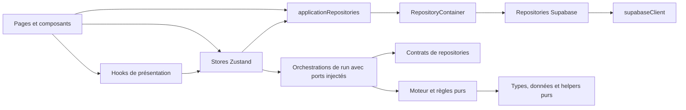

# Frontières métier et dépendances

ARCH-S3 conserve le moteur déterministe, les contrats publics des stores et le format des sauvegardes. La règle d'import se vérifie dans `check:static` avec `scripts/check-business-boundaries.mjs`. Elle lit les AST TypeScript/TSX avec la dépendance existante `@babel/parser` ; elle n'exécute pas les modules et ne modifie aucun fichier source.

## Carte et responsabilités



La flèche représente une dépendance autorisée. Les pages existantes consomment aussi des règles de présentation pures et quelques endpoints administratifs/authentification ; cette carte ne prétend pas que chaque écran passe obligatoirement par un hook ou un repository. Les interfaces de données sont séparées des adaptations Supabase : voir [les contrats de données](domain-data-contracts.md).

| Couche | Entrées et préconditions | Responsabilité et sorties |
| --- | --- | --- |
| Pages, composants, hooks | État sélectionné, actions publiques et paramètres de route | Présentation, navigation et feedback ; déclenchent les opérations, sans décider les règles du replay |
| Stores | État Zustand, mutations atomiques et politique existante de persistance/merge | Publication de l'état et raccord des ports de l'application ; les opérations de run délèguent leur orchestration |
| Orchestrations de run | Snapshots de run, horloge/identifiants, ports de services et de progression | Démarrage, journal d'autorité, finalisation, sauvegarde/retry et progression ; contrôlent l'idempotence et les opérations concurrentes |
| Moteur `src/game` et domaine | Données métier et RNG explicite lorsque nécessaire | Règles, validation, calculs et replay ; aucune dépendance React, page, store ou transport DB |
| Interfaces de repositories | Identifiants, filtres, pagination et résultats métier typés | Contrat des opérations DB ; aucun client Supabase ni construction d'implémentation |
| `RepositoryContainer` | Client Supabase fourni à la construction, options de journalisation | Unique construction/cache des repositories concrets ; `applicationRepositories` raccorde ce même conteneur à l'application |
| Repositories Supabase | Client fourni, DTO de schéma et contrats métier | Requêtes, pagination, erreurs et adaptation schéma→métier ; ne pilotent pas les stores |

Le checker analyse `src/**/*.{ts,tsx,mjs,js}` et les sources de `data/` si ce répertoire existe. Il résout les chemins relatifs, les extensions source et les alias déclarés dans `tsconfig.json`. Les imports, réexports, imports de type, `require` et imports dynamiques littéraux donnent chacun une preuve `source:ligne → cible`. Une syntaxe invalide fait échouer l'analyse. Un import interne non résolu ou calculé depuis le moteur est refusé : il ne disparaît pas silencieusement du graphe.

## Règles CI et exceptions bornées

- Tout chemin accessible depuis `src/game` est vérifié, y compris les helpers partagés et les imports de type. Il ne peut atteindre React, React DOM, Zustand, Supabase, les pages, composants, hooks, stores, repositories ou leur conteneur.
- Les appelants importent les services par entrée explicite. Le barrel `src/services/index.ts` reste une façade de compatibilité sans consommateur applicatif ; ajouter un consommateur fait échouer la règle.
- Les repositories concrets sont importés par `RepositoryContainer` ou entre adaptateurs. Les pages, hooks, stores et services de domaine consomment `applicationRepositories` ou `src/services/interfaces/*`. Les tests peuvent importer les implémentations pour vérifier leurs adaptations.
- Les dépendances avec syntaxe valeur de chaque service sont suivies transitivement : atteindre un store ou Zustand échoue. Les ports de lecture/mutation sont injectés depuis le raccord UI ; les cycles exclusivement de type restent distingués.
- Tout SCC valeur hors du raccord hérité de six stores décrit ci-dessous fait échouer CI. L'allowlist est nominative : ajouter un module à ce cycle, introduire un autre cycle ou faire revenir un service métier dans la composante est refusé ; casser un cycle existant reste autorisé.
- Les diagnostics montrent la ligne, l'import, le chemin interdit et une alternative : données via `src/types`, règle pure via `src/game`/`src/domain`, effets injectés par l'orchestration ou accès DB via le conteneur existant.

Trois entrées historiques de services restent accessibles au moteur : `enhancementService.ts` pour les calculs d'améliorations, `masteryService.ts` pour la progression/récompense et `championEconomyRunContract.ts` pour le contrat d'accès figé. Elles sont pures, déjà utilisées par le replay et listées nominativement dans le checker. Leurs dépendances sont suivies : ajouter React ou le client DB à l'une de ces entrées échoue aussi. Les interfaces de repositories sont accessibles uniquement par syntaxe `import type` ; leur graphe est également contrôlé.

Le seul import dynamique calculé autorisé est le locator Node de `game/balance/balanceReproCli.ts` : `pathToFileURL(resolve(process.cwd(), 'supabase/functions/verify-run/authority-version-resolver.generated.ts')).href`. Son nom de variable, son initialisation AST et son chemin fixe sont vérifiés ; une destination modifiée, ambiguë ou réutilisée dans un autre module est refusée. Ce locator sert à comparer le replay avec le vérificateur Edge archivé.

Il n'existe aucune exception `src/game → stores`. Les contrats `CombatantInfo`, `CombatStatusInfo`, `SpellInfo` et `BattleSpeed` sont détenus par `src/types/combatPresentation.ts` ; les anciens points d'entrée des stores les réexportent pour compatibilité.

Les trois adaptateurs auparavant rangés sous `game/run` ont été déplacés sans reexport dans le moteur :

| Avant | Après | Motif |
| --- | --- | --- |
| `game/run/runFinalization.ts` | `stores/runCombatFinalization.ts` | Raccord UI vers les actions du store à la fin d'un combat |
| `game/run/runPersistence.ts` | `stores/persistence/runPersistence.ts` | Migration/merge Zustand, stockage navigateur et quarantaine |
| `game/run/runStartCoordinator.ts` | `services/runLifecycle/runStartCoordinator.ts` | Verrou de démarrage navigateur et inspection du stockage |

`isRecord` a été extrait dans `utils/valueGuards.ts`. La validation métier d'une sauvegarde importe ce helper pur ; `utils/persistence.ts` conserve son réexport compatible. Cela supprime le chemin `game/run/runPersistenceValidation → utils/persistence → observability → dbLogger → supabaseClient`.

## Mesure avant/après et cycles

La mesure initiale est figée depuis l'arbre Git `9e2c66f5`, avant tout changement concurrent. Les imports comptent les déclarations et les réexports ; ils ne comptent pas les noms importés individuellement. Les cycles sont des composantes fortement connexes (SCC), avec toutes les lignes d'import qui les prouvent, et non une énumération exponentielle de tous les parcours possibles.

| Mesure | Avant `9e2c66f5` | Après ARCH-S3 |
| --- | ---: | ---: |
| Fichiers sources | 374 | 388 (+14) |
| Imports | 1 825 | 1 885 (+60) |
| Imports internes | 1 648 | 1 706 (+58) |
| Imports exclusivement de type | 380 | 426 (+46) |
| Consommateurs du barrel services | 0 | 0 |
| Imports directs `game → stores` | 4 | 0 |
| Imports UI → repositories concrets | 4 | 0 |
| SCC avec syntaxe valeur | 1, six modules | 1, six modules de stores |
| SCC tous imports, types inclus | 2 | 2 |

Le cycle valeur initial est prouvé notamment par les imports suivants :

- `services/runLifecycleService.ts:3 → stores/authStore.ts` ;
- `stores/authStore.ts:172 → stores/runStore.ts` (import dynamique) ;
- `stores/runStore.ts:13 → stores/runStoreLifecycleSlice.ts` ;
- `stores/runStoreLifecycleSlice.ts:24 → services/runLifecycleService.ts` ;
- `stores/authStore.ts:130 → stores/enhancementStore.ts` et `stores/enhancementStore.ts:22 → stores/authStore.ts` ;
- `stores/runStore.ts:14 → stores/runStoreMapSlice.ts` et `stores/runStoreMapSlice.ts:30 → stores/authStore.ts`.

Après extraction, `runLifecycleService` ne fait plus partie du SCC valeur. Le raccord UI `stores/runLifecycleDependencies.ts` le remplace : le cycle restant est entièrement entre les stores `authStore`, `enhancementStore`, `runStore`, `runStoreLifecycleSlice`, `runStoreMapSlice` et `runLifecycleDependencies`. Il est prouvé par `runStoreLifecycleSlice.ts:11 → runLifecycleDependencies.ts`, `runLifecycleDependencies.ts:10 → authStore.ts`, `authStore.ts:177 → runStore.ts` et `runStore.ts:13 → runStoreLifecycleSlice.ts`, ainsi que les retours existants entre `authStore` et `enhancementStore`. Il n'y a aucun nouveau SCC valeur ; le raccord croisé des stores reste une dette explicite, tandis que les services de cycle de run n'importent aucun store.

Le second SCC initial réunit douze modules `game/types/utils`. Plusieurs retours sont `import type` : ils sont effacés à l'exécution. La convergence des types d'autorité ajoute `game/authority/types.ts` à cette composante déjà existante via `types/runAttempt.ts`, sans nouveau SCC valeur et sans changement du schéma sérialisé. Les rapports distinguent systématiquement ces liens des cycles avec syntaxe valeur ; une déclaration à syntaxe valeur reste comptée conservativement même si le bundler peut l'éliminer.

## Vérification et reproduction

```sh
node scripts/check-business-boundaries.mjs
node scripts/check-business-boundaries.mjs --report /tmp/business-dependencies.json
npm run test -- tests/businessBoundaries.test.mjs
node scripts/check-current-authority-source.mjs
```

Les tests de frontières injectent React et des imports de stores/DB dans des modules `src/game` en mémoire, vérifient les chemins indirects et restaurent naturellement leur fixture isolée. Une injection réelle a aussi été faite le 11/10/2026 : `src/game/__architecture_react_fault__.ts` avec `import 'react'` produit un exit `1` et un diagnostic indiquant la ligne ainsi que l'alternative. Le fichier a été supprimé dans un `finally`, puis le même checker a retourné `0`. Aucun fixture d'injection n'est commité.

Les 47 tests de frontières passent, y compris les imports calculés ambigus, les réexports de type, l'évasion vers un dossier d'outillage non analysé, les nouveaux cycles valeur, une dépendance service→store cachée par un helper et l'accès aux repositories concrets par le conteneur. Les preuves d'imports et les SCC se régénèrent avec l'option `--report` ci-dessus ; les compteurs de la table concernent les sources applicatives, pas les tests.

Le hash du bundle déterministe est resté `c74af7632acfb7e4a2ff45140d62d0a96bbd6b063994b3f4b43d0f72fa785e16` pour `run-engine-0.2.0` après les déplacements et l'extraction du helper. Ni les archives d'autorité, ni leurs identifiants, ni les migrations SQL n'ont été changés.
